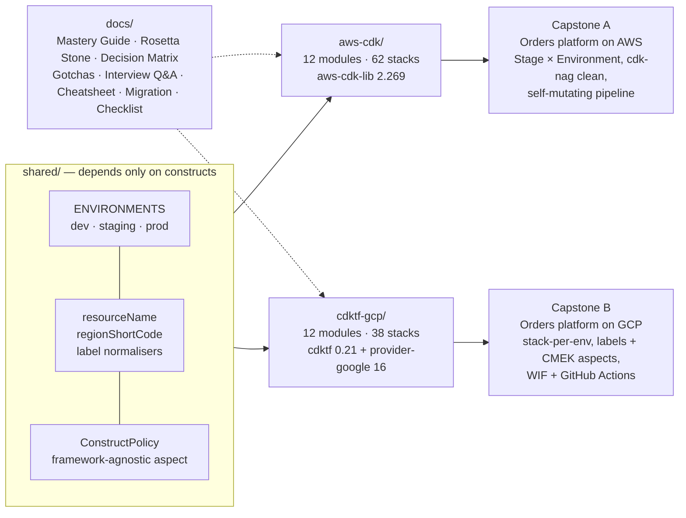

# cdk-mastery

> Production mastery of **AWS CDK** and **CDK for Terraform on GCP** — 24 runnable modules, two capstone platforms, one shared construct library, and 496 tests that prove every claim in the READMEs. Nothing is a stub, nothing needs credentials to synthesize.

[](.nvmrc)
[](aws-cdk/package.json)
[](cdktf-gcp/package.json)
[](cdktf-gcp/package.json)
[](#verify-everything)
[](LICENSE)

```
$ npm ci && npm test            # 24 suites, 496 tests, no cloud credentials, no Docker, no Terraform binary
$ cd aws-cdk   && npx cdk ls    # 62 CloudFormation stacks, M00-Hello … M11-Pipeline/M11-Prod/Observability
$ cd cdktf-gcp && npx cdktf list  # 38 Terraform stacks, m00-hello … m11-prod-observability
```

There is no first-party "GCP CDK". What the industry uses for GCP-in-a-real-language is **CDK for Terraform** with the Google provider — the same `constructs` tree AWS CDK is built on, synthesizing Terraform JSON instead of CloudFormation. This repository teaches both side by side, module for module, so the shared ideas (the construct tree, tokens, aspects, testing, escape hatches) are learned once and the real differences (CloudFormation's managed state vs. Terraform's state file, `cdk bootstrap` vs. backends, custom resources vs. providers) are learned deliberately.

## Why this repo exists

Most CDK material stops at "here is a bucket". Production CDK is about *where stack boundaries go*, *what a tier is allowed to change*, *how a governance rule becomes a failing synth*, *how a pipeline self-mutates across accounts*, *how to adopt a 2019 template without replacing a database*, and *how to explain every one of those decisions to a reviewer*. Every module here ends in code that runs, tests that assert the README's claims, three exercises with solutions, and an interview-angle section — because you understand a mechanism when you have built it, broken it in a test, and argued for it.

The two tracks are numbered identically on purpose: **module `NN` teaches the same idea in both frameworks.** Read them in pairs.

## The curriculum

| # | AWS CDK track (`aws-cdk/`) | CDK for Terraform on GCP (`cdktf-gcp/`) | Shared idea |
|---|---|---|---|
| 00 | [From CloudFormation to the construct tree](aws-cdk/src/modules/00-introduction/README.md) | [Terraform core, CDKTF & the synth → plan → apply loop](cdktf-gcp/src/modules/00-introduction/README.md) | App → Stack → Construct; what synth writes; what the engine does after |
| 01 | [Constructs, logical IDs & tokens](aws-cdk/src/modules/01-constructs-and-tokens/README.md) | [Providers, resources, data sources & tokens](cdktf-gcp/src/modules/01-providers-resources-and-tokens/README.md) | L1/L2/L3 vs provider bindings; identity derivation; lazy values |
| 02 | [Stacks, environments & references](aws-cdk/src/modules/02-stacks-environments-and-references/README.md) | [State, backends & environments](cdktf-gcp/src/modules/02-state-backends-and-environments/README.md) | Stack boundaries; cross-stack references and the ordering they impose; state |
| 03 | [Networking & containers](aws-cdk/src/modules/03-networking-and-containers/README.md) | [Networking & compute](cdktf-gcp/src/modules/03-networking-and-compute/README.md) | VPC, NAT, private data paths, a real service, least privilege |
| 04 | [Serverless & event-driven](aws-cdk/src/modules/04-serverless-and-events/README.md) | [Serverless & events](cdktf-gcp/src/modules/04-serverless-and-events/README.md) | API → function → table; events → queue → worker; assets; IAM grants |
| 05 | [Custom constructs & construct libraries](aws-cdk/src/modules/05-custom-constructs/README.md) | [Constructs & modules](cdktf-gcp/src/modules/05-constructs-and-modules/README.md) | Designing reusable APIs; validation; jsii/projen; Terraform modules |
| 06 | [Aspects, tags & governance](aws-cdk/src/modules/06-aspects-tags-and-governance/README.md) | [Aspects, labels & governance](cdktf-gcp/src/modules/06-aspects-labels-and-governance/README.md) | Mutating vs validating aspects; cdk-nag vs conftest; org-level policy |
| 07 | [Testing](aws-cdk/src/modules/07-testing/README.md) | [Testing](cdktf-gcp/src/modules/07-testing/README.md) | Fine-grained assertions, snapshots, testing aspects, the IaC test pyramid |
| 08 | [Pipelines & CI/CD](aws-cdk/src/modules/08-pipelines-and-cicd/README.md) | [CI/CD & Workload Identity Federation](cdktf-gcp/src/modules/08-cicd-and-workload-identity/README.md) | Self-mutating pipelines vs GHA+OIDC/WIF; plan-on-PR; drift |
| 09 | [Multi-account & multi-region](aws-cdk/src/modules/09-multi-account-and-multi-region/README.md) | [Multi-project & org scale](cdktf-gcp/src/modules/09-multi-project-and-org-scale/README.md) | One environment model driving many accounts/projects/regions |
| 10 | [Escape hatches, custom resources & migration](aws-cdk/src/modules/10-escape-hatches-custom-resources-and-migration/README.md) | [Escape hatches, HCL migration & interop](cdktf-gcp/src/modules/10-escape-hatches-hcl-migration-and-interop/README.md) | Overriding anything; adopting what exists; refactoring without replacement |
| 11 | [Capstone: the Orders platform](aws-cdk/src/modules/11-capstone-platform/README.md) | [Capstone: the Orders platform on GCP](cdktf-gcp/src/modules/11-capstone-platform/README.md) | dev + prod, governed, tested, pipelined — from one `EnvironmentTier` |

Every module ships `README.md` (problem → mental model → mechanics → walkthrough → production notes → gotchas → exercises → checklists → interview angle), `src/modules/NN-slug/*.ts` (runnable stacks and constructs, one concept per file), `test/NN-slug.test.ts` (assertions that pin the README's claims), and `solutions/` (three exercises, each tested). The structure is in [`docs/CURRICULUM.md`](docs/CURRICULUM.md); the README shape in [`docs/MODULE-TEMPLATE.md`](docs/MODULE-TEMPLATE.md).



## The reference docs (`docs/`)

| Doc | What it is for |
|---|---|
| [`MASTERY-GUIDE.md`](docs/MASTERY-GUIDE.md) | The theory the modules assume, twelve chapters keyed to module numbers, both frameworks side by side |
| [`ROSETTA-STONE.md`](docs/ROSETTA-STONE.md) | Concept mapping: AWS CDK × CDKTF × Terraform HCL × CloudFormation × Pulumi; "same word, different meaning"; "no equivalent" |
| [`DECISION-MATRIX.md`](docs/DECISION-MATRIX.md) | When to choose CDK, CDKTF, HCL/OpenTofu, Pulumi, Crossplane/Config Connector — with dated vendor facts and four org archetypes |
| [`GOTCHAS.md`](docs/GOTCHAS.md) | 77 real gotchas, symptom → cause → fix, grouped by theme |
| [`INTERVIEW-QA.md`](docs/INTERVIEW-QA.md) | 52 Staff/Principal-level questions with pointed model answers |
| [`CHEATSHEET.md`](docs/CHEATSHEET.md) | CLI flags, assertion APIs, escape hatches, env vars, macOS first-ten-minutes setup |
| [`MIGRATION.md`](docs/MIGRATION.md) | Playbooks: CFN → CDK, ClickOps → CDK, HCL → CDKTF, CDK ↔ CDKTF, Pulumi ↔ either — with risk tables and rollbacks |
| [`MASTERY-CHECKLIST.md`](docs/MASTERY-CHECKLIST.md) | "You are a master when you can…" — verifiable items per module, plus five prove-it projects |

## Getting started

```bash
nvm use                      # Node 22 (.nvmrc); 20+ works
npm ci                       # one install for all three workspaces (~1 GB: two prebuilt Google providers are large)
npm run build                # tsc --noEmit on every workspace
npm test                     # shared + aws-cdk + cdktf-gcp
```

Per track:

```bash
cd aws-cdk
npx cdk ls                                   # every stack, M00 … M11
npx cdk synth 'M04-*' --quiet                # one module
npx cdk synth -c cdk-mastery:modules=00,11   # a subset of modules (faster)
npx ts-node --prefer-ts-exts src/modules/00-introduction/inspect.ts   # print the construct tree and cloud assembly

cd cdktf-gcp
npx cdktf list                               # every stack, m00 … m11
CDKM_MODULES=00,11 npx cdktf synth           # a subset of modules
npx ts-node --prefer-ts-exts src/modules/00-introduction/inspect.ts   # print the construct tree and cdk.tf.json
```

Deploying anything is opt-in and documented per module. AWS: `cdk bootstrap` the account(s) in `aws-cdk/cdk.json` (`cdk-mastery:account`/`region`; the placeholder accounts `111111111111`/`222222222222` are fake) — the capstone README has the two-account bootstrap runbook. GCP: install Terraform or OpenTofu (`TERRAFORM_BINARY_NAME=tofu`), set `CDKM_GCP_PROJECT`, and optionally `CDKM_STATE_BUCKET` to switch every backend to GCS. `aws-cdk/cdk.context.json` is committed on purpose (module 02 explains why); it seeds availability-zone lookups for the placeholder accounts so `cdk synth` works with no credentials — run `cdk context --clear` when you point at real accounts.

## Verify everything

| Command | What it proves |
|---|---|
| `npm run build` | All 264 TypeScript files type-check under `strict` |
| `npm test` | 496 tests across 25 suites (3 skipped: they need a Terraform binary + registry access; enable with `CDKM_TERRAFORM=1`) |
| `cd aws-cdk && npx cdk synth --quiet` | 62 stacks synthesize; the capstone stages pass cdk-nag `AwsSolutions` with every acknowledgement justified |
| `cd cdktf-gcp && npx cdktf synth` | 38 stacks synthesize to `cdktf.out/stacks/*/cdk.tf.json` |
| `scripts/typecheck-module.sh <track> <NN-slug>` | One module in isolation (what CI runs per module) |

The GitHub Actions workflow in [`.github/workflows/ci.yml`](.github/workflows/ci.yml) runs exactly these.

## Reading order

1. Track A 00–02, then Track B 00–02. The mental models diverge here; see both before going deeper.
2. Alternate module by module (A03, B03, A04, B04 …). Read [`docs/ROSETTA-STONE.md`](docs/ROSETTA-STONE.md) after 05 and again after 10.
3. Do both capstones. Then take [`docs/MASTERY-CHECKLIST.md`](docs/MASTERY-CHECKLIST.md) honestly and build the five prove-it projects without looking here.

## Skills demonstrated

AWS CDK v2 at depth — construct-tree mechanics and logical-ID derivation, tokens and lazies, cross-stack reference strategies (strong/weak/name-based) and their deploy-order consequences, L3 construct API design under jsii constraints, mutating and validating aspects with priorities, cdk-nag as a scoped validation plugin with per-finding acknowledgements, fine-grained and snapshot assertions, self-mutating CodePipelines with cross-account trust and approval gates, GitHub Actions with OIDC, `Stage × Environment` modelling with custom synthesizers and cross-region references, the full escape-hatch ladder, `cloudformation-include`, `cdk import`/`migrate`, Provider-framework and `AwsCustomResource` custom resources · CDK for Terraform at depth — provider bindings and version coupling, tokens/iterators/dynamic blocks, GCS backends and remote-state contracts, stack-per-environment factories, `TerraformAsset`, registry modules via `TerraformHclModule`, labels/CMEK/no-public-bucket aspects, conftest policy on synthesized JSON, org policies, `Testing.*` matchers and gated `terraform validate`/`plan` tests, Workload Identity Federation for GitHub Actions, project factories and Shared VPC, `import`/`moved` refactors, HCL ↔ CDKTF interop · Platform engineering — one environment model driving two clouds, cost models derived from the same sizing code as the stacks, composite-alarm paging design, teardown runbooks, and Principal-level trade-off writing.

## Topics

`aws-cdk` `cdk` `cdktf` `cdk-for-terraform` `terraform` `opentofu` `google-cloud` `gcp` `aws` `infrastructure-as-code` `iac` `typescript` `constructs` `cdk-nag` `platform-engineering` `multi-account` `multi-cloud` `workload-identity-federation` `codepipeline` `github-actions` `testing` `learning-path` `curriculum`

## License

MIT. See [LICENSE](LICENSE).
