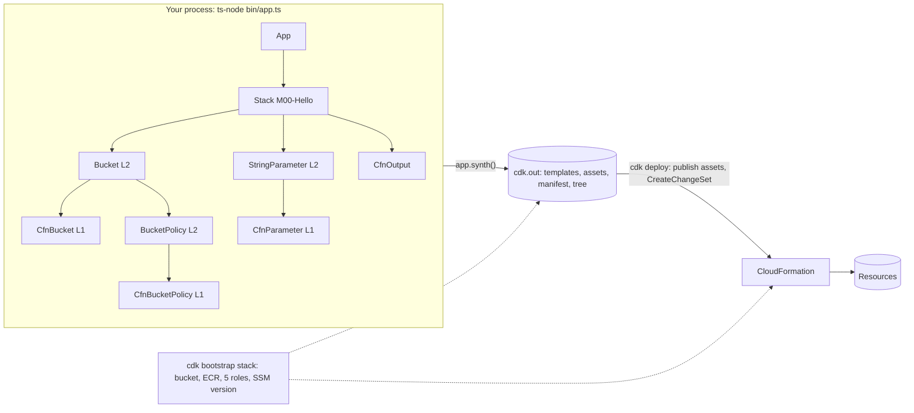

# 00 · Introduction: from CloudFormation to the construct tree

> After this module you can explain, from memory, what happens between `new cdk.App()` and a CloudFormation `CreateChangeSet` call: every phase of synthesis, every file in `cdk.out`, and every resource `cdk bootstrap` put in your account.

## Why this exists (the problem)

CloudFormation is a good deployment engine and a poor authoring language. A 40-line YAML template for one bucket with SSL enforcement, versioning and a lifecycle rule is normal; a 3,000-line template for one service is normal; and none of it composes. You cannot write a function that returns "a bucket configured our way", you cannot unit-test a template without deploying it, and cross-stack wiring is a hand-maintained web of `Export`/`ImportValue` pairs.

CDK keeps the engine and replaces the authoring layer. You write a program that builds a **tree of constructs**; the framework walks the tree and emits templates plus everything needed to deploy them (assets, roles, dependency order) into a directory called the **cloud assembly**. CloudFormation still owns state, drift detection, rollback and permissions. Everything that is hard to reason about in CDK — logical IDs, tokens, cross-stack references, bootstrap — is a consequence of that split: a program running on your laptop has to produce artefacts that a state machine in AWS will apply later. Hold that split in your head and the rest of the track is mechanics.

## Mental model



The tree is the single source of truth. Every construct has a **scope** (its parent), an **id** (unique among siblings) and therefore a **path** (`M00-Hello/Artifacts/Resource`). Paths drive logical IDs, which drive CloudFormation's notion of resource identity. That is why "just renaming a construct" replaces infrastructure.

Three construct levels sit in the tree:

| Level | Class prefix | What it is | Example in this module |
|---|---|---|---|
| L1 | `Cfn*` | 1:1 with a CloudFormation resource type; generated from the spec | `CfnBucket` under `Artifacts/Resource` |
| L2 | none | Opinionated wrapper with sane defaults, `grant*`/`metric*` methods, and child L1s | `s3.Bucket`, `ssm.StringParameter` |
| L3 | pattern | Several L2s wired together for one use case | none here; module 03 and 05 |

The stack is just a construct that knows how to render its L1 descendants into one template. The app is the root that knows where `cdk.out` is.

## How it works

### 1. Construction

`bin/app.ts` (written by the integrator) creates `new cdk.App()` and calls each module's `addToApp`. Ours is `src/modules/00-introduction/index.ts`:

```ts
export function addToApp(app: cdk.App): void {
  new HelloStack(app, 'M00-Hello', { tier: 'dev', description: '...' });
}
```

`HelloStack` (`hello-stack.ts`) creates one L2 bucket, one SSM parameter, a probe construct and an output. Nothing is rendered at this point. The bucket's name is a real string, but `this.bucket.bucketName` is a **token** (`${Token[TOKEN.12]}`) that will become `{ "Ref": "Artifacts82DD59A1" }` only at render time. Module 01 is entirely about tokens.

No `env` is passed. The stack is **environment-agnostic**: `Stack.of(this).region` is `{ "Ref": "AWS::Region" }`, the manifest records `aws://unknown-account/unknown-region`, and the same template can be deployed to any account the CLI's credentials point at. Anything that needs to know the region at synth time (AZ counts for a VPC, `Vpc.fromLookup`, cross-region references) forces you to pass a concrete env. Module 02 covers the trade-off.

### 2. Synthesis: the phases

`app.synth()` — which the CLI triggers by running your `app` command with `CDK_OUTDIR` set — calls `synthesize(root)` in `aws-cdk-lib/core/lib/private/synthesis.js`. The order in 2.269.0, verified by the probe in `lifecycle-phases.ts`:

| Phase | What runs | Your hook |
|---|---|---|
| construct | Constructors, top-down. | The constructor. |
| prepare (a) | `invokeAspects`: every aspect visits every node under the scope it was added to, ordered by priority. Last chance to mutate the tree. | `Aspects.of(scope).add({ visit })` (module 06) |
| prepare (b) | `injectMetadataResources` (the `CDKMetadata` resource) then `prepareApp`: cross-stack references are found by **rendering every L1 once** and looking for tokens that point at other stacks. `Lazy` producers run for the first time here — *before validation*. | `Lazy.*({ produce })` |
| validate | `node.validate()` on every construct, pre-order. Any returned message aborts synth with `[path] message`. | `node.addValidation({ validate })` |
| synthesize | Each stack's synthesizer writes `<stack>.template.json` and its asset manifest; the tree writer emits `tree.json`; the feature-flag report is generated; `manifest.json` is built; then validation plugins run against the written templates. | Nothing (custom synthesis is internal API). |

The probe records each phase into a string that is written into an SSM parameter value, so the template itself carries the proof:

```ts
Value: cdk.Lazy.uncachedString({
  produce: () => {
    this.produced += 1;
    this.record(this.produced === 1 ? 'prepare:resolve-references' : 'synthesize');
    return this.events.join(' -> ');
  },
}),
```

Result in the synthesized template: `construct -> prepare:aspects -> prepare:resolve-references -> validate -> synthesize`. Two practical consequences: a `Lazy` cannot assume validations have run, and `Lazy.string` (cached) would freeze the value produced in the prepare phase — which is why the probe uses `Lazy.uncachedString`.

### 3. `cdk.out` anatomy

Run the module's inspector (it synthesizes into a temp dir, never into `aws-cdk/cdk.out`):

```
cd aws-cdk && npx ts-node --prefer-ts-exts src/modules/00-introduction/inspect.ts
```

| File | Purpose |
|---|---|
| `cdk.out` | `{"version":"54.0.0"}` — the cloud assembly schema version. A CLI older than the schema refuses to read the assembly; that is the mechanism behind "please upgrade your CLI". |
| `manifest.json` | The index. One entry per artifact: each stack (`aws:cloudformation:stack`) with its template file, target environment, the roles to assume for deploy/lookup/CFN execution, `requiresBootstrapStackVersion` and dependencies; each asset manifest (`cdk:asset-manifest`); the tree (`cdk:tree`); and a `cdk:feature-flag-report` that lists every flag, your value and the recommended value. |
| `<Stack>.template.json` | The CloudFormation template. Always contains the `BootstrapVersion` parameter and the `CheckBootstrapVersion` rule (below), and a `CDKMetadata` resource when version reporting is enabled (default under the CLI, off in tests). |
| `<Stack>.assets.json` | What to publish before deploying: files (the template itself is one, keyed by its SHA-256, plus Lambda zips) and Docker images, with destination bucket/repository and the publishing role to assume. `cdk deploy` runs `cdk-assets` against this file. |
| `<Stack>.metadata.json` | Per construct path: logical IDs (`aws:cdk:logicalId`), warnings/errors (`aws:cdk:warning`, `aws:cdk:error`), the creation stack trace of each construct (`aws:cdk:creationStack`), and — with `@aws-cdk/core:enableAdditionalMetadataCollection` — which props were set on each L2 (`aws:cdk:analytics:construct`, values redacted to `*`). This is how `cdk deploy` prints construct paths instead of logical IDs in its progress output. |
| `tree.json` | The construct tree with `fqn` and library version per node. The CloudFormation console's "Constructs" tab and the `cdk` LSP read it. |
| `validation-report.json` | Output of validation plugins. In 2.269.0 a built-in CloudFormation-Validate plugin always runs (it is what flags an empty `Resources` section); cdk-nag can also be wired as a plugin. |
| `asset.<hash>/` or `asset.<hash>.zip` | Staged asset contents (module 04 produces these). The name is the content hash, so unchanged code is never re-uploaded. |

`inspect.ts` also prints every logical ID next to the path it came from. Note `BootstrapVersion` and `CheckBootstrapVersion`: they are ordinary `CfnParameter`/`CfnRule` constructs that the synthesizer adds to the stack, which is why they appear in `findAll()`.

### 4. What `cdk bootstrap` creates

`cdk bootstrap aws://111111111111/us-east-1` deploys a CloudFormation stack named `CDKToolkit` (template: `cdk bootstrap --show-template`). With the default qualifier `hnb659fds` it creates:

| Resource | Name pattern | Used by |
|---|---|---|
| S3 staging bucket (versioned, SSE-KMS or SSE-S3, TLS-only policy) | `cdk-hnb659fds-assets-<account>-<region>` | file assets: templates, Lambda zips |
| ECR repository (image scanning on, lifecycle policy on untagged images) | `cdk-hnb659fds-container-assets-<account>-<region>` | Docker image assets |
| KMS key (optional, `--bootstrap-kms-key-id` / `--bootstrap-customer-key`) | alias `cdk-hnb659fds-assets-key` | staging bucket encryption |
| IAM role: file publishing | `cdk-hnb659fds-file-publishing-role-<account>-<region>` | `cdk-assets` to write to the bucket |
| IAM role: image publishing | `cdk-hnb659fds-image-publishing-role-<account>-<region>` | `cdk-assets` to push to ECR |
| IAM role: lookup | `cdk-hnb659fds-lookup-role-<account>-<region>` | context providers (`Vpc.fromLookup`, `valueFromLookup`) — read-only |
| IAM role: deploy | `cdk-hnb659fds-deploy-role-<account>-<region>` | the CLI/pipeline to call CloudFormation; can pass the cfn-exec role |
| IAM role: CloudFormation execution | `cdk-hnb659fds-cfn-exec-role-<account>-<region>` | CloudFormation itself while creating your resources. Default policy is `AdministratorAccess`; narrow with `--cloudformation-execution-policies` and a permissions boundary (module 09). |
| SSM parameter | `/cdk-bootstrap/hnb659fds/version` | the version number of the bootstrap stack (`32` in the template shipped with CLI 2.1141.0; the default synthesizer requires `>= 6`, lookups require `>= 8`) |

The roles trust the bootstrapping account by default and additionally any accounts passed with `--trust` (for pipelines deploying cross-account, module 08/09). Every template you synthesize references these by name — look at `assumeRoleArn` and `cloudFormationExecutionRoleArn` in `manifest.json`, or at the `Rules` block:

```json
"CheckBootstrapVersion": { "Assertions": [ { "Assert": { "Fn::Not": [ { "Fn::Contains": [ ["1","2","3","4","5"], { "Ref": "BootstrapVersion" } ] } ] },
  "AssertDescription": "CDK bootstrap stack version 6 required. ..." } ] }
```

`BootstrapVersion` is a parameter of type `AWS::SSM::Parameter::Value<String>` defaulting to `/cdk-bootstrap/hnb659fds/version`; CloudFormation resolves it at deploy time, so a stack cannot deploy into an un-bootstrapped or under-bootstrapped environment. Changing the qualifier (exercise 3) changes every one of the names above.

The bootstrap stack is *the* security boundary of a CDK estate: whoever can assume the deploy role can deploy anything the cfn-exec role can create. Treat it as production infrastructure with its own review process.

### 5. The CLI tour

All commands accept stack IDs (`M00-Hello`), globs (`M0*`) and `--all`. `-c key=value` adds context. `--app` is read from `cdk.json`.

| Command | What it does | When you reach for it |
|---|---|---|
| `cdk ls` | Synthesizes and prints stack IDs (with `--long`: env and dependencies). | First thing after cloning; verifies the app runs. |
| `cdk synth [stack]` | Synthesizes to `cdk.out` and prints the template (with `--quiet` only writes). | Local check; CI artefact step. Pass `--app cdk.out` to later commands to reuse it. |
| `cdk diff` | Synthesizes and diffs against the deployed template (or `--template file`). Exit code 1 on differences. `--change-set` (default) creates a real change set for precise replacement info; `--no-change-set` is faster and needs no deploy permissions. | On every pull request. |
| `cdk deploy` | Publishes assets, creates and executes a change set. `--require-approval never` for CI; `--hotswap` for dev loops (bypasses CloudFormation for Lambda code, ECS task defs, Step Functions; never in prod); `--method=prepare-change-set` to stage an approval step. | Deploys. |
| `cdk destroy` | Deletes the stack. Respects `RemovalPolicy.RETAIN` and `terminationProtection`. | Ephemeral envs; module 02 shows what survives. |
| `cdk watch` | `deploy --watch`: re-deploys (hotswap by default) when files matching `cdk.json`'s `watch` block change. | Dev inner loop for Lambda/ECS. |
| `cdk import` | Brings existing resources under the stack via CloudFormation resource import; you supply identifiers interactively or via `--resource-mapping`. | Adopting hand-made resources (module 10). |
| `cdk migrate` | Generates a CDK app from an existing template, a deployed stack (`--from-stack`) or scanned resources (`--from-scan`). Produces L1s only. | Starting point for legacy estates (module 10). |
| `cdk context` | Lists cached context (`cdk.context.json`); `--clear`, `--reset KEY` evicts entries so the next synth re-queries AWS. | After a VPC or AMI changed in the account. |
| `cdk doctor` | Prints CLI/lib versions, environment variables, and detects mismatches. | Support tickets; "works on my machine". |
| `cdk flags` | Lists every feature flag with current/recommended values; `cdk flags --set` toggles them in `cdk.json`. | After upgrading `aws-cdk-lib`. |
| `cdk bootstrap` | Creates/updates the `CDKToolkit` stack per environment. `--show-template` to review; `--qualifier`, `--trust`, `--cloudformation-execution-policies`, `--custom-permissions-boundary`. | Once per account/region, and again after CLI upgrades that raise the version. |
| `cdk acknowledge <id>` / `cdk notices` | Notices are security/compat advisories fetched from GitHub and printed after every command; `ack` silences one by ID (stored in `cdk.context.json`). | Whenever a notice fires. |
| `cdk gc` | Deletes unreferenced assets from the bootstrap bucket/repo. | Cost hygiene on old accounts. |
| `cdk drift`, `cdk rollback`, `cdk refactor`, `cdk orphan`, `cdk diagnose` | Newer (2.1100+) lifecycle helpers: detect drift, roll back a stuck `UPDATE_FAILED`, move resources between stacks with a mapping, detach without deleting, explain a failed deploy. | Operations. |

### 6. `cdk.json` and feature flags

`aws-cdk/cdk.json` has three jobs: tell the CLI how to run the app (`"app": "npx ts-node --prefer-ts-exts bin/app.ts"`), configure `watch`, and hold **context**. Context is a key/value bag readable via `scope.node.tryGetContext(key)`; it is populated from `cdk.json`, `cdk.context.json`, `~/.cdk.json` and `-c` flags (later wins).

Feature flags are context keys prefixed `@aws-cdk/`. They exist because CDK cannot change a default behaviour without changing everybody's logical IDs or IAM policies, which would trigger resource replacement on the next deploy. So every behavioural fix ships behind a flag: existing apps keep the old behaviour, `cdk init` writes all recommended flags into new apps, and `cdk flags` helps you adopt them deliberately. Examples in our file: `@aws-cdk/aws-lambda:useCdkManagedLogGroup` (module 04 relies on it), `@aws-cdk/core:defaultCrossStackReferences: "weak"` (module 02), `@aws-cdk/core:validateAgainstDefaultRules: true` (turns the CloudFormation-Validate warnings — e.g. an empty stack — into errors). The two `cdk-mastery:*` keys at the bottom are plain context, not flags; modules read them for a concrete env.

Tests construct `new cdk.App()` directly and therefore see *no* `cdk.json` context. Where a flag matters to a test, pass it explicitly: `new cdk.App({ context: { '@aws-cdk/aws-lambda:useCdkManagedLogGroup': true } })`.

## Walkthrough

Read in this order, from `aws-cdk/`:

1. `src/modules/00-introduction/hello-stack.ts` — the stack. Note the props interface, the shared `resourceName` helper, and the ASCII tree in the class comment.
2. `src/modules/00-introduction/lifecycle-phases.ts` — the phase probe. Read the header comment against the table in "How it works".
3. `src/modules/00-introduction/index.ts` — `addToApp`, the only integration point.
4. `src/modules/00-introduction/inspect.ts` — run it: `npx ts-node --prefer-ts-exts src/modules/00-introduction/inspect.ts`. Compare its output with the table in section 3.
5. `test/00-introduction.test.ts` — every claim above is asserted: `npx jest test/00-introduction.test.ts`.
6. Then the CLI on the whole app: `npx cdk ls`, `npx cdk synth M00-Hello --quiet && ls cdk.out`, `npx cdk diff M00-Hello --no-change-set` (needs credentials to fetch the deployed template; for a stack that was never deployed it diffs against an empty template, and `--template <file>` diffs two local templates with no credentials at all).

## Production notes

- **Bootstrap version drift.** Upgrading the CLI can raise the required bootstrap version; deploys then fail at the `CheckBootstrapVersion` rule with a clear message. Pipelines should run `cdk bootstrap` idempotently or pin the CLI. Track the version in `/cdk-bootstrap/<qualifier>/version` per account with AWS Config or a scheduled check.
- **The cfn-exec role is `AdministratorAccess` by default.** Anyone who can `cdk deploy` (assume the deploy role) is effectively admin. Scope it with `--cloudformation-execution-policies` and a permissions boundary, and never share a qualifier between teams with different blast radii.
- **The staging bucket grows forever** unless you run `cdk gc` or add a lifecycle rule; Lambda zips are content-addressed so every code change adds an object.
- **`cdk.out` is a build artefact.** Synthesize once in CI, store the directory, and run `cdk deploy --app cdk.out` in later stages. Re-synthesizing per stage risks non-determinism (timestamps, `Date.now()`, unpinned lookups).
- **Env-agnostic stacks** cannot use lookups or region-dependent construct logic (`Vpc` with `maxAzs` silently uses two dummy AZs). Decide per stack, and say so in the stack's docstring.
- **Synth time.** The whole tree is built on every CLI invocation. Apps with hundreds of stacks should split into multiple apps or use `Stage`s and `cdk synth <stack>` selectively; `--exclusively` skips dependencies.

## Gotchas

- Symptom: `cdk deploy` says *"This CDK CLI is not compatible with the CDK library used by your application"* → cause: `cdk.out` schema newer than the CLI → fix: upgrade `aws-cdk`; the lib and CLI are versioned independently since 2.1000.
- Symptom: deploy fails with *"CDK bootstrap stack version 6 required"* → cause: environment never bootstrapped, bootstrapped with the legacy template, or with a different qualifier → fix: `cdk bootstrap` with the same `--qualifier` the synthesizer uses.
- Symptom: a `Lazy` producer sees a value that was set in a validation → cause: tokens are first resolved during reference resolution, *before* `validate` → fix: do all mutation in constructors or aspects; keep validations pure.
- Symptom: renaming a construct id replaced a database → cause: logical IDs are path hashes → fix: `overrideLogicalId` (module 01) or `cdk refactor`; review `cdk diff` for `[-]`/`[+]` pairs before every deploy.
- Symptom: template has `CDKMetadata` in `cdk synth` output but not in tests → cause: version reporting is enabled by the CLI (`versionReporting`), disabled when you instantiate `App` yourself → fix: none needed; do not assert on it.
- Symptom: `cdk synth` fails with *"Resources section must exist and be non-empty"* → cause: `@aws-cdk/core:validateAgainstDefaultRules` is `true` in `cdk.json` and a stack rendered no resources → fix: give the stack a resource or remove the stack; do not disable the flag.
- Symptom: a test that calls `app.synth()` leaves `cdk.out.*` directories in `/tmp` → cause: jest does not fire Node's `exit` event → fix: `afterAll(cxapi.CloudAssembly.cleanupTemporaryDirectories)` as in our test file.

## Exercises

1. **Move a construct into a scope.** Wrap the bucket in a `Storage` construct and predict the new logical ID before running the test. Solution: `solutions/exercise-1-scoped-stack.ts` (the ID becomes `StorageArtifacts<hash>` — a replacement).
2. **Write an assembly reader.** Given a `CloudAssembly`, return per-stack resource-type counts, outputs, environment and bootstrap requirement — the seed of a PR bot. Solution: `solutions/exercise-2-assembly-report.ts`; test it with `new cdk.App({ outdir })` + `app.synth()`.
3. **Change the bootstrap qualifier for one stack** and show that every synthesizer role name and the `BootstrapVersion` parameter follow it. Solution: `solutions/exercise-3-custom-qualifier.ts`. Bonus: achieve the same app-wide with `@aws-cdk/core:bootstrapQualifier` in `cdk.json` and explain why per-stack is the wrong default for a monorepo.

## Checklist

- [ ] Every account/region the app targets is bootstrapped with the qualifier the synthesizer uses, and the bootstrap version is monitored.
- [ ] The cfn-exec role policy and permissions boundary are reviewed like any other admin credential.
- [ ] CI synthesizes once, archives `cdk.out`, and deploys with `--app cdk.out`.
- [ ] `cdk.json` contains all recommended feature flags for the pinned `aws-cdk-lib` (`cdk flags` shows no unset recommendations).
- [ ] Code review: no construct id was renamed or re-scoped without a corresponding `overrideLogicalId`/`cdk refactor` plan and a `cdk diff` attached to the PR.
- [ ] Code review: stacks are explicitly env-agnostic or env-specific, and the docstring says which.

## Interview angle

1. *"Walk me through what happens when I run `cdk deploy`."* — App executes (construct phase) → aspects → reference resolution → validation → templates and asset manifests written to `cdk.out` → CLI reads `manifest.json`, assumes the file/image publishing roles and uploads assets by hash → assumes the deploy role, creates a change set (with the cfn-exec role as the service role), optionally asks for approval on IAM/security-group changes → executes it → streams stack events, mapping logical IDs back to construct paths via `<stack>.metadata.json`.
2. *"Why does CDK need a bootstrap stack when plain CloudFormation does not?"* — Assets. A template cannot carry a Lambda zip or a container image, so there must be a bucket and a repository in the target account before the first deploy; the roles exist so a CI principal in one account can deploy into another with least privilege; the SSM version parameter lets templates assert the bootstrap contract they need.
3. *"What is a feature flag in CDK and why can't the library just fix the bug?"* — Because the "bug" is often encoded in deployed logical IDs or IAM policies; changing it silently would replace resources or widen/narrow permissions on the next deploy. Flags let each app opt in deliberately; `cdk init` enables all recommended flags for new apps; `cdk flags` manages adoption.

## References

- CDK Developer Guide: Concepts → Apps, Stacks, Constructs; "Bootstrapping your environment"; "Feature flags"; "CDK CLI reference".
- `aws-cdk-lib/core/lib/private/synthesis.js` (`synthesize()`), `core/lib/stack-synthesizers/default-synthesizer.d.ts` (role/bucket name templates, `DEFAULT_QUALIFIER`).
- `@aws-cdk/cloud-assembly-schema` (the `manifest.json`/`assets.json` contract) and `aws-cdk-lib/cx-api` (`CloudAssembly`, `CloudFormationStackArtifact`).
- `cdk bootstrap --show-template` for the exact bootstrap template of your CLI version.
