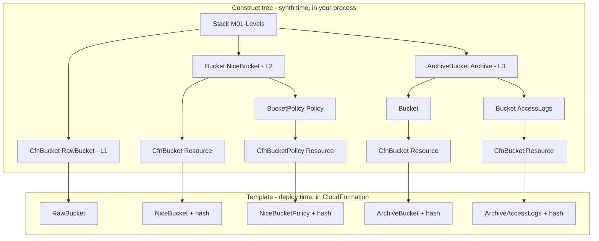

# 01 · Constructs, logical IDs & tokens

> After this module you can pick the right construct level for a job, predict a resource's logical ID from its construct path without synthesizing, and handle any deploy-time value (token) without writing the bug that mangles it.

## Why this exists (the problem)

Three things confuse everyone in their first month of CDK, and all three are the same thing seen from different angles: **the program runs before the cloud exists**.

1. You call `new s3.Bucket(...)` and the template contains two resources with names you did not choose (`NiceBucket4A1B2C3D`, `NiceBucketPolicy…`). Rename the construct and CloudFormation deletes your bucket.
2. `bucket.bucketName` is a string, `bucket.bucketName.toUpperCase()` compiles, and the deployed resource is called `${TOKEN[TOKEN.42]}`.
3. You reach for a CloudFormation `Parameter` because that is how templates were always configured, and suddenly `cdk diff` is blind and tests cannot see the value.

This module gives you the three mechanisms behind those symptoms — construct levels, logical-ID allocation, and tokens — as precise rules you can apply in code review.

## Mental model



Only `CfnElement`s (L1 resources, outputs, parameters, conditions, mappings, rules) become template entries. Everything else in the tree is scaffolding that exists to *name* and *organise* those elements. A **token** is a placeholder for a value that lives on the right-hand side of the diagram (a bucket's generated name, an ARN) while your code runs on the left.

## How it works

### Levels (`levels.ts`)

| | L1 `CfnBucket` | L2 `Bucket` | L3 `ArchiveBucket` |
|---|---|---|---|
| Source | Generated from the CloudFormation resource spec | Hand-written by the CDK team | Hand-written by you or a library |
| Props | CFN property names, camelCased; all optional; no defaults | Intent-level (`versioned: true`, `enforceSSL: true`); secure defaults (public access blocked) | Use-case level (`transitionAfter`) |
| Children | none — it *is* the element | `Resource` (the L1) plus helpers it decides you need (`Policy`) | several L2s |
| Helpers | none | `grantRead()`, `addToResourcePolicy()`, `bucketArn`, `metric*` | whatever you expose |
| Escape hatch | n/a | `bucket.node.defaultChild as s3.CfnBucket` then `addPropertyOverride()` | reach into public members |

Rule of thumb: **L2 by default**. Drop to L1 when the L2 does not exist for a new service, lags a new property, or when you are adopting a template verbatim (module 10). Write an L3 when the same three-to-five L2s are wired the same way in more than one place (module 05). Never subclass an L2 to change its defaults; wrap it.

The L2's L1 is `node.defaultChild`. It is a convention, not a guarantee: L2s name their primary child `Resource` (or `Default`) and `defaultChild` looks for exactly those ids. `ArchiveBucket` (an L3) has no `defaultChild`; the test asserts that.

### Logical IDs (`logical-ids.ts`)

`Stack.allocateLogicalId(element)` takes the element's path **relative to the stack** and runs `makeUniqueId` (`core/lib/private/uniqueid.js`). `predictLogicalId` in this module is a line-by-line re-implementation you can run in your head:

```ts
const components = pathComponents.filter((c) => c !== 'Default');       // 1. Default is invisible
if (components.length === 1) return alnum(components[0]);              // 2. depth 1: verbatim, no hash
const hash = md5(components.join('/')).slice(0, 8).toUpperCase();      // 3. hash includes "Resource"
const deduped = ...;                                                   // 4. Foo/Foo -> Foo
const human = deduped.filter((c) => c !== 'Resource').map(alnum).join('').slice(0, 240);
return human + hash;                                                   // 5.
```

Consequences:

- `new CfnOutput(stack, 'BucketName')` is `BucketName`; `new CfnBucket(stack, 'RawBucket')` is `RawBucket`. Only depth ≥ 2 gets a hash.
- The hash is over the *path*, so moving a construct into a new parent (exercise 1 of module 00) or renaming any ancestor changes it. Renaming the **stack** does not (path is stack-relative) — but the stack name changes, which is a new stack.
- A scope named `Default` disappears (exercise 1 here). Two elements whose paths collapse to the same ID fail synthesis with `section 'Resources' already contains '<id>'`.

Three APIs give you IDs, and they differ in scope:

| API | Input | Output | Use for |
|---|---|---|---|
| `stack.getLogicalId(cfnElement)` | stack-relative path | template logical ID | tests, `renameLogicalId` keys |
| `Names.uniqueId(construct)` | **full** path incl. stack id | alnum + hash | suffixes that must be unique app-wide |
| `Names.uniqueResourceName(construct, { maxLength, separator })` | full path | `M01X-Data-19D93C37` | physical names with a length limit |

Two ways to change IDs, both in `PrefixedIdsStack`:

- Override `protected allocateLogicalId(cfnElement)` on a Stack subclass to apply a scheme to every element (prefixing, legacy naming). Leave `BootstrapVersion`/`CheckBootstrapVersion` alone.
- `cfn.overrideLogicalId('LegacyParameter')` pins one element. The pin is applied in `CfnElement.synthesizeLogicalId`, *before* the stack is asked, so `stack.getLogicalId()` still returns the allocated ID while `stack.resolve(cfn.logicalId)` returns the pin. `stack.renameLogicalId(old, new)` is the third option: a stack-wide rename table applied inside `getLogicalId()`; synth fails if a rename is never used, which protects you from typos (exercise 3).

### Tokens (`tokens.ts`)

A token is a string, number or list whose real value CDK does not have yet. Encoded forms:

| Kind | Looks like in TS | Resolves to |
|---|---|---|
| string | `${Token[TOKEN.123]}` | `{ Ref }`, `{ Fn::GetAtt }`, `{ Fn::Join }` … |
| number | a large negative integer (`-1.888…e+289`) | a number or intrinsic |
| list | `["#{Token[TOKEN.124]}"]` (one element) | a list or `{ Fn::Split }`, `{ Fn::GetAZs }` |
| `IResolvable` | an object with `resolve(context)` | whatever it returns |

What is allowed:

- **Interpolate**: `` `s3://${bucket.bucketName}/x` `` → `Fn::Join`. CDK's string encoding detects the placeholder inside a larger string and splits it back out.
- **Compose with `Fn`**: `Fn.select(4, Fn.split(':', queue.queueArn))`, `Fn.sub('…${BucketName}…', { BucketName })`, `Fn.join('/', […])`, `Fn.importValue`, `Fn.getAzs()`. Each returns a token.
- **Defer with `Lazy`**: `Lazy.string/number/list/any({ produce })` runs `produce` at resolution — after every constructor has finished. `TokensStack` registers handlers *after* creating the Lazy and the template still lists both. `Lazy.string` caches the first production; `Lazy.uncachedString` re-runs it (module 00 needed that to observe phases).
- **Detect**: `Token.isUnresolved(x)` for string/number/list; `Tokenization.isResolvable(x)` for `IResolvable` objects. `classify()` shows the four cases.
- **Resolve** with `stack.resolve(x)` — in tests and debugging. Construct code that calls `resolve` on values it did not create is almost always wrong: it bakes in assumptions about intrinsics and breaks cross-stack references.

What is not allowed is anything that *inspects* the string: `.length`, `.toUpperCase()`, `.slice()`, `.split()`, `===`, regexes, `parseInt`, arithmetic on number tokens, `list[i]` on list tokens. None of these throw. `namingBug` in `tokens.ts` shows the result: the placeholder is mangled into a string CDK no longer recognises as a token, so the template gets the literal text `${TOKEN[TOKE`. `namingFix` checks `Token.isUnresolved` first and composes instead of inspecting. (Exercise 2 generalises this into reusable guards.)

`Duration` and `Size` are **not** tokens. They are typed units with conversions that refuse lossy results unless asked (`Duration.minutes(90).toHours()` throws; `toHours({ integral: false })` returns `1.5`). L2s accept them and render the number in the unit their L1 needs, so you never pass `345600` and hope it was seconds.

`Aws.REGION`, `Aws.ACCOUNT_ID`, `Aws.PARTITION` are tokens for CloudFormation pseudo-parameters. In an env-agnostic stack `stack.region` is *the same token*; in an env-specific stack it is the literal you passed. Module 02 builds on this.

### Parameters, outputs, annotations (`parameters-and-outputs.ts`)

`CfnParameter` works — `AlertEmail` flows through as `{ Ref: 'AlertEmail' }` — and the file's header comment lists why it is discouraged: no synth-time branching, no use in IDs, blind `cdk diff`, untestable, one assembly no longer means one deployment. The CDK-native alternative is *synth-time configuration*: props, context (`node.tryGetContext`), typed env objects like the shared `ENVIRONMENTS`, and a stack per environment. Keep parameters for values the *deployer* must own (Service Catalog products, values that may never be committed and are not secrets).

`CfnOutput` with `exportName` creates a CloudFormation Export; module 02 shows why CDK usually writes those for you.

`Annotations.of(scope).addInfoV2/addWarningV2(id, message)` and `addError(message)` attach messages to a path. They land in `<stack>.metadata.json`; the CLI prints them and fails on errors; warnings can be acknowledged by id (`Annotations.of(scope).acknowledgeWarning(id)`) or turned fatal with `cdk synth --strict`. `Validations.of(scope).addError(id, message)` is the newer id-carrying form. In tests, `Annotations.fromStack(stack).hasWarning(path, matcher)` asserts them; `Template.fromStack` does *not* throw on error annotations — only the CLI does — which is why the test checks with `hasError`.

## Walkthrough

From `aws-cdk/`:

1. `src/modules/01-constructs-and-tokens/levels.ts` — read the three buckets top to bottom, then `npx cdk synth M01-Levels` and find the four `AWS::S3::Bucket` entries and the two bucket policies.
2. `logical-ids.ts` — read `predictLogicalId`, then pick any path from the synth output and compute its ID by hand (`echo -n 'NiceBucket/Resource' | md5sum | cut -c1-8 | tr a-f A-F`).
3. `tokens.ts` — read `TokensStack.rendered`; the test file prints nothing, but every entry there is asserted against the exact intrinsic.
4. `parameters-and-outputs.ts` — `npx cdk synth M01-Parameters` and look at `Parameters`, `Outputs`, and the warning the CLI prints for the dev tier.
5. `test/01-constructs-and-tokens.test.ts` — `npx jest test/01-constructs-and-tokens.test.ts`.
6. Solutions in `solutions/` for the three exercises below.

## Production notes

- **Logical-ID stability is your data-retention policy.** Every stateful resource (tables, buckets, queues with messages, KMS keys) should have `RemovalPolicy.RETAIN` *and* a code-review rule that its construct path never changes without `overrideLogicalId`/`renameLogicalId`. `cdk diff` shows a rename as a delete plus a create; make reviewers look for `[-]` on stateful types.
- **`allocateLogicalId` overrides are forever.** Once deployed, removing the override renames every resource. Decide before the first deploy.
- **Tokens in physical names.** `bucketName: \`${stack.stackName}-data\`` is fine (Fn::Join), but S3 needs lowercase and CDK cannot lowercase a token; `Names.uniqueResourceName` or a literal from your naming helper (`resourceName` in `@cdk-mastery/shared`) avoids a deploy-time failure.
- **`Lazy` and Aspects.** Aspects run before reference resolution, so a `Lazy` may observe aspect mutations; validations run after, so a validation cannot rely on a Lazy having been produced with final data. Keep Lazy producers pure and cheap: they run at least twice.
- **Parameters and pipelines.** A stack with parameters and no defaults cannot be deployed by `cdk deploy --all` in CI without `--parameters`, and CDK Pipelines does not support them at all. Convert before you automate.

## Gotchas

- Symptom: resource physically named `${TOKEN[TOKEN.42]}-index` or a CloudFormation validation error about characters → cause: string method on a token → fix: `Token.isUnresolved` guard, compose with `Fn`/interpolation.
- Symptom: `list[0]` is `undefined` or `#{Token[…]}` → cause: list tokens are single-element arrays → fix: `Fn.select(0, list)`.
- Symptom: `if (stack.region === 'us-east-1')` never true → cause: env-agnostic stack, `region` is a token → fix: pass `env` or compare with `Token.isUnresolved` first and branch on a literal from config.
- Symptom: `section 'Resources' already contains 'X'` → cause: two elements collapsed to one logical ID (usually a `Default` scope, or the same id at depth 1 in two scopes that both vanish) → fix: rename one scope to something not named `Default`.
- Symptom: after adding an intermediate construct, `cdk diff` wants to replace a table → cause: path-derived ID changed → fix: `overrideLogicalId(oldId)` next to the construct, or `renameLogicalId`; keep the mapping in code with a comment naming the deploy it protects.
- Symptom: `renameLogicalId` throws *"The following Logical IDs were attempted to be renamed, but not found"* → cause: the key is not the currently allocated ID (typo, or you keyed by the override) → fix: compute the key with `stack.getLogicalId(cfn)` as `RefactoredStack` does.
- Symptom: test with `serverAccessLogsBucket` throws *"objectOwnership must be set to ObjectWriter when accessControl is LogDeliveryWrite"* → cause: bare `new cdk.App()` lacks the `@aws-cdk/aws-s3:serverAccessLogsUseBucketPolicy` flag from `cdk.json` → fix: pass the flag in the test `context` (as our test does) and do not pin `objectOwnership` on log buckets.
- Symptom: `Duration.minutes(90).toHours()` throws → cause: integral conversion by default → fix: `toHours({ integral: false })` or choose a unit the L1 accepts.

## Exercises

1. **The invisible scope.** Create a grouping construct whose id is `Default` and prove its children keep the logical IDs they would have had directly under the stack; then make two elements collide and read the error. Solution: `solutions/exercise-1-default-scope.ts`.
2. **Token guards.** Write `requireLiteral`, `withSuffix` (validates S3 length when literal, `Fn.join`s when not), `isWithin` for numbers and `third` for lists. Solution: `solutions/exercise-2-token-guards.ts`.
3. **Refactor without replacement.** Move a DynamoDB table and a queue into a `Storage` construct and keep the deployed logical IDs using both `renameLogicalId` and `overrideLogicalId`. Solution: `solutions/exercise-3-refactor-without-replacement.ts`. Then read `cdk refactor --help` and decide when you would use the CLI instead.

## Checklist

- [ ] Every stateful resource's construct path is treated as an API: changes require an ID pin and a diff review.
- [ ] No string/number/list method is called on a value that can be a token; helper functions guard with `Token.isUnresolved`.
- [ ] No `stack.resolve()` in construct code; only in tests.
- [ ] `CfnParameter` only where the deployer must own the value; everything else is props/context/env config.
- [ ] Code review: L2 used unless there is a written reason for L1; escape hatches (`addPropertyOverride`) carry a comment with the missing-feature issue link.
- [ ] Code review: `Duration`/`Size` used instead of raw numbers for time and bytes.

## Interview angle

1. *"How does CDK derive a logical ID, and why does it hash?"* — Path relative to the stack, `Default` dropped, depth-1 verbatim, otherwise human-readable components (minus `Resource`, deduped) plus 8 hex chars of MD5 over the joined path. The hash makes IDs unique across scopes that share leaf names (`Api/Handler/Resource` vs `Worker/Handler/Resource`) while keeping them readable; the human part alone would collide.
2. *"What is a token and why can't I call `.length` on it?"* — A placeholder string/number/list standing in for a deploy-time value; `.length` measures the placeholder, not the value, and any transformation destroys the marker CDK uses to substitute the intrinsic. Compose (`Fn`, interpolation, `Lazy`) instead of inspecting; guard with `Token.isUnresolved`.
3. *"When is a CloudFormation parameter the right choice in CDK?"* — When the value must be supplied by whoever deploys, not whoever authors: Service Catalog products, templates handed to other teams, values that cannot be committed. Otherwise synth-time configuration keeps the assembly deterministic, diffable and testable.

## References

- CDK Developer Guide: Concepts → Constructs, Tokens, Parameters, Identifiers (logical IDs), Escape hatches.
- `aws-cdk-lib/core/lib/private/uniqueid.js` (`makeUniqueId`), `core/lib/stack.d.ts` (`allocateLogicalId`, `getLogicalId`, `renameLogicalId`), `core/lib/cfn-element.d.ts` (`overrideLogicalId`).
- `aws-cdk-lib/core/lib/token.d.ts`, `lazy.d.ts`, `cfn-fn.d.ts`, `duration.d.ts`, `size.d.ts`, `annotations.d.ts`, `validation/validations.d.ts`.
- `aws-cdk-lib/assertions` — `Template`, `Match`, `Annotations`.
