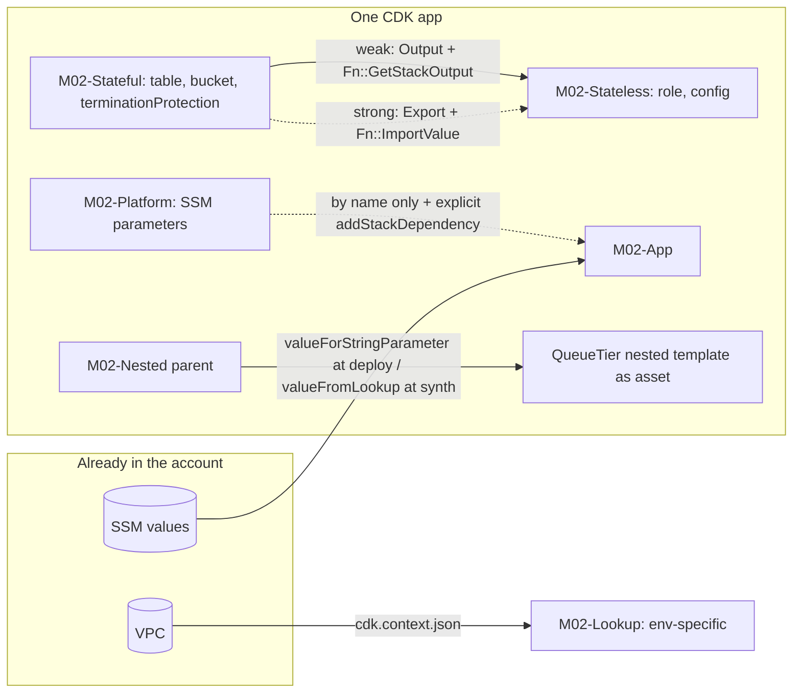

# 02 · Stacks, environments & references

> After this module you can split an app into stacks along the right seams, wire values between them with the coupling you actually want (strong, weak, or none), and keep every synth deterministic and offline even when it depends on things that already exist in the account.

## Why this exists (the problem)

The first CDK app is one stack. It works until one of four things happens: the stack passes 500 resources; a deploy of a Lambda change rolls back and takes the database with it; two teams need to deploy on different days; or a consumer stack refuses to update with *"Export … cannot be deleted as it is in use"* and the producer refuses to update for the same reason — the deadly embrace. All four are stack-boundary problems, and CloudFormation's model (a stack is a unit of deployment, rollback, permissions *and* identity) means the boundaries you draw are the blast radii you get.

The second thing that breaks is reproducibility. A stack that looks up a VPC or an AMI works on the author's laptop with their credentials and fails in CI, or worse: synthesizes something different next week because the account changed. CDK's answer, context caching in `cdk.context.json`, is simple but only if you understand the mechanism.

## Mental model



Three kinds of coupling, weakest to strongest:

| Coupling | Mechanism | CDK sees it? | Deploy order enforced? | Producer deletable while consumer exists? |
|---|---|---|---|---|
| none (by name) | SSM parameter, `Fn.importValue` of a foreign export | no | only if you `addStackDependency` | yes (consumer breaks at next deploy) |
| weak | plain `Output` + `Fn::GetStackOutput` | yes | yes (implicit dependency) | yes (consumer breaks at next deploy) |
| strong | `Export` + `Fn::ImportValue` | yes | yes | **no** — CloudFormation blocks it |

## How it works

### Environment-agnostic vs environment-specific (`environments.ts`)

`env: { account, region }` on `StackProps` decides whether `stack.account`/`stack.region` are literals or tokens (`{ Ref: 'AWS::AccountId' }` / `{ Ref: 'AWS::Region' }`). `Aws.REGION` is *always* the token. `describeEnvironment()` classifies a stack the way the manifest does (`aws://unknown-account/unknown-region`).

What only works with a concrete env: every context lookup (below), `availabilityZones` beyond two (`Fn::GetAZs` gives an agnostic stack exactly two selections), region-conditional logic (`regionShortCode(this.region)` in `EnvSpecificStack`), cross-region references. What only works without one: deploying the same assembly to several accounts with `cdk deploy` and different credentials. Rule: **stateless, region-independent stacks can be agnostic; anything that looks things up is specific**. Every module's `addToApp` gets its env from `cdk.json` context via `envFromContext(app)`.

Note that even a specific stack's `availabilityZones` is a lookup (`availability-zones:account=…:region=…`): un-cached, you get `['dummy1a','dummy1b','dummy1c']` and a `manifest.missing` entry.

### Stateful/stateless separation and cross-stack references (`stateful-stateless.ts`)

`StatefulStack` owns the DynamoDB table and the bucket; `terminationProtection` and `RemovalPolicy` follow `tier.retainStatefulResources` from the shared library, so dev is disposable and prod is not. `StatelessStack` gets the stateful stack as a prop and uses `stateful.table.tableName` and `grantReadWriteData(role)`.

The moment a token from stack A is rendered inside stack B, CDK (during *prepare*, module 00) records a **cross-stack reference** and an implicit stack dependency `B → A`. In 2.269.0 the CloudFormation mechanism depends on the reference **strength**:

| Strength | Producer template | Consumer template | Set by |
|---|---|---|---|
| strong | `Outputs.ExportsOutputRefOrders…` with `Export.Name: "M02-Stateful:ExportsOutputRefOrders…"` | `Fn::ImportValue` | flag unset (bare `new cdk.App()` in tests) or `"strong"`; CDK warns you to choose |
| weak | plain `Output` | `Fn::GetStackOutput` (new intrinsic; reads the output through the consumer's cfn-exec role) | `@aws-cdk/core:defaultCrossStackReferences: "weak"` — **our `cdk.json`** |
| both | Export *and* Output | `Fn::GetStackOutput` | transitional value for migrating strong → weak |

Finer control: `CrossStackReferences.of(resource).produce(strength)` for every reference *to* a resource (`weakBucketReferences` prop shows it), `CrossStackReferences.of(stack).consume(strength)` for every reference a consumer makes, and `Stack.consumeReference(value, strength)` for one usage. The last one has a sharp edge in this version: it accepts only raw `CfnReference`s, so `queue.queueArn`/`bucket.bucketArn`/`topic.topicArn` (wrapped by `getResourceArnAttribute`) throw `ConsumeReferenceRequiresResourceAttribute`; use the L1's `attrArn` (exercise 1).

**The deadly embrace (strong only).** Deployed: consumer imports two exports. Change: consumer stops using the table. Synth: the producer template loses the exports because CDK only emits the ones that are referenced. Deploy: CloudFormation rejects the producer update — *Export M02-Stateful:ExportsOutputRefOrders… cannot be deleted as it is in use by M02-Stateless* — and the consumer cannot deploy first because the producer must go first. Fix, in three deploys:

1. In the producer, `this.exportValue(this.table.tableName)` and `this.exportValue(this.table.tableArn)` (the `retainExports` prop). CDK generates the *same* export names it would have generated implicitly. Remove the consumer usage. Deploy both.
2. Remove the `exportValue` calls. Deploy the producer.
3. Now the table can be deleted or moved.

`exportStringListValue` is the list variant. With weak references there is no embrace: the producer deploys, and the consumer fails at *its* next deploy if the output is gone — which is why weak is the recommended default and why the migration path is `"both"` first.

### Sharing by name: SSM (`ssm-sharing.ts`)

For anything that crosses an app, repo or team boundary, publish under a naming contract (`/cdk-mastery/<tier>/platform/<key>`) and read by name:

- `StringParameter.valueForStringParameter(scope, name)` → a template **parameter** of type `AWS::SSM::Parameter::Value<String>` resolved by CloudFormation at deploy time. Works in agnostic stacks, invisible to `cdk diff`, cannot be branched on.
- `StringParameter.valueFromLookup(scope, name)` → a **context lookup** at synth time; the literal lands in the template; visible in `cdk diff`; requires env; cached in `cdk.context.json` until you `cdk context --reset`.
- `Fn.importValue('name')` → the raw intrinsic for an Export owned by a stack CDK does not know about. No dependency, no validation.

Because CDK cannot see a by-name reference, it cannot order the deploy: `appStack.addStackDependency(platform, 'reason')` states it explicitly (`addDependency` is the deprecated name in 2.269.0; it still works but warns). The reason string appears in error messages about dependency cycles.

### Nested stacks (`nested.ts`)

`class QueueTier extends cdk.NestedStack`. CDK writes `M02NestedQueues<hash>.nested.template.json` to `cdk.out`, registers it as a **file asset**, and adds an `AWS::CloudFormation::Stack` to the parent with a `TemplateURL` pointing at the bootstrap bucket. Values flow parent → nested as nested *Parameters* and nested → parent as nested *Outputs* read with `Fn::GetAtt [QueuesNestedStackQueuesNestedStackResource…, Outputs.M02NestedQueuesWork…Arn]` — the test asserts exactly that for `grantConsumeMessages`. One change set, atomic rollback, one lifecycle. Use nested stacks to get *past* 500 resources for a unit that must deploy atomically; do not use them to separate ownership or cadence.

### Context lookups (`lookups.ts`)

A lookup computes a **context key** from its arguments and asks `node.tryGetContext(key)`. Present → real data. Absent → a dummy value (`vpc-12345`, `dummy1a`, `dummy-value-for-<name>`) plus a `{ key, provider, props }` record in the assembly's `manifest.missing`. The CLI reads `missing`, assumes the bootstrap **lookup role**, calls the API, writes `cdk.context.json`, and synthesizes again. The keys are literally:

```
vpc-provider:account=111111111111:filter.vpc-id=vpc-0123456789abcdef0:region=us-east-1:returnAsymmetricSubnets=true
ssm:account=111111111111:parameterName=/cdk-mastery/dev/platform/log-retention-days:region=us-east-1
availability-zones:account=111111111111:region=us-east-1
```

`LookupStack` seeds the VPC key with a `VpcContextResponse`-shaped object (`dummyVpcContext`) via `this.node.setContext(...)` **before** creating children (context can only be set on a node without children, and is inherited downwards). That is what `cdk.context.json` would contain; the stack then builds a real security group with literal subnet and AZ data. With `seedSsmValue: false` the test shows the other path: the dummy value and the `missing` entry, including the `lookupRoleArn` the CLI will assume.

**Commit `cdk.context.json`.** It is what makes synth deterministic and credential-free for every developer and for CI, and it turns "the prod VPC changed" into a reviewable diff. Evict entries deliberately with `cdk context --reset <key>`. The repo's `.gitignore` currently lists `aws-cdk/cdk.context.json`; that line should go before the first real lookup is cached.

### The 500-resource limit (`stack-budget.ts`)

CloudFormation caps a template at 500 resources. L2s hide their counts (a NAT'd two-AZ VPC with endpoints is ~35, an ECS pattern ~20, a `NodejsFunction` with alias/canary ~8). `ResourceBudget` is an Aspect: it counts `CfnResource`s per stack (nested stacks separately) and adds a warning at 80% and an error above the limit, so CI fails before CloudFormation does. Splitting strategies, in order: by lifecycle (stateful/stateless), by ownership, by cardinality with positional shard ids (exercise 3), nested stacks for atomic units, and reducing count (`@aws-cdk/aws-iam:minimizePolicies`, shared log groups).

## Walkthrough

From `aws-cdk/`, read in this order:

1. `environments.ts` → `npx cdk synth M02-Agnostic` and `npx cdk synth M02-Specific`; compare the SSM parameter values.
2. `stateful-stateless.ts` → `npx cdk synth M02-Stateless` and look for `Fn::GetStackOutput` (weak, from `cdk.json`). Then `npx cdk synth M02-Stateless -c @aws-cdk/core:defaultCrossStackReferences=strong` and look for `Fn::ImportValue` plus the producer's `Export`.
3. `ssm-sharing.ts` → `npx cdk synth M02-App --quiet && grep -A3 '"M02-App"' cdk.out/manifest.json`: the artifact lists `M02-Platform` under `dependencies` although no reference exists.
4. `nested.ts` → `npx cdk synth M02-Nested --quiet && ls cdk.out | grep nested`.
5. `lookups.ts` → `npx cdk synth M02-Lookup`: synthesizes offline because the stack seeds its own context.
6. `stack-budget.ts`, then `test/02-stacks-environments-and-references.test.ts` → `npx jest test/02-stacks-environments-and-references.test.ts`.

`index.ts` documents each stack's env choice. `M02-Specific` and `M02-Lookup` need `cdk-mastery:account`/`cdk-mastery:region` from `cdk.json`; everything else is agnostic. `M02-App` uses `Fn.importValue` only when `externalAlertsTopicExportName` is set (it is not in `addToApp`), so nothing in this module depends on a stack outside the app.

## Production notes

- **Turn on weak references deliberately.** New apps: `"weak"`. Existing apps with deployed exports: `"both"`, deploy everywhere, then `"weak"`. Going straight to `"weak"` drops Exports that deployed consumers still import — the embrace, app-wide.
- **Weak means the consumer can break.** `Fn::GetStackOutput` reads at deploy time; if the producer removed the output, the consumer's next deploy fails. Pair weak references with a pipeline that deploys producers before consumers (CDK Pipelines does, from the implicit dependency) and with `cdk diff` on producers that watches `Outputs`.
- **Stateful stacks get termination protection and RETAIN in prod**, and their deploy role should be narrower than the stateless stacks'. `cdk destroy` of a protected stack fails; that is the point.
- **SSM parameters as an interface are an API**: version them in the name (`/org/env/platform/v1/...`) when you change semantics, and grant `ssm:GetParameter` explicitly if consumers read them at runtime rather than at deploy.
- **`cdk.context.json` staleness** is the most common "works locally, wrong in prod" cause: a VPC recreated by another team, an AMI rotated. Add `cdk context --reset` to the runbook for those events and review context diffs like code.
- **Nested stack templates over 51,200 bytes must be uploaded** — CDK always uploads them, but `cdk diff` shows a nested change only as a hash change unless you diff the nested template directly (`--template`).
- **Cross-region references** require `crossRegionReferences: true` and concrete envs on both stacks (module 09); strong ones use `ExportWriter`/`ExportReader` custom resources with a 4 KB response limit.

## Gotchas

- Symptom: *Export X cannot be deleted as it is in use by Y* → cause: strong reference removed from the consumer → fix: `exportValue` in the producer, deploy, remove, deploy; or migrate to weak via `"both"`.
- Symptom: `ConsumeReferenceRequiresResourceAttribute` → cause: `Stack.consumeReference` given an L2 ARN attribute → fix: pass the L1 attribute (`(x.node.defaultChild as CfnQueue).attrArn`).
- Symptom: warning `@aws-cdk/core:crossStackReferencesDefaultStrong` in tests → cause: bare `new cdk.App()` has no flag → fix: pass `context: { '@aws-cdk/core:defaultCrossStackReferences': 'weak' }` (or `'strong'`) explicitly in tests that create cross-stack references.
- Symptom: *Cannot retrieve value from context provider vpc-provider since account/region are not specified* → cause: lookup in an agnostic stack → fix: pass `env`.
- Symptom: template contains `vpc-12345` / `dummy1a` / `dummy-value-for-…` → cause: context not cached and synth run without credentials (`--app cdk.out`, or CI without the lookup role) → fix: commit `cdk.context.json`; check `manifest.missing` in CI and fail if non-empty.
- Symptom: `Cannot set context after children have been added` → cause: `setContext` on a node that already has children → fix: set it on the App at construction (`new App({ context })`) or on a fresh stack before creating resources, as `LookupStack` does.
- Symptom: `M02-App` deployed before `M02-Platform` and failed on a missing parameter → cause: by-name reference is invisible to CDK → fix: `addStackDependency`.
- Symptom: `stack.dependencies` is empty in a test right after construction → cause: implicit dependencies are recorded during synthesis → fix: call `Template.fromStack` (or `app.synth()`) first.
- Symptom: *Template format error: Number of resources, 5xx, is greater than maximum allowed, 500* → cause: hidden L2 fan-out → fix: `ResourceBudget` in CI and split by lifecycle/cardinality.

## Exercises

1. **Weaken one reference.** Hub exposes a topic and a queue; the spoke must reference the queue weakly and the topic strongly. Solution: `solutions/exercise-1-weaken-one-reference.ts` (and see the L1-attribute limitation).
2. **A typed SSM contract.** Write `SharedValue.publish / consumeAtDeploy / consumeAtSynth` over a single naming function, with `consumeAtSynth` refusing agnostic stacks. Solution: `solutions/exercise-2-shared-value.ts`.
3. **Positional sharding.** Distribute N tenant queues across stacks of at most K, with stack and construct ids that never change when a tenant is removed. Solution: `solutions/exercise-3-sharded-stacks.ts`. Bonus: apply `ResourceBudget` to each shard and pick K so a shard stays under 80% with the L2s you use.

## Checklist

- [ ] Every stack is explicitly agnostic or specific; specific ones read env from config, never hard-code it.
- [ ] Data lives in stacks with `terminationProtection` and `RETAIN` in prod; compute lives elsewhere.
- [ ] `@aws-cdk/core:defaultCrossStackReferences` is set (`weak` for new apps); migration from strong went through `both`.
- [ ] By-name references (SSM, `Fn.importValue`) have an explicit `addStackDependency` and a documented naming contract.
- [ ] `cdk.context.json` is committed, reviewed, and CI fails on non-empty `manifest.missing`.
- [ ] `ResourceBudget` (or equivalent) runs in CI.
- [ ] Code review: a removed cross-stack usage under strong references comes with the `exportValue` step.
- [ ] Code review: nested stacks are used for atomicity or size, not for ownership.

## Interview angle

1. *"How do cross-stack references work in CDK and what is the deadly embrace?"* — Tokens from stack A rendered in stack B are detected during prepare; with strong references CDK emits an Export in A and `Fn::ImportValue` in B, plus an implicit dependency. Removing B's usage removes A's Export while B still imports it, and CloudFormation blocks both updates. Fix with `exportValue` in A for one deploy, or move to weak references (`Fn::GetStackOutput`) via `"both"`.
2. *"Why is `cdk.context.json` committed when it looks like a cache?"* — Because it *is* the input that makes synthesis deterministic: without it a synth needs credentials and may produce a different template on a different day. Committing it makes environment changes reviewable and CI hermetic; `cdk context --reset` is the explicit invalidation.
3. *"How would you split a 900-resource service stack?"* — First by lifecycle (stateful vs stateless), then by ownership/cadence, then by cardinality with positional ids; nested stacks only for units that must deploy atomically. Wire the pieces with weak references inside an app and SSM contracts across apps; add a resource-budget check in CI so it does not happen again.

## References

- `aws-cdk-lib/README.md` § "Reference strength", "The deadly embrace", "Controlling reference strength" (shipped in `node_modules/aws-cdk-lib`).
- `aws-cdk-lib/core/lib/private/refs.js` (`resolveValue`, `createImportValue`, `createGetStackOutput`), `core/lib/cross-stack-reference-strength.d.ts`, `core/lib/stack.d.ts` (`exportValue`, `consumeReference`, `addStackDependency`).
- `aws-cdk-lib/aws-ec2/lib/vpc.d.ts` (`Vpc.fromLookup`), `@aws-cdk/cloud-assembly-api/lib/context/vpc.d.ts` (`VpcContextResponse`), `aws-ssm/lib/parameter.d.ts` (`valueForStringParameter`, `valueFromLookup`).
- CDK Developer Guide: Environments; Context (runtime context, `cdk context`); Nested stacks; CloudFormation quotas.
