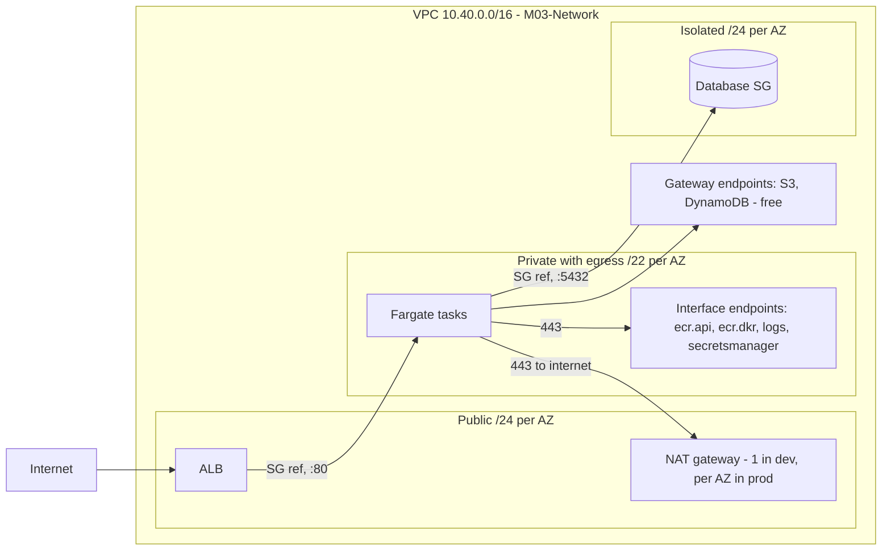

# 03 · Networking & containers

> After this module you can build a VPC whose monthly bill you can predict, wire security groups without ever typing a CIDR for an internal hop, and deploy an ECS Fargate service two ways — with the L3 pattern and by hand — knowing exactly when each is the right call.

## Why this exists (the problem)

`new ec2.Vpc(this, 'Vpc')` with no props creates a working VPC with a NAT gateway in every AZ. In three regions and three environments that is nine NAT gateways idling at ~$32 each before a byte is processed, and every ECR image pull crosses them at $0.045/GB. The L2 defaults are safe, not cheap; the cost model has to be in your head.

Security groups are the second place defaults hurt: hand-written rules use CIDRs, break when task IPs change, and drift from what the code says. CDK's `connections` API expresses "this may talk to that on this port" as a relation between constructs and derives the rules on both sides.

Then containers: `ecs_patterns.ApplicationLoadBalancedFargateService` builds a production-shaped service in one construct, and teams either never look inside it (and cannot change the health check) or rewrite everything from L2s at the first missing knob. Both are wrong; the pattern exposes its parts.

## Mental model



Every arrow between two boxes inside the VPC is a `connections` call, and every one of them becomes a pair of security-group rules referencing the other side's security group — never an IP.

## How it works

### The VPC (`network.ts`)

```ts
this.vpc = new ec2.Vpc(this, 'Vpc', {
  ipAddresses: ec2.IpAddresses.cidr('10.40.0.0/16'),
  maxAzs,                                   // 3 when tier.highlyAvailable, else 2
  natGateways: this.natGatewayCount,        // maxAzs in prod, 1 in dev
  subnetConfiguration: [
    { name: 'Public',   subnetType: ec2.SubnetType.PUBLIC,              cidrMask: 24 },
    { name: 'Private',  subnetType: ec2.SubnetType.PRIVATE_WITH_EGRESS, cidrMask: 22 },
    { name: 'Isolated', subnetType: ec2.SubnetType.PRIVATE_ISOLATED,    cidrMask: 24 },
  ],
  gatewayEndpoints: { S3: {...}, DynamoDb: {...} },
  flowLogs: { Rejected: {...} },
  restrictDefaultSecurityGroup: true,
});
```

- **Subnet groups.** `subnetConfiguration` is a list of *groups*; each group gets one subnet per AZ. Public subnets route to the IGW and auto-assign public IPs; `PRIVATE_WITH_EGRESS` subnets route `0.0.0.0/0` to a NAT; `PRIVATE_ISOLATED` subnets have no default route at all. Tasks go in private, databases in isolated, load balancers and NATs in public. The `/22` for private is deliberate: Fargate tasks and Lambda ENIs consume IPs fast.
- **NAT count vs cost.** `natGateways: 1` in dev means both AZs' private subnets route to one NAT in one AZ — an AZ outage removes egress for the other AZ, which is acceptable in dev. In prod, one per AZ. The test asserts 1 vs 3 gateways and that only private subnets get a NAT route.
- **Endpoints.** Gateway endpoints (S3, DynamoDB) are free and are route-table entries; always add them. Interface endpoints are ENIs with a security group, billed per AZ-hour plus per GB, and they keep ECR pulls, log writes and secret reads off the NAT (and off the internet). `privateDnsEnabled` (default) makes the normal service hostnames resolve to the endpoint, so no SDK configuration changes. Each interface endpoint's SG must allow 443 from the clients — `allowEndpointAccess(client)` does that with `connections.allowDefaultPortFrom`.
- **Flow logs** for `REJECT` only, to a log group with tier retention (7/30/365 days via `retentionFor`). Accepted-traffic logs are expensive and rarely read.
- **`restrictDefaultSecurityGroup`** deploys a small custom resource that strips the VPC's default SG of its allow-all rules. The `@aws-cdk/aws-ec2:restrictDefaultSecurityGroup` flag makes this the default under the CLI; the code sets it explicitly so a bare test `App` behaves identically.
- **Env-specific.** The VPC L2 needs AZ *names* to create subnets, which is a context lookup (`availability-zones:account=…:region=…`). Without a cached value you get `dummy1a/1b/1c` — fine for tests, and the CLI fills in real names on first synth with credentials (module 02).

### The `connections` API (`handbuilt-service.ts`, `network.ts`)

Anything with a `.connections` property is `IConnectable`: security groups, services, load balancers, Lambda functions in a VPC, RDS instances, interface endpoints. `a.connections.allowTo(b, port)` and `b.connections.allowFrom(a, port)` are the same statement. CDK writes an **ingress** rule on `b`'s SG with `a`'s SG as the source, and — only if `a`'s SG is *not* `allowAllOutbound` — an **egress** rule on `a`'s SG with `b`'s SG as the destination. The hand-built stack owns its service SG with `allowAllOutbound: false` precisely so the egress side is explicit and reviewable; the test asserts both rules for `app -> postgres` and the lone `443` egress.

`targetGroup.addTarget(service)` uses the same machinery: it calls `service.connections.allowFrom(loadBalancer, port)`, which is why the service SG accepts port 80 from the ALB SG and from nothing else.

### The L3 pattern (`pattern-service.ts`)

`ApplicationLoadBalancedFargateService` creates cluster (if absent), task definition, container, log driver, ALB in the public subnets, listener, target group, service in the private subnets, SGs, and — with `circuitBreaker` — automatic rollback. Twenty-odd resources from one constructor. The props that matter in production and how the file sets them:

| Concern | Prop | Value here |
|---|---|---|
| Image without Docker | `taskImageOptions.image` | `ContainerImage.fromRegistry('public.ecr.aws/nginx/nginx:stable')` |
| Logs | `taskImageOptions.logDriver` | `LogDrivers.awsLogs({ logGroup, streamPrefix })` into a log group we own with tier retention |
| Failed deploy | `circuitBreaker` | `{ enable: true, rollback: true }` |
| Rolling deploy capacity | `minHealthyPercent` / `maxHealthyPercent` | 100 / 200 (never below desired, double during rollout) |
| Container health | `healthCheck` | `CMD-SHELL curl -f http://localhost/` |
| No public IPs on tasks | `assignPublicIp` | `false` (tasks land in `PRIVATE_WITH_EGRESS`) |
| Cheaper compute | `runtimePlatform` | ARM64 |

**Reaching in.** The pattern exposes `.service`, `.taskDefinition`, `.loadBalancer`, `.listener`, `.targetGroup`, `.cluster`. The file uses all of them after construction: `targetGroup.configureHealthCheck` and `setAttribute('deregistration_delay…')`, `loadBalancer.setAttribute(...)`, `service.autoScaleTaskCount(...)` with `scaleOnCpuUtilization` and `scaleOnRequestCount({ targetGroup })`, and `listener.addAction` for a 403 on `/internal/*`. Nothing about the pattern is sealed; if the knob exists on the L2, you can turn it.

**When L3 is enough:** one container, one port, HTTP(S) behind an ALB, standard health check, no sidecars, no service discovery. **When to drop to L2:** multiple containers or ports, a listener shared by several services (host/path routing), NLB/gRPC, `EXTERNAL` deployment controller (CodeDeploy blue/green), capacity-provider strategies, or an audit that must see every SG rule as code. Exercise 3 shows a service with no load balancer at all, which the pattern cannot express.

### The hand-built service (`handbuilt-service.ts`)

Same shape, every decision explicit, in data-path order:

1. `ecs.Cluster` — `containerInsightsV2: ENHANCED` in prod (per-task metrics; costs CloudWatch).
2. `ecs.FargateTaskDefinition` — `cpu: 256, memoryLimitMiB: 512` must be a valid Fargate pair; ARM64. The L2 creates the **execution role** (pull image, write logs, read secrets) and the **task role** (what your code calls) separately; the test asserts they differ.
3. `taskDefinition.addContainer` — `LogDrivers.awsLogs` with `mode: NON_BLOCKING` and a 25 MiB buffer (renders as `max-buffer-size: 26214400b`): under log backpressure the container keeps serving instead of blocking on stdout. Use `BLOCKING` only for audit trails where losing a line is worse than a stall.
4. `ApplicationLoadBalancer` in `PUBLIC` subnets, `dropInvalidHeaderFields`, 60 s idle timeout. `addListener('Http', { port: 80, open: true })` — `open: true` is the default and adds `0.0.0.0/0` ingress on the ALB SG; it is spelled out so a reviewer sees it.
5. `ApplicationTargetGroup` with `targetType: IP` (Fargate is always IP targets), 30 s deregistration delay, and an explicit health check (`/`, 15 s interval, 2 healthy / 3 unhealthy). `listener.addTargetGroups`.
6. `ecs.FargateService` with an owned SG, `circuitBreaker`, `healthCheckGracePeriod: 60s` (ALB health checks are ignored during startup), `availabilityZoneRebalancing` in prod, `enableExecuteCommand` only outside prod. `targetGroup.addTarget(service)`.
7. `connections` wiring to the database SG.
8. `autoScaleTaskCount` with CPU target tracking (60%, 1 min out / 5 min in) and `ALBRequestCountPerTarget` (200 rps per task).

## Walkthrough

From `aws-cdk/`:

1. `src/modules/03-networking-and-containers/network.ts`, then `npx cdk synth M03-Network --quiet && grep -c '"Type"' cdk.out/M03-Network.template.json` to see the resource count.
2. `pattern-service.ts`, then `npx cdk synth M03-PatternService | grep -A3 DeploymentCircuitBreaker`.
3. `handbuilt-service.ts`, then diff the two templates' `AWS::EC2::SecurityGroupIngress` resources.
4. `test/03-networking-and-containers.test.ts` — `npx jest test/03-networking-and-containers.test.ts`.
5. `solutions/` for the exercises.

All three stacks are env-specific (`cdk-mastery:account/region` from `cdk.json`), because the VPC needs AZs and the service stacks reference the VPC across stacks, which requires matching envs. With `@aws-cdk/core:defaultCrossStackReferences: "weak"` in `cdk.json`, the VPC id, subnet ids and AZ list travel as `Fn::GetStackOutput` references.

## Production notes

- **Cost, monthly, per environment (us-east-1 list):** NAT gateways (count × ~$32 + $0.045/GB), interface endpoints (4 × AZs × ~$7 + $0.01/GB), ALB (~$16 + LCUs), Fargate vCPU/GB-hours, Container Insights enhanced (per-metric CloudWatch charges). A dev environment with `natGateways: 1`, 2 AZs and 4 endpoints is ~$110 idle; prod with 3 AZs is ~$210 idle before compute.
- **Image supply chain.** `fromRegistry('public.ecr.aws/…:stable')` is a moving tag. Pin by digest (`nginx@sha256:…`) or mirror into your own ECR with `ecr.Repository` and image scanning. Docker Hub without credentials is rate-limited from NAT IPs; prefer ECR Public.
- **Deployment safety.** Circuit breaker rollback stops a bad task definition from wedging a service, but only if the health check fails. A container that starts and returns 200 on `/` while its dependency is broken is "healthy"; make `/` (or a dedicated path) check what matters. Set `healthCheckGracePeriod` longer than your cold start.
- **Rolling deploys and capacity.** `minHealthyPercent: 100, maxHealthyPercent: 200` doubles capacity during a deploy; in a small VPC that can exhaust IPs. Watch `AvailableIpAddressCount` on private subnets.
- **Scaling.** Request-count-per-target scaling reacts faster than CPU for web services; CPU protects against non-request work. Keep both. Scale-in cooldown longer than scale-out.
- **Exec access.** `enableExecuteCommand` grants `ssmmessages:*` on the task role and opens a shell into prod containers. Leave it off in prod or gate it behind an approval.
- **Monitor:** `HealthyHostCount`/`UnHealthyHostCount` per target group, `TargetResponseTime` p99, `HTTPCode_ELB_5XX_Count`, `RunningTaskCount` vs `DesiredCount`, ECS deployment events (circuit breaker triggers), NAT `ErrorPortAllocation`, and the endpoint SG denies in flow logs.

## Gotchas

- Symptom: *There are no 'Private' subnet groups in this VPC* → cause: `natGateways: 0` converts `PRIVATE_WITH_EGRESS` groups to isolated → fix: keep ≥ 1 NAT, or select `PRIVATE_ISOLATED` for the service and add endpoints for everything it needs.
- Symptom: tasks stuck in `PENDING`, `CannotPullContainerError` → cause: private subnets without NAT *or* without both ECR endpoints (`ecr.api` **and** `ecr.dkr`) plus the S3 gateway endpoint (image layers are served from S3) → fix: add all three.
- Symptom: `connections.allowTo(db)` produced no egress rule → cause: the source SG is `allowAllOutbound: true` (the L2 default), so CDK considers egress already covered → fix: own the SG with `allowAllOutbound: false`.
- Symptom: `AZs` in the template are `dummy1a` → cause: env-specific stack, AZ context not cached → fix: synth once with credentials (or seed the `availability-zones:` context key) and commit `cdk.context.json`.
- Symptom: deploy rolled back with *"circuit breaker triggered"* after a health-check tweak → cause: health check interval × unhealthy threshold shorter than startup, grace period too short → fix: raise `healthCheckGracePeriod`, `startPeriod` on the container health check.
- Symptom: CPU/memory error at deploy (*"No Fargate configuration exists for given values"*) → cause: invalid cpu/memory pair → fix: use a documented combination (256/512, 512/1024–4096, 1024/2048–8192, …).
- Symptom: `max-buffer-size` in the template is `26214400b` not `25m` → cause: the L2 renders `Size` in bytes → fix: none; assert on bytes.
- Symptom: the pattern's listener already owns port 80, so `addRedirect()` fails → cause: two listeners on one port → fix: build listeners by hand (exercise 2) or use the pattern's `redirectHTTP: true` with `protocol: HTTPS` and a certificate.

## Exercises

1. **NAT instance for dev.** Replace the NAT gateway with `NatProvider.instanceV2` on a `t4g.nano`, restrict its SG with `connections`, and compare the resource list. Solution: `solutions/exercise-1-nat-instance.ts`.
2. **HTTPS only.** Add a 443 listener with an imported ACM certificate and `RECOMMENDED_TLS`, and redirect 80 → 443 with `addRedirect`. Solution: `solutions/exercise-2-https-listener.ts`.
3. **A private Spot worker.** No load balancer; `FARGATE` base 1 + `FARGATE_SPOT` weight 3; a Secrets Manager secret injected via the execution role; the task role limited to `grantConsumeMessages`; step scaling on queue depth. Solution: `solutions/exercise-3-spot-worker.ts` (the cluster must be created with `enableFargateCapacityProviders: true`).

## Checklist

- [ ] NAT gateway count is a per-tier decision with a stated cost; dev is 1.
- [ ] S3 and DynamoDB gateway endpoints exist; interface endpoints cover ECR (api + dkr), Logs and Secrets Manager for any private Fargate service.
- [ ] No security-group rule references a CIDR for an internal hop; sources/destinations are SG references produced by `connections`.
- [ ] Service SGs are owned with `allowAllOutbound: false` where egress must be auditable.
- [ ] Circuit breaker with rollback on every ECS service; health checks test dependencies, grace period exceeds cold start.
- [ ] Log groups are owned, with retention, and `NON_BLOCKING` unless audit requires otherwise.
- [ ] Task role and execution role are separate; `grant*` only on the task role.
- [ ] Images are pinned by digest or mirrored to ECR.
- [ ] Code review: any `open: true` listener, `assignPublicIp: true`, or `enableExecuteCommand: true` has a comment saying why.

## Interview angle

1. *"Design the network for a Fargate service that must not touch the public internet for AWS API calls, and justify the cost."* — Private-with-egress subnets for tasks, isolated for data, gateway endpoints for S3/DynamoDB (free), interface endpoints for ecr.api, ecr.dkr, logs, secretsmanager, sts (per AZ-hour); NAT only for third-party egress, sized 1 in dev / per-AZ in prod. Show the per-GB arithmetic where endpoints beat NAT.
2. *"What does `connections.allowTo` actually produce and why is it better than writing rules?"* — Ingress on the target SG with the source SG as principal, egress on the source SG if it is not allow-all; rules follow constructs, so IPs and refactors do not break them, and the code review reads as intent.
3. *"When would you stop using `ApplicationLoadBalancedFargateService`?"* — Multi-container/multi-port tasks, shared listeners with routing rules, NLB/gRPC, blue/green via CodeDeploy, capacity-provider strategies, or no load balancer at all. Until then, keep the pattern and configure its exposed L2s.

## References

- `aws-cdk-lib/aws-ec2/lib/vpc.d.ts` (`VpcProps`, `SubnetType`), `nat.d.ts` (`NatProvider`), `connections.d.ts`, `vpc-endpoint.d.ts`.
- `aws-cdk-lib/aws-ecs-patterns/lib/base/application-load-balanced-service-base.d.ts` and `fargate/application-load-balanced-fargate-service.d.ts` (exposed members).
- `aws-cdk-lib/aws-ecs/lib/base/base-service.d.ts` (`circuitBreaker`, `minHealthyPercent`, `autoScaleTaskCount`), `log-drivers/aws-log-driver.d.ts`.
- AWS docs: VPC pricing (NAT gateway, PrivateLink), Fargate task sizes, ECS deployment circuit breaker, ALB target-group health checks.
