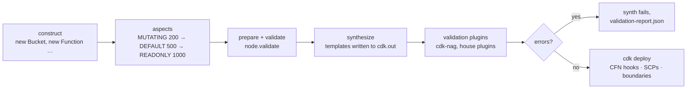

# 06 · Aspects, tags & governance

> After this module you can enforce a platform policy over every resource in an app — including resources created by constructs you do not own — and you can say precisely *when* each enforcement runs, which ones are allowed to change the tree, and which layer (aspect, validation plugin, CloudFormation hook, SCP) a given rule belongs in.

## Why this exists (the problem)

A CDK app with forty stacks and a dozen third-party construct libraries has thousands of L1 resources. "Every bucket is encrypted", "every log group expires", "every resource carries a cost-center tag" cannot be enforced by asking people to remember props. Code review does not scale to it either: the offending resource is usually three layers down inside a construct nobody on the team wrote.

Both cloud frameworks in this repo solve it the same way, because both are built on `constructs`: after the app is fully constructed and *before* anything is rendered, the framework walks the tree and lets you visit every node. In AWS CDK that hook is `Aspects`. The subtlety — and the reason this module is not a one-pager — is that the walk is ordered, some visitors change the tree while others judge it, and the framework itself uses the same mechanism for tags, removal policies and permissions boundaries. Get the order wrong and your validator reports a bucket as untagged one millisecond before the tagger tags it.

## Mental model



Think of it as a build pipeline for a tree. Construction is the compiler front-end; aspects are compiler passes (some optimise, some lint); synthesis is code generation; validation plugins are the linter that runs on the *object code*; CloudFormation hooks and SCPs are the runtime sandbox. Every rule belongs at exactly one of those stations, and the deciding question is always: *what information does the rule need, and can it still change anything there?*

## How it works

### 1. An aspect is `{ visit(node) }`, applied at a scope, inherited by the subtree

`aspects/enforce-bucket-encryption-aspect.ts` is the minimal mutating aspect:

```ts
export class EnforceBucketEncryptionAspect implements cdk.IAspect {
  visit(node: IConstruct): void {
    if (!(node instanceof s3.CfnBucket)) return;
    if (node.bucketEncryption !== undefined) return; // respect explicit choices
    node.bucketEncryption = { serverSideEncryptionConfiguration: [rule] };
  }
}
```

Two things to notice. It targets the **L1** (`CfnBucket`), because by the time aspects run every L2 has already consumed its props; the L1 property bag is the only thing still writable and it is exactly what synthesis renders. And it *only fills gaps*: an aspect that overwrites explicit choices is a trap for the next engineer who wonders why their prop has no effect.

`Aspects.of(scope).add(aspect, { priority })` registers it on `scope`; during synthesis every node in the subtree is visited. `Aspects.of(app)` covers everything; `Aspects.of(stack)` covers one stack; `Aspects.of(someConstruct)` covers a subtree. Scope is your first control knob.

### 2. Ordering: priority, then inheritance

`governance.ts` applies seven aspects and the order is the point:

```ts
MUTATING (200) : Tags, EnforceBucketEncryption, LogRetention
DEFAULT  (500) : (nothing here; this is where un-prioritised aspects land)
READONLY (1000): NoPublicBuckets, RequireTags, ConstructPolicy (PascalCaseIds)
```

The synthesis code (`aws-cdk-lib/core/lib/private/synthesis.js`, `invokeAspects`) sorts the aspects that apply to a node by `priority` ascending, and among equal priorities runs **inherited (ancestor-applied) aspects before locally-applied ones**. `AspectPriority.MUTATING` is 200, `DEFAULT` 500, `READONLY` 1000 — verified in the test `aspects run in priority order`. Aspects at the *same* priority added at the *same* scope are not guaranteed any order, so never rely on registration order between two mutators; give them different priorities.

`Tags.of(scope).add(k, v)` is itself an aspect (a `Tag` instance). With the feature flag `@aws-cdk/core:aspectPrioritiesMutating` (on in this repo's `cdk.json`) library-added aspects such as Tags, `RemovalPolicies` and `PermissionsBoundary` get MUTATING priority; without it they get DEFAULT. Either way they run before READONLY, which is why `RequireTagsAspect` must be registered at READONLY — the test `RequireTagsAspect gives false positives when it runs before the Tags aspect` shows what happens at priority 100.

One more flag: `@aws-cdk/core:aspectStabilization` (recommended by the library, **not** set in this repo's `cdk.json`, so off everywhere here) makes the walk loop until no aspect adds nodes or aspects, so an aspect that creates a construct gets that construct visited too. With it on, an aspect that registers an aspect of *lower* priority than one already run on that node throws `CannotInvokeAspectWithLowerPriority`. Without it you get a single pass and a warning `@aws-cdk/core:ignoredAspect` if an aspect adds another aspect.

### 3. Mutating vs read-only is a contract, not a type

The framework cannot stop a READONLY aspect from writing. The contract is yours:

| | Mutating | Read-only (validating) |
|---|---|---|
| Priority | `AspectPriority.MUTATING` | `AspectPriority.READONLY` |
| Touches | L1 properties, `cfnOptions`, tags | nothing |
| Reports via | `Annotations.addInfo` (say what you changed) | `Annotations.addError` / `addWarning` |
| Examples here | `EnforceBucketEncryptionAspect`, `LogRetentionAspect` | `NoPublicBucketsAspect`, `RequireTagsAspect`, `ConstructPolicyAspect` |

`NoPublicBucketsAspect` (`aspects/no-public-buckets-aspect.ts`) shows the reporting side:

```ts
cdk.Annotations.of(node).addError('NoPublicBucketsAspect: bucket must set all four PublicAccessBlockConfiguration flags …');
```

Why not `throw`? A throw aborts the walk at the first offender and hides the rest. `addError` attaches metadata to the node, the walk continues, and the CLI prints every error before exiting non-zero. Tests read them with `Annotations.fromStack(stack).hasError(path, matcher)` — no `toThrow`, no try/catch. Note that in this version an annotation error does not abort `app.synth()` by default; with `@aws-cdk/core:annotationsInValidationReport: true` (on in `cdk.json`, off in a bare `new cdk.App()`) annotations are folded into the validation report and `synth()` throws in-process — the test `with annotationsInValidationReport on … annotation errors fail synthesis` demonstrates the difference. Decide which behaviour your tests want and set the context explicitly.

It also matches by `cfnResourceType === 'AWS::S3::Bucket'` rather than `instanceof CfnBucket`. `instanceof` fails across duplicate copies of `aws-cdk-lib` (a construct library that bundled its own); the string check is the robust governance choice and the cast to `s3.CfnBucket` afterwards is safe because the L1 shape for a type is stable. Property values may be `IResolvable`; resolve through `Stack.of(node).resolve(...)` before inspecting.

### 4. The shared `ConstructPolicy` is already an aspect — the bridge adds reporting

`shared/src/policy.ts` defines `ConstructPolicy.visit(node: IConstruct)`. TypeScript's structural typing means `Aspects.of(app).add(policy)` type-checks in *both* frameworks (the last test in the file proves it). What the shared class lacks is CDK-idiomatic reporting, so `aspects/construct-policy-aspect.ts` wraps it:

```ts
visit(node: IConstruct): void {
  if (this.options.exclude?.(node)) return;
  const before = this.policy.violations.length;
  this.policy.visit(node);
  for (const v of this.policy.violations.slice(before)) {
    cdk.Annotations.of(node).addError(`[${v.rule}] ${v.message}`);
  }
}
```

`exclude` exists for one reason: the root you apply the policy to has an id chosen by the caller (`M06-Governed`), and stack ids are stack *names*, not logical IDs; `PascalCaseIds` rejects it and it is not the rule's business.

### 5. Tags: inheritance, priority, `includeResourceTypes`

```ts
cdk.Tags.of(scope).add(key, value);                 // priority 100, every taggable L1 beneath
cdk.Tags.of(scope).add('data-classification', 'internal', {
  includeResourceTypes: ['AWS::S3::Bucket', 'AWS::DynamoDB::Table', 'AWS::DynamoDB::GlobalTable'],
  priority: 200,
});
```

Resolution rule (`TagManager`): for a given key, the highest priority wins; at equal priority the tag applied *closest* to the resource wins (it is applied last). Defaults: `add` 100, `remove` 200, tags passed directly on an L1's props 50. The test `closest tag wins at equal priority; a higher-priority ancestor tag beats a closer one` pins both branches: `Tags.of(bucket).add('owner', 'team-x')` overrides the stack-level `owner`, but `Tags.of(bucket).add('data-classification', 'public')` loses to the platform's priority-200 tag. That is the mechanism for "teams may override `owner`, nobody may downgrade `data-classification`".

`RequireTagsAspect` reads `TagManager.of(node).tagValues()` — the effective, post-resolution set — and only complains about resource types that have a Tags property. Resource types without one (e.g. `AWS::Lambda::Permission`) are silently skipped; a plugin that inspects templates cannot make that distinction without its own type list (see §7).

### 6. Permissions boundaries, app-wide

```ts
iam.PermissionsBoundary.of(scope).apply(managedPolicy);
```

is yet another aspect (`PermissionsBoundary` visits every `CfnRole`/`CfnUser` and sets `PermissionsBoundary`). The one applied closest to a role wins. `permissions-boundary.ts` builds a `DeveloperBoundary` managed policy (allow workload services, deny `iam:CreateRole` / `PutRolePermissionsBoundary` / `CreatePolicyVersion` so a role cannot mint an unbounded role) and applies it to the stack; `applyImportedBoundary` shows the far more common case where security owns the policy and you only know its name. The test `every role in the stack references the boundary managed policy` counts roles and asserts *all* of them carry the `Ref`.

A boundary only caps what a role's own policies grant; it never grants. That is why its wildcards are acknowledged rather than removed under cdk-nag (`AwsSolutions-IAM5[Resource::*]`, one `Action::…` per statement action) — with the reason spelled out in `governed-stack.ts`.

### 7. cdk-nag 3.x is a validation plugin, not an aspect

This is the version-specific part. cdk-nag 2 ran as an aspect and suppressed via `NagSuppressions`. cdk-nag **3.0.2** (pinned) implements `IPolicyValidationPlugin` and uses the core `Validations` API (`nag.ts`):

| cdk-nag 2 (what blog posts show) | cdk-nag 3 (this repo) |
|---|---|
| `Aspects.of(app).add(new AwsSolutionsChecks({ verbose: true }))` | `Validations.of(app).addPlugins(new AwsSolutionsChecks(app, { verbose: true }))` |
| `NagSuppressions.addResourceSuppressions(c, [{ id, reason }])` | `Validations.of(c).acknowledge({ id, reason })` |
| `NagSuppressions.addStackSuppressions(stack, [...])` | `Validations.of(stack).acknowledge(...)` (inherited by every descendant) |
| `{ id: 'AwsSolutions-IAM5', appliesTo: ['Resource::*'] }` | `{ id: 'AwsSolutions-IAM5[Resource::*]' }` — each finding acknowledged individually |
| `Annotations.fromStack(stack).findError('*', Match.stringLikeRegexp('AwsSolutions-.*'))` | `new AwsSolutionsChecks().validateScope(stack).violations` (see `nagFindings`) |

Consequences: plugins run after templates are written; if any plugin reports `success: false`, `app.synth()` throws in a test process (the report text is the exception message) and the CLI prints the consolidated report and writes `cdk.out/validation-report.json`. `Validations.of(app).addPlugins` may only be called on an `App` or a `Stage`, which is why the capstone registers nag on the Stage and this module registers on the App behind `-c cdk-mastery:nag=true`. `App({ policyValidationBeta1: [...] })` is the deprecated spelling of the same registration and still works.

Reading findings in tests without letting synthesis explode is the job of `nagFindings(scope)`:

```ts
const report = new AwsSolutionsChecks(undefined, { verbose: true }).validateScope(scope);
```

Call it **after** `app.synth()` or `Template.fromStack(stack)` — otherwise mutating aspects have not run and you will chase findings that never reach a template. Rule ids for wildcard-style rules carry the finding in brackets; `AwsSolutions-IAM4[Policy::arn:<AWS::Partition>:iam::aws:policy/service-role/AWSLambdaBasicExecutionRole]` is the exact id for the Lambda basic execution policy (cdk-nag flattens `Fn::Join`/`Ref` into `<...>`).

### 8. Writing a validation plugin yourself

`mandatory-tags-plugin.ts` is a complete `IPolicyValidationPlugin` in ~40 lines: it reads each `context.stackTemplates[].templatePath` from disk, inspects `Properties.Tags` on a configured list of resource types and returns a `PolicyValidationPluginReport`. Compare it with `RequireTagsAspect`, which enforces the *same* rule one station earlier:

| | `RequireTagsAspect` (aspect) | `MandatoryTagsPlugin` (plugin) |
|---|---|---|
| Sees | constructs, `TagManager` | rendered JSON |
| Can mutate | yes (but chooses not to) | no |
| Knows which types are taggable | yes, from the L1 | no — needs its own list |
| Catches `addPropertyOverride('Tags', …)` and `CfnInclude` resources | only if they went through the tree | yes, it reads the final artefact |
| Runs on | `cdk synth` in-process | `cdk synth` in-process; the same interface wraps external tools (cfn-guard, checkov) |

Rule of thumb: if the rule can be *fixed* automatically, write a mutating aspect. If it needs the final template (raw overrides, included templates, cross-resource invariants) write a plugin. If it must hold even for templates that never went through CDK, it belongs outside the process — CloudFormation Hooks (pre-create/pre-update guard on the template as submitted), SCPs (deny the API call: `s3:PutBucketPublicAccessBlock` with the wrong values), or AWS Config (detect after the fact).

## Walkthrough

Read in this order:

1. `aspects/enforce-bucket-encryption-aspect.ts` — the mutating pattern; SSE-KMS with Bucket Keys when a key is given.
2. `aspects/log-retention-aspect.ts` — mutating with a clamp; note the `Token.isUnresolved` guard.
3. `aspects/no-public-buckets-aspect.ts` — read-only; string-type matching; `Annotations.addError`.
4. `aspects/require-tags-aspect.ts` — read-only; depends on ordering; `TagManager.tagValues()`.
5. `aspects/construct-policy-aspect.ts` — the bridge to `@cdk-mastery/shared`.
6. `governance.ts` — `applyGovernance(scope, { tier, service })`: tags, priorities, the whole policy in one call. `retentionFromDays` maps `tier.logRetentionDays` onto the enum.
7. `permissions-boundary.ts` — `DeveloperBoundary` + `PermissionsBoundary.of(scope).apply`.
8. `nag.ts` — `applyAwsSolutionsChecks(app | stage)` and `nagFindings(scope)` for tests.
9. `mandatory-tags-plugin.ts` — a real `IPolicyValidationPlugin`.
10. `governed-stack.ts` — an ordinary application stack made compliant by governance, with every acknowledgement justified.
11. `index.ts` — `M06-Governed` (env-agnostic) plus the two opt-in context flags.

Commands (from `aws-cdk/`):

```bash
npx cdk synth M06-Governed                                   # clean
npx cdk synth M06-Governed -c cdk-mastery:m06-violations=true   # aspects report; synth fails (annotations are in the report)
npx cdk synth M06-Governed -c cdk-mastery:nag=true              # AwsSolutions + MandatoryTags plugins over the whole app
npx jest test/06-aspects-tags-and-governance.test.ts
```

## Production notes

- **Where to apply**: at the `Stage` in a pipeline (module 08/11), so *every* stack of an environment gets the same policy and the pipeline's own stack is judged separately. Applying at the `App` in a repo that also holds bootstrap/pipeline stacks generates hundreds of `IAM5` findings you do not want to acknowledge.
- **Cost**: `LogRetentionAspect` is the single highest-ROI aspect in most organisations. Default log retention is *never expire*; CloudWatch Logs storage is $0.03/GB-month and Lambda fleets produce terabytes.
- **KMS**: SSE-KMS on a hot bucket without `bucketKeyEnabled` multiplies KMS request cost (each GET/PUT is a KMS call at $0.03/10k). The aspect sets Bucket Keys on.
- **Boundaries**: an SCP of the form `Deny iam:CreateRole unless iam:PermissionsBoundary == <arn>` is what makes the boundary mandatory; the aspect is what makes compliance automatic. Deploy the boundary policy from a security-owned stack, import it by name everywhere else.
- **cdk-nag noise budget**: acknowledgements are a code-review artefact. Require a `reason` that a stranger can evaluate; reject "false positive" without an explanation. `writeSuppressionsToCloudFormation: true` copies them into template metadata (`cdk_nag.rules_to_suppress`) for auditors who read `cdk.out`, not source.
- **Monitor**: turn the validation report into a metric. `validation-report.json` per synth, count of acknowledgements per rule per stack, trend it. A rising `IAM5` count is a design smell, not a nag problem.

## Gotchas

- **Validator runs before the tagger** → you applied it at DEFAULT/MUTATING priority or at a scope *below* the Tags aspect with equal priority → register validators at `AspectPriority.READONLY`.
- **`instanceof CfnBucket` is false for a bucket you can see in the template** → two copies of `aws-cdk-lib` in `node_modules` (a construct library pinned a different version) → match on `CfnResource.isCfnResource(node) && node.cfnResourceType === '…'`; fix the dependency tree with `npm ls aws-cdk-lib`.
- **Aspect mutation has no effect** → you set a prop on the L2 (already consumed) or on a property that was passed as an `IResolvable`/`Lazy` and is overwritten at render → set the L1 field; for Lazy values use `addPropertyOverride` (module 10).
- **`Template.fromStack` throws with a cdk-nag report before your assertion runs** → the plugin is registered on the App under test → do not register it in unit tests; call `nagFindings(stack)` after `app.synth()`; or register and assert `expect(() => app.synth()).not.toThrow()` as the compliance test.
- **`Validations.of(x).addPlugins` throws** → `x` is a Stack or construct → plugins register only on `App`/`Stage`; acknowledgements can go anywhere.
- **Acknowledged `AwsSolutions-IAM5` still reported** → v3 requires per-finding ids → `AwsSolutions-IAM5[Resource::*]`, `AwsSolutions-IAM5[Action::s3:*]`; read the exact id from the report text.
- **`Annotations.fromStack(...).hasError` passes locally but `cdk synth` fails** → `cdk.json` enables `annotationsInValidationReport`; the bare `new cdk.App()` in your test does not → pass the context in the test when you want the CLI behaviour.
- **An aspect that creates constructs never sees them tagged** → single-pass aspect invocation → enable `@aws-cdk/core:aspectStabilization`.
- **`Tags.of(stack).add` does not tag the stack itself** → `@aws-cdk/core:explicitStackTags` (on) means stack-level tags must be passed as `new Stack(app, id, { tags })` → tag the stack explicitly if you rely on CloudFormation stack tags for propagation.

## Exercises

1. **Retain stateful resources (easy).** Write a read-only aspect that warns (or errors, in prod) when a stateful resource (`AWS::S3::Bucket`, `AWS::DynamoDB::Table`, `AWS::RDS::*`, `AWS::KMS::Key`, `AWS::Logs::LogGroup`, `AWS::SQS::Queue`) does not carry `DeletionPolicy: Retain` *and* `UpdateReplacePolicy: Retain`. Drive it from `tier.retainStatefulResources`. Solution: `solutions/exercise-1-retain-stateful-aspect.ts` — note it reads `cfnOptions`, because the template does not exist yet.
2. **Fleet runtime upgrade (medium).** Write a mutating aspect that rewrites deprecated Lambda runtimes (`nodejs14.x/16.x/18.x`) to `nodejs22.x` and records an info annotation per function. It must run before cdk-nag's `AwsSolutions-L1`, so choose the priority accordingly. Solution: `solutions/exercise-2-lambda-runtime-aspect.ts`.
3. **A house rule pack (hard).** Subclass `NagPack` with one rule, `SqsRedrivePolicy`: every `AWS::SQS::Queue` must have a `RedrivePolicy` with `maxReceiveCount >= 3`. Register it like `AwsSolutionsChecks`, honour `Validations.of(x).acknowledge`, and make the rule id `HouseRules-SqsRedrivePolicy`. Solution: `solutions/exercise-3-house-rules-pack.ts` — the rule *function name* is the id suffix, so no arrow functions.

## Checklist

- [ ] Every mutating aspect is registered at `AspectPriority.MUTATING`, every validator at `READONLY`; nothing relies on registration order.
- [ ] Mutating aspects fill gaps and never overwrite explicit props; each mutation leaves an info annotation.
- [ ] Validators report with `Annotations`, never `throw`; tests assert per construct path.
- [ ] Mandatory tags come from `mandatoryTags(tier, service)`; platform-owned tags carry an explicit `priority`.
- [ ] A permissions boundary is applied at the widest scope and an SCP makes it mandatory.
- [ ] cdk-nag (3.x: `Validations.of(...).addPlugins`) runs on the Stage/App in CI; every `acknowledge` has a reason a reviewer can evaluate.
- [ ] Code review: no `NagSuppressions` imports (v2 API, gone); no acknowledgement wider than the construct that owns the finding; no aspect matching on class names of L2s.
- [ ] Code review: `cdk.json` feature flags `aspectPrioritiesMutating` and `annotationsInValidationReport` are set (and `aspectStabilization` if any aspect creates constructs); tests pass the same context where behaviour depends on them.

## Interview angle

1. *"Why do aspects run after construction instead of during it, and what would break if they ran during?"* — During construction the tree is incomplete: a child created later would be missed, and an L2 has not yet created its L1 so there is nothing to mutate. Running after construction and before synthesis gives a complete, still-mutable tree. Running after synthesis (a plugin) gives a complete, *immutable* artefact — good for judging, useless for fixing.
2. *"An aspect and a validation plugin both fail the build. Why have both?"* — Different inputs and powers: the aspect sees typed constructs and can repair; the plugin sees the rendered template, including raw overrides and included templates the aspect never saw. And a plugin's interface is what external tools plug into (cfn-guard, checkov), so it is the integration point, while aspects are the platform team's remediation layer.
3. *"Where should 'no public buckets' be enforced: aspect, cdk-nag, CloudFormation hook, SCP, or Config?"* — All layers, with different roles: aspect fixes it before anyone notices; nag/plugin blocks non-compliant synth in CI; a CFN hook blocks templates that bypassed CDK; an SCP blocks the API (`s3:PutBucketPublicAccessBlock` with permissive values, and `s3:PutBucketPolicy` granting `*`) for console users; Config detects drift and account-level defaults. Defence in depth, cheapest layer first.

## References

- Aspects: https://docs.aws.amazon.com/cdk/v2/guide/aspects.html and `aws-cdk-lib/core/lib/aspect.d.ts` (`AspectPriority`, `AspectOptions`)
- Tags: https://docs.aws.amazon.com/cdk/v2/guide/tagging.html and `aws-cdk-lib/core/lib/tag-aspect.d.ts`
- Annotations: https://docs.aws.amazon.com/cdk/v2/guide/apps.html#apps-synth-validation
- Policy validation plugins: https://docs.aws.amazon.com/cdk/v2/guide/policy-validation-synthesis.html and `aws-cdk-lib/core/lib/validation/*.d.ts`
- cdk-nag 3 README (migration table) — `node_modules/cdk-nag/README.md`; rules: `node_modules/cdk-nag/RULES.md`
- Permissions boundaries: https://docs.aws.amazon.com/IAM/latest/UserGuide/access_policies_boundaries.html
- CloudFormation Hooks: https://docs.aws.amazon.com/cloudformation-cli/latest/hooks-userguide/
- Feature flags reference: `node_modules/aws-cdk-lib/cx-api/lib/features.js` (search `aspectPrioritiesMutating`, `aspectStabilization`, `annotationsInValidationReport`)
