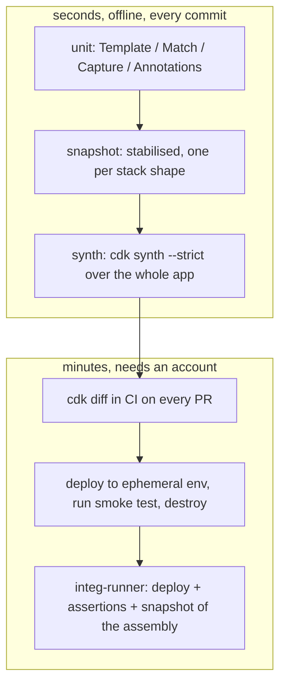

# 07 · Testing

> After this module you can prove, offline and in milliseconds, that a stack renders what its README claims — with fine-grained assertions where the claim is specific, snapshots only where they earn their keep, and assembly-level tests for Stages — and you can place each kind of test on an IaC testing pyramid that ends in a real deployment.

## Why this exists (the problem)

Infrastructure code has the worst feedback loop in software: a wrong prop surfaces twenty minutes into a CloudFormation deployment, as a rollback, in an account you had to get credentials for. Most teams respond with one of two failure modes. Either they write no tests ("it's declarative, what would I test?") and discover replacements in production, or they snapshot every template and train themselves to run `jest -u` without reading the diff — which is the same as no tests, plus noise.

The CDK's `assertions` module lets you test the *rendered template* the way you test a function's return value. The skill is knowing what to assert: the decisions (tier → retention policy), the invariants (no wildcard IAM), the contracts (an output other stacks consume), and the logical IDs that must never move. This module's test file is the deliverable; the stack exists to be tested.

## Mental model



Lower layers catch *what you wrote*; upper layers catch *what AWS does with it*. A test belongs at the lowest layer that can observe the failure.

## How it works

### 1. `Template.fromStack` synthesizes and parses

```ts
const app = new cdk.App();
const stack = new TestableStack(app, 'Testable', { tier, ...extra });
return { app, stack, template: Template.fromStack(stack) };
```

`Template.fromStack` runs the full synthesis of the *app* (aspects, validation, rendering) in a temp directory and parses that stack's JSON. Two consequences: it is the expensive call, so build once per shape in a `beforeAll`; and after it runs the tree is frozen — mutating the stack and calling it again throws. Everything in `test/07-testing.test.ts` follows that rule.

### 2. Fine-grained assertions

| Method | Matches | Use when |
|---|---|---|
| `hasResourceProperties(type, props)` | `Properties` of *some* resource of the type, partial | the common case |
| `hasResource(type, { Properties, DeletionPolicy, … })` | the whole resource object | `DeletionPolicy`, `UpdateReplacePolicy`, `DependsOn`, `Metadata`, `Condition` |
| `resourceCountIs(type, n)` | count by type | "exactly two queues" |
| `resourcePropertiesCountIs(type, props, n)` | count by type + props; `n = 0` is a negative test | "exactly one queue has a redrive policy" |
| `hasOutput / findOutputs`, `hasParameter`, `hasMapping / findMappings`, `hasCondition` | the other sections | contracts with other stacks/pipelines |
| `templateMatches(obj)` | the whole document | rarely; small stacks, or with `Match.objectLike` islands |
| `findResources(type, props?)` | returns `{ logicalId: resource }` | ad-hoc inspection, custom helpers |

`hasResource` is where `DeletionPolicy` lives — the tests `hasResource reaches outside Properties` pin `Retain` for prod and `Delete` for dev, which is the single most valuable assertion in the file: it is the one that prevents data loss when someone "simplifies" the tier logic.

### 3. `Match` — say exactly how loose you are

Default matching is `objectLike` at every level: extra keys are fine, listed keys must match. The tests exercise each matcher and one negative per matcher:

- `Match.arrayWith([...])` — an **ordered subsequence**. `[customerId, pk]` does not match `[pk, sk, customerId]`; the test proves it. Tags render sorted by key, so put `arrayWith` patterns in key order.
- `Match.arrayEquals([...])` — exact array.
- `Match.objectLike({})` / `Match.exact({})` — partial vs exact object; `exact` switches partial matching off for that subtree.
- `Match.absent()` — key must not exist (`ReservedConcurrentExecutions` when not configured).
- `Match.anyValue()` — key must exist with a non-null value (asset hashes).
- `Match.stringLikeRegexp('^Orders')` — logical IDs are `<id><hash>`; never hard-code the hash.
- `Match.not(pattern)` — inverse.
- `Match.serializedJson(pattern)` — for JSON-in-a-string (`DefinitionString`, `PolicyDocument` passed as string).

A matcher is an object with `.test(value)`; the test `a matcher can be used standalone` shows you can apply it to any JS value, which is how custom helpers stay small.

### 4. `Capture` — pull values out, assert in code

```ts
const policyDoc = new Capture();
template.hasResourceProperties('AWS::IAM::Policy', { PolicyDocument: policyDoc, Roles: [{ Ref: Match.stringLikeRegexp('^WorkerServiceRole') }] });
const statements = policyDoc.asObject().Statement;
```

`asObject()/asArray()/asString()/asNumber()/asBoolean()` type the captured value. When the pattern matched several resources, `next()` advances to the next capture and returns `false` when exhausted — the test iterates `DeletionPolicy` over both queues. A `Capture(innerPattern)` only captures values that satisfy the inner pattern, which is how you capture "the redrive policy with `maxReceiveCount: 3`" and nothing else.

### 5. `Annotations.fromStack` — test what aspects and constructs *say*

Aspects and constructs that validate report through `Annotations`, not the template. `Annotations.fromStack(stack).hasError(path, matcher)` / `hasWarning` / `hasInfo` / `findError` / `hasNoError` assert on those messages per construct path (`/Testable/Work/Resource`). The stack under test records a warning when `enableDlq: false` (`addWarningV2` — the id makes it acknowledgeable with `Annotations.of(scope).acknowledgeWarning(id, reason)`), and `EncryptedQueuesAspect` (`encrypted-queues-aspect.ts`) emits errors. Both are tested; the aspect is also tested in isolation in a throwaway `Stack` with two hand-made queues — the pattern for unit-testing any construct: the smallest tree that exercises it.

Note that a plain `new cdk.App()` does not enable `@aws-cdk/core:annotationsInValidationReport`; with it (as in this repo's `cdk.json`), an error annotation makes `synth()` throw. Module 06 covers the switch.

### 6. Snapshots, honestly

A snapshot asserts "nothing changed". That is valuable exactly once: when you refactor and intend no template change. The rest of the time it asserts nothing, because every intended change produces a diff someone approves without reading.

They are also flaky by construction. The test `a raw snapshot is hostage to asset hashes and bootstrap plumbing` shows the two moving parts in an otherwise deterministic template: `S3Key: "<sha256>.zip"` (changes when `handlers/` changes) and the `BootstrapVersion` parameter + `CheckBootstrapVersion` rule (change when the bootstrap version requirement bumps). `snapshot-helpers.ts` removes both:

```ts
export function stableSynthesizer(): cdk.DefaultStackSynthesizer {
  return new cdk.DefaultStackSynthesizer({ generateBootstrapVersionRule: false });
}
export function stabilizeAssets<T>(template: T): T   // S3Key: "<sha>.zip" → "<asset-hash>.zip"
```

Pass the synthesizer via stack props in the test, run `toJSON()` through `stabilizeAssets`, then `toMatchSnapshot()`. The committed snapshot lives in `test/__snapshots__/07-testing.test.ts.snap`. Rules of engagement: one snapshot per *stack shape* (not per tier per option), review snapshot diffs like code, and prefer `Match.anyValue()` / `stringLikeRegexp` for hashes in fine-grained tests instead of masking.

### 7. Stages: test the assembly, not just a template

Pipelines deploy Stages. What you want to know about a Stage — which stacks, which names, which env, in what order — is not in any single template; it is in the cloud assembly manifest:

```ts
const assembly = app.synth().getNestedAssembly(stage.artifactId);
assembly.stacks.map((s) => s.stackName)             // ['Dev-Config', 'Dev-Workload']
assembly.getStackByName('Dev-Workload').environment  // { account, region }
assembly.getStackByName('Dev-Config').dependencies   // includes the Workload artifact and its own `.assets` manifest
```

This is the one place `app.synth()` is called directly in tests (the brief's rule). A Stage prefixes its id onto stack *names* (`Dev-Workload`) while hierarchical ids keep the slash (`Dev/Workload`) — `cdk ls` shows the latter, `cdk deploy` accepts either. `Template.fromStack` still works on a stack inside a Stage.

### 8. Negative tests

Every optional feature needs a test that it is *absent* when off: `resourceCountIs('AWS::SQS::Queue', 1)` with `enableDlq: false`, `Match.absent()` for `ReservedConcurrentExecutions`. A suite without negatives cannot tell "the feature works" from "the feature is always on".

### 9. The upper layers (described, not runnable here)

- **`cdk synth --strict`** — fails on any *warning* annotation, not just errors. Run it in CI on the whole app; it turns "someone will notice the warning" into a build break. Warnings you accept get `Annotations.of(scope).acknowledgeWarning(id, reason)` (only `addWarningV2` warnings carry an id; `cdk acknowledge` is for CLI *notices*, a different thing).
- **`cdk diff` in CI** — on every PR, `cdk diff --app 'npx ts-node bin/app.ts' '**'` against the live stacks; exit code 1 when there are differences (`--fail`). Post the output on the PR (module 08's workflow does this). It is the only pre-deploy check that sees *drift* and *replacements* (`[-]/[+]` on the same type), because it compares against the deployed template, not the previous commit.
- **Deploy to ephemeral** — `cdk deploy` a `PreviewStage` (exercise 2) named after the PR, run a smoke test, `cdk destroy`. Catches everything synthesis cannot: IAM propagation, service quotas, regional feature gaps.
- **`@aws-cdk/integ-runner`** — the framework's own integration tests: an `integ.*.ts` file defines an `IntegTest` with `assertions` (`ExpectedResult`, `awsApiCall`), the runner deploys it, runs the assertions, snapshots the *assembly*, and destroys. The snapshot is compared on subsequent runs so that library changes which alter templates are caught without redeploying. Use it for constructs you publish; it is heavyweight for application stacks.

## Walkthrough

1. `testable-stack.ts` — the subject: bucket (tier-dependent `RemovalPolicy`), `TableV2` with a GSI, asset-backed Lambda, SQS + optional DLQ, `CfnParameter`, lazy `CfnMapping`, two outputs, a warning annotation.
2. `handlers/index.js` — the asset; edit it and watch the raw `S3Key` change.
3. `encrypted-queues-aspect.ts` — a read-only aspect used only to demonstrate `Annotations.fromStack`.
4. `snapshot-helpers.ts` — `stableSynthesizer`, `stabilizeAssets`.
5. `testable-stage.ts` — two stacks with a dependency, for assembly tests.
6. `index.ts` — `M07-Testable` (env-agnostic) and `M07-Stage` (stacks `M07-Stage-Workload`, `M07-Stage-Config`).
7. **`test/07-testing.test.ts`** — read it top to bottom; every `describe` is a README section.

```bash
cd aws-cdk
npx jest test/07-testing.test.ts            # ~30 s cold, dominated by ts-jest compile
npx jest test/07-testing.test.ts -u         # only after you have read the snapshot diff
npx cdk synth --strict M07-Testable         # warnings fail the build
npx cdk ls                                  # M07-Testable, M07-Stage/Workload, M07-Stage/Config
```

## Production notes

- **Cost of a test**: synthesis ~50–300 ms per app, plus asset staging (copies `handlers/` into the temp `cdk.out`). Share templates across tests with `beforeAll`; never synth in a loop. `ts-jest` compile time dominates cold runs; `isolatedModules`/`swc` cut it if it matters.
- **What to assert, in priority order**: removal policies per tier; IAM (no `*`, grants only to the right principals); encryption on every stateful resource; outputs/exports other stacks consume; logical-ID stability of stateful resources (exercise 3); counts of expensive resources (NAT gateways, KMS keys); conditional features present/absent.
- **Do not assert** framework internals: the exact logical-ID hash, the order of keys, the wording of auto-generated descriptions, the `CDKMetadata` resource (absent in tests, present under the CLI — a reason `templateMatches` with exact keys fails in CI).
- **Snapshot hygiene**: `stabilizeAssets` + `generateBootstrapVersionRule: false`; one snapshot per shape; the reviewer reads the `.snap` diff. A snapshot file that changes in every PR is a test to delete.
- **Version bumps**: `aws-cdk-lib` upgrades legitimately change templates (new defaults behind feature flags, new custom-resource runtimes). Expect snapshot churn on upgrade; fine-grained tests should not churn — if they do, the upgrade changed behaviour you rely on. Module 09 covers pinning flags.
- **Monitor** the ratio of `-u` runs to snapshot count in CI logs; a rising ratio means snapshots are rubber-stamped.

## Gotchas

- **`Template.fromStack` throws "Cannot synthesize twice / app already synthesized"** → you mutated the stack after synthesizing → build a new `App` per shape.
- **`arrayWith` fails on tags you can see in the template** → order-sensitive subsequence → list patterns in the rendered (sorted) order, or use one `arrayWith` per tag.
- **`hasResourceProperties` fails on `DeletionPolicy`** → it is not under `Properties` → `hasResource(type, { DeletionPolicy })`.
- **Snapshot differs between laptop and CI** → asset hash of a directory includes file modes/contents; `CDKMetadata` appears under the CLI only → stabilise assets, never snapshot a CLI-produced template against a test-produced one.
- **`Annotations.fromStack(...).hasError` passes but `cdk synth` succeeds** → CLI prints errors and exits 1 only if the flag is off; with `annotationsInValidationReport` synth itself fails → consistent either way, but set the flag in tests that assert failure.
- **Capture returns the wrong value** → the pattern matched several resources; you read the first → iterate with `next()`, or narrow the pattern (add `Roles`, a logical-ID regexp).
- **Stage test cannot find a stack by name** → `getStackByName` takes the stack *name* (`Dev-Workload`), `getStackArtifact` the artifact id (`DevWorkload8FFC2DAA`) → pick the right one; hierarchical ids (`Dev/Workload`) are neither.
- **`toMatchSnapshot` wrote a new file in CI** → `--ci` flag makes missing snapshots fail instead of writing → always run `jest --ci` in pipelines.

## Exercises

1. **No wildcard IAM (easy).** Write `expectNoWildcardIam(template)` that fails if any `Allow` statement in `AWS::IAM::Policy`, `AWS::IAM::ManagedPolicy` or inline role policies has `Action: '*'` or `Resource: '*'`. Normalise string-or-array shapes. Solution: `solutions/exercise-1-no-wildcard-iam.ts`; the test proves the worker stack is clean and a hand-made wildcard role is caught.
2. **Preview per PR (medium).** Write a `PreviewStage` that names its stacks `pr-<n>-…`, forces `RemovalPolicy.DESTROY` on everything (`RemovalPolicies.of(stage).destroy()`), tags with `preview`, and always uses the dev tier. Test it through the assembly. Solution: `solutions/exercise-2-preview-stage.ts`.
3. **Template diff (hard).** Write `diffTemplates(before, after)` returning added/removed/changed logical IDs and pairing removed+added of the same type as `suspectedReplacements`; wrap it as `expectStableLogicalIds`. Show that renaming a construct id is detected as a replacement while a property change is not. Solution: `solutions/exercise-3-template-diff.ts`.

## Checklist

- [ ] Every tier decision (`RemovalPolicy`, PITR, retention, HA) has a positive and a negative assertion.
- [ ] IAM: `expectNoWildcardIam` (or equivalent) runs on every stack.
- [ ] Outputs/exports consumed elsewhere are asserted with `hasOutput` (name + export name).
- [ ] Logical IDs of stateful resources are protected (snapshot or `expectStableLogicalIds`).
- [ ] Snapshots: stabilised, one per shape, reviewed as diffs, `jest --ci` in pipelines.
- [ ] Stages are tested through `app.synth()`; stack names and envs asserted.
- [ ] CI runs `cdk synth --strict` and `cdk diff --fail` on PRs; a deploy-to-ephemeral job exists for risky changes.
- [ ] Code review: no hard-coded logical-ID hashes; no `-u` in a PR without a snapshot diff in the description; no test that synthesizes in a loop.

## Interview angle

1. *"What do you assert in an IaC unit test, and what do you refuse to assert?"* — Assert decisions and invariants (retention, IAM, encryption, exports, counts of costly resources), because those are the things a refactor can silently flip. Refuse to assert framework-generated detail (hashes, descriptions, key order) because it churns without meaning and trains people to ignore failures.
2. *"When is a snapshot test the right tool?"* — When the intent is "no change": library upgrades, refactors, construct extraction. It needs stabilisation (asset hashes, bootstrap rule) and a reviewer who reads the diff. As a *default* test it degrades into rubber-stamping; fine-grained tests carry the intent better.
3. *"How do you test that a change will not replace the production table?"* — Three layers: a unit test that the table's logical ID is unchanged (`diffTemplates` against a committed template or snapshot), `cdk diff` in CI which shows `[-]/[+]` for replacement, and `UpdateReplacePolicy: Retain` plus `DeletionPolicy: Retain` asserted with `hasResource` so that even a mistake keeps the data.

## References

- `aws-cdk-lib/assertions` guide: https://docs.aws.amazon.com/cdk/v2/guide/testing.html
- API: `node_modules/aws-cdk-lib/assertions/lib/{template,match,capture,annotations}.d.ts`
- Cloud assembly API: `node_modules/aws-cdk-lib/cx-api/lib/legacy-moved.d.ts` (`CloudAssembly`, `CloudFormationStackArtifact`)
- `cdk synth --strict`, `cdk diff --fail`: https://docs.aws.amazon.com/cdk/v2/guide/ref-cli-cmd.html
- integ-runner: https://github.com/aws/aws-cdk/tree/main/packages/%40aws-cdk/integ-runner and `@aws-cdk/integ-tests-alpha`
- Jest snapshot testing: https://jestjs.io/docs/snapshot-testing
