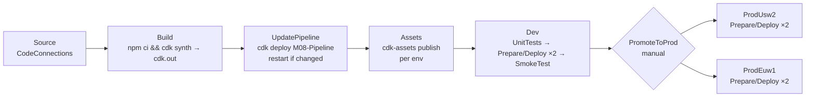

# 08 · Pipelines & CI/CD

> After this module you can ship a CDK app through a self-mutating CodePipeline with unit-test gates, smoke tests fed by stack outputs, a manual approval and parallel regional waves — or through GitHub Actions with OIDC and no long-lived keys — and you can argue which of the two a given team should pick.

## Why this exists (the problem)

`cdk deploy` from a laptop is how every CDK app starts and how too many stay. It couples production to one person's credentials, their `node_modules`, and their memory of which stacks to deploy in which order. Then the second environment arrives, and the third account, and someone runs `cdk deploy --all` with the wrong `AWS_PROFILE`.

CDK's answer is that a *pipeline is just another stack*: the same app that defines the workload defines the delivery machinery, deploys it once, and from then on the pipeline updates itself from source before it deploys anything else. The alternative — a generic CI system running the CLI — is simpler to reason about and fits teams that already live in GitHub. Both need the same three things to be safe: short-lived credentials, a diff before a deploy, and a gate before production.

## Mental model



The cloud assembly produced by Build is the *only* artefact. Every later action consumes it; nothing after Build runs TypeScript or `npm`. The pipeline is a deterministic function of one commit.

## How it works

### 1. The deployable unit is a Stage

`app-stage.ts`: `AppStage extends cdk.Stage` holds `QueueStack` and `FunctionStack` (Lambda from a file asset, SQS event source, one `CfnOutput`). A pipeline never deploys a bare Stack; it deploys a Stage, which is a self-contained nested cloud assembly (`cdk.out/assembly-M08-Pipeline-Dev/`) with its own stacks, assets and dependency graph. The pipeline reads that graph to order Prepare/Deploy actions — the test `Dev stage: … Prepare/Deploy per stack in dependency order` shows Queue before Function because Function imports the queue ARN.

### 2. `pipelines.CodePipeline` — what each prop buys you

`pipeline-stack.ts`:

```ts
this.pipeline = new pipelines.CodePipeline(this, 'Pipeline', {
  pipelineType: codepipeline.PipelineType.V2,
  synth: new pipelines.ShellStep('Synth', {
    input: source,
    installCommands: ['npm ci'],
    commands: ['npx cdk synth --quiet'],
    primaryOutputDirectory: 'aws-cdk/cdk.out',
  }),
  dockerEnabledForSynth: false,
  crossAccountKeys: props.devEnv.account !== props.prodAccount,
  selfMutation: true,
  useChangeSets: true,
  publishAssetsInParallel: true,
});
```

| Prop | Effect | Decide by |
|---|---|---|
| `synth` | The Build project. `installCommands` → `install` phase, `commands` → `build`, `primaryOutputDirectory` → the artifact. | Monorepo layout; here the app is under `aws-cdk/`. |
| `pipelineType: V2` | Variables, triggers, stage conditions. The `defaultPipelineTypeToV2` flag makes V2 default under `cdk.json`, but a bare `new App()` renders V1 — set it explicitly so templates do not depend on context. | Always V2 for new pipelines. |
| `dockerEnabledForSynth` | Privileged mode on the synth CodeBuild project. | Only if synth bundles in Docker (`DockerImageAsset`, Docker bundling). Slower builds otherwise. |
| `crossAccountKeys` | A customer-managed KMS key on the artifact bucket so other accounts' deploy roles can decrypt artifacts. ~$1/month plus key-policy plumbing. | `true` iff any stage is in another account (the test `crossAccountKeys follows …` asserts 1 vs 0 keys). The `crossAccountKeysDefaultValueToFalse` flag already defaults it off. |
| `selfMutation` | The UpdatePipeline stage. | `true` unless the pipeline stack is deployed by something else. |
| `useChangeSets` | Prepare (`CHANGE_SET_REPLACE`) + Deploy (`CHANGE_SET_EXECUTE`) per stack vs one direct-deploy action. | Keep change sets: they are what a `ConfirmPermissionsBroadening` step or a human inspects. Turn off only to shave ~30 s/stack in a pipeline nobody gates. |
| `publishAssetsInParallel` | One CodeBuild action per asset vs one for all. | Parallel unless you hit CodeBuild concurrency quotas. |

### 3. Self-mutation

The `UpdatePipeline` stage runs, from the fresh assembly, `cdk -a . deploy M08-Pipeline --require-approval=never --verbose` (test: `self-mutation: UpdatePipeline deploys the pipeline stack …`). If the pipeline's own template changed — you added a stage, a step, a region — CloudFormation updates it and CodePipeline restarts the execution (`RestartExecutionOnUpdate: true`) so the *new* pipeline processes the same commit. The practical rule that falls out of this: **you `cdk deploy` the pipeline stack exactly once**, from a laptop or a bootstrap job, and never again. All later changes arrive through source.

Why it matters: without self-mutation, pipeline definition and workload definition drift; the pipeline that deploys commit N was defined at commit N−k. With it, the pipeline is versioned with the code it deploys, and a PR that adds a prod region is reviewed like any other PR.

### 4. Assets and `cdk-assets`

The Assets stage has one action per asset (`Consumer_Code` here). Each runs `cdk-assets --path <assembly>/<stack>.assets.json publish <assetId>:<destination>` — the asset manifest lists, per asset, a destination per target environment (bucket `cdk-hnb659fds-assets-<account>-<region>`, an `assumeRoleArn` for `cdk-hnb659fds-file-publishing-role-<account>-<region>`). The publishing CodeBuild project's role can assume exactly those roles. Publishing happens *before* any stack deploys, and is idempotent (objects are keyed by content hash), so a rerun costs nothing.

Cross-region deploys additionally need a CodePipeline artifact bucket **in each target region**; CDK generates `M08-Pipeline-support-us-west-2` / `-eu-west-1` stacks in the *pipeline* account for that (test: `stages inside the pipeline are nested assemblies …`). They must be deployed before the pipeline stack; `cdk deploy M08-Pipeline` does it automatically because they are dependencies.

### 5. Steps: `pre`, `post`, `envFromCfnOutputs`, approvals, waves

```ts
this.pipeline.addStage(this.dev, {
  pre:  [new pipelines.ShellStep('UnitTests', { input: source, installCommands: ['npm ci'], commands: ['npm test -w aws-cdk -- --ci'] })],
  post: [new pipelines.ShellStep('SmokeTest', {
    envFromCfnOutputs: { FUNCTION_NAME: this.dev.functionStack.functionNameOutput },
    commands: ['aws lambda invoke --function-name "$FUNCTION_NAME" …'],
  })],
});
const prodWave = this.pipeline.addWave('Prod', { pre: [new pipelines.ManualApprovalStep('PromoteToProd', { comment })] });
for (const region of props.prodRegions) prodWave.addStage(new AppStage(this, `Prod${…}`, { tier: ENVIRONMENTS.prod, env: { account: props.prodAccount, region } }));
```

- A `ShellStep` with an `input` gets that file set (the source, for unit tests); without one it gets the cloud assembly.
- `envFromCfnOutputs` is the only sane way to pass "what did we just deploy" into a test: CDK sets a `Namespace` on the Function deploy action and injects `#{<namespace>.FunctionName}` as an environment variable of the smoke-test project (test: `envFromCfnOutputs wires a stack output …`). No SSM lookups, no hard-coded names.
- `ManualApprovalStep` in a wave's `pre` gates every stage in the wave with one approval. `Wave` stages run in parallel: the test shows both prod regions' `Queue.Prepare` at `RunOrder 2`.
- The smoke test here targets the dev stage, which is in the pipeline's own account; a post-step against another account must assume a role there (a `CodeBuildStep` with `rolePolicyStatements`, see exercise 2) because steps run in the pipeline account.

### 6. Cross-account deploys need trust, granted at bootstrap

Each prod action carries `Region: us-west-2` and `RoleArn: arn:aws:iam::222222222222:role/cdk-hnb659fds-deploy-role-222222222222-us-west-2`. That role exists only if the prod account was bootstrapped **trusting the pipeline account**:

```bash
# in the pipeline account (111111111111), once per region the pipeline itself uses
npx cdk bootstrap aws://111111111111/us-east-1

# in each prod account/region, trusting the pipeline account
npx cdk bootstrap aws://222222222222/us-west-2 aws://222222222222/eu-west-1 \
  --trust 111111111111 \
  --cloudformation-execution-policies arn:aws:iam::aws:policy/AdministratorAccess
```

`--trust` adds the pipeline account to the trust policy of the deploy/publishing/lookup roles; `--cloudformation-execution-policies` is what CloudFormation itself runs with — scope it down with a customer policy in real life (module 09 shows the qualifier variant).

### 7. GitHub Actions + OIDC instead

`github-oidc-stack.ts` creates:

1. `iam.OidcProviderNative` for `https://token.actions.githubusercontent.com`, audience `sts.amazonaws.com`, **no thumbprint** (IAM validates GitHub's chain against its own trust store; a pinned thumbprint breaks at the next certificate rotation). It renders the native `AWS::IAM::OIDCProvider`; the older `iam.OpenIdConnectProvider` L2 is a custom-resource Lambda from before CloudFormation supported the type — the test asserts zero Lambda functions.
2. A role trusting `sts:AssumeRoleWithWebIdentity` with `aud == sts.amazonaws.com` and `sub ∈ { repo:o/r:ref:refs/heads/main, repo:o/r:environment:prod }`. **The `sub` condition is the entire security model**; without it any repository on GitHub could assume the role.
3. A policy allowing only `sts:AssumeRole` on `cdk-<qualifier>-*-role-*`, conditioned on the bootstrap roles' `aws-cdk:bootstrap-role` tag. The CLI does all real work through the bootstrap roles; the GitHub role itself can do nothing else.

`.github-workflows-example/cdk-deploy.yml` (a complete workflow, kept out of the repo's real `.github/` on purpose):

- `permissions: id-token: write` — required to mint the OIDC token.
- `aws-actions/configure-aws-credentials@v4` with `role-to-assume: ${{ vars.CDK_DEPLOY_ROLE_ARN }}` (the stack output).
- **PR job**: `cdk synth --strict`, `cdk diff --app cdk.out --all --fail`, output posted (and updated, via a marker comment) on the PR, then `cdk diff --security-only --fail` as a hard stop. Concurrency group per PR with `cancel-in-progress: true`.
- **main job**: `cdk deploy --app cdk.out --all --require-approval never --concurrency 4`, in a GitHub Environment `prod` (required reviewers = the GHA `ManualApprovalStep`), concurrency group `cdk-deploy-main` with `cancel-in-progress: false` — cancelling a running `cdk deploy` leaves CloudFormation mid-update.

Secrets handling: there are none. No access keys in GitHub, no `AWS_SECRET_ACCESS_KEY` anywhere (the test greps for it). Application secrets stay in Secrets Manager/SSM and are referenced from templates (`SecretValue.secretsManager`, dynamic references), never passed through the workflow. The CodeConnections ARN for the CodePipeline variant is a *context* value or an SSM parameter, not code.

### 8. Pipeline vs GitHub Actions — the decision

| | `pipelines.CodePipeline` | GitHub Actions + OIDC |
|---|---|---|
| Runs where | Your AWS account; no data leaves | GitHub runners; the OIDC token is the only credential |
| Self-mutating | Yes; pipeline versioned with app | Workflow file versioned with app; nothing to mutate |
| Cross-account | Native (bootstrap `--trust`, per-account roles) | Same bootstrap trust; the GHA role assumes bootstrap roles |
| Approvals | `ManualApprovalStep`, `ConfirmPermissionsBroadening` | GitHub Environments with reviewers; `cdk diff --security-only --fail` |
| Diff on PR | Possible (exercise 2) but awkward — pipelines start from a push to a branch | Natural |
| Parallel regions | `Wave` | Matrix jobs |
| Cost | CodePipeline ~$1/pipeline/month + CodeBuild minutes; artifact bucket, KMS key | Runner minutes |
| Failure modes | Pipeline stuck on a failed self-mutation; needs `cdk deploy` from a laptop once to unstick | Runner network egress, rate limits, `concurrency` misconfiguration |
| Pick when | Org mandates in-account CI, multi-account with many stages, no GitHub | Team already ships from GitHub, wants PR diffs, few environments |

## Walkthrough

1. `app-stage.ts` — `AppStage`, `QueueStack`, `FunctionStack`, the `FunctionName` output; `handlers/index.js` is the asset.
2. `pipeline-stack.ts` — the pipeline; read the prop comments.
3. `github-oidc-stack.ts` — provider + deploy role.
4. `.github-workflows-example/cdk-deploy.yml` — the alternative.
5. `index.ts` — `M08-Pipeline` and `M08-GitHubOidc`; both need the concrete env from context.
6. `test/08-pipelines-and-cicd.test.ts` — asserts stage/action names, run orders, buildspecs, roles, the workflow file.

```bash
cd aws-cdk
npx cdk ls                                  # M08-Pipeline, M08-Pipeline-support-*, M08-GitHubOidc, M08-Pipeline/Dev/Queue, …
npx cdk synth M08-Pipeline --quiet
npx jest test/08-pipelines-and-cicd.test.ts
# first and only manual deploy of the pipeline (needs a real CodeConnections ARN):
npx cdk deploy M08-Pipeline -c cdk-mastery:connectionArn=arn:aws:codeconnections:...
```

## Production notes

- **Bootstrap is the trust boundary.** `--trust` decides which account may deploy into which; review bootstrap changes like IAM changes. Re-bootstrap after CLI upgrades that bump the template version (`cdk bootstrap` is idempotent).
- **Pipeline stuck**: a bad self-mutation (e.g. a synth error in the pipeline stack) means the pipeline cannot fix itself. Fix in source, then `cdk deploy M08-Pipeline` from a laptop once.
- **Costs**: CodePipeline V2 bills per action-minute; the Assets stage with many small assets adds up — `publishAssetsInParallel: false` batches them. The artifact bucket accumulates every execution's artifacts and has no expiry by default; pass your own `artifactBucket` with a lifecycle rule.
- **Runtime versions**: Synth runs on CodeBuild's default image; pin Node with `codeBuildDefaults.buildEnvironment.buildImage` and `.nvmrc`, or a green build today is red on the next image rollout.
- **`--require-approval never`** is correct in automation *only* because a human gate exists upstream (PR review, GitHub Environment, `ManualApprovalStep`). Without one it is `sudo` with no prompt.
- **Monitor**: pipeline execution failures (EventBridge `CodePipeline Pipeline Execution State Change` → SNS), time-in-approval, and asset publishing duration. A growing Assets stage is a sign that bundling belongs in synth, not per-deploy.
- **Security footguns**: an OIDC trust policy with `sub` on `StringLike: repo:org/*`; a deploy role with `AdministratorAccess` instead of bootstrap-role assumption; `pull_request_target` workflows running fork code with deploy credentials.

## Gotchas

- **`Cannot synthesize env-agnostic pipeline`** → pipeline stack without `env` → give it a concrete account/region.
- **Pipeline created, first run fails at UpdatePipeline with AccessDenied** → the pipeline account is not trusted by the target account, or the target is not bootstrapped → `cdk bootstrap --trust`.
- **`Stack M08-Pipeline-support-us-west-2 must be deployed first`** → cross-region stages need per-region artifact buckets → deploy the support stacks (a plain `cdk deploy M08-Pipeline` does, since they are dependencies).
- **Tests see `PipelineType: V1`** → the V2 default is a feature flag not visible to a bare `new App()` → set `pipelineType` explicitly.
- **Smoke test gets an empty `$FUNCTION_NAME`** → the output is on a stack the step does not depend on, or the step ran before the deploy → put the step in `post` of the stage that owns the output.
- **`cdk diff` in a pipeline step says "no credentials"** → a `ShellStep` cannot assume bootstrap roles → use `CodeBuildStep` with `rolePolicyStatements` (exercise 2).
- **GitHub says `Not authorized to perform sts:AssumeRoleWithWebIdentity`** → `sub` claim mismatch: PR workflows have `sub = repo:o/r:pull_request`, environment jobs `repo:o/r:environment:<name>`, branch pushes `repo:o/r:ref:refs/heads/<branch>` → add the right pattern or split roles (exercise 3).
- **Two merges to main deployed concurrently and one rolled back** → no concurrency group → `concurrency: { group: cdk-deploy-main, cancel-in-progress: false }`.

## Exercises

1. **Gate on permissions broadening only (easy).** Replace the blanket manual approval with `ConfirmPermissionsBroadening`, so a human is paged only when the change set widens IAM or security-group access. Solution: `solutions/exercise-1-permissions-gate.ts` — it renders as `SecurityCheck.Check` + `SecurityCheck.Confirm`.
2. **A `cdk diff` step in the pipeline (medium).** Write a `CodeBuildStep` that runs `cdk diff --app . '<stage path>/**' --fail` against the target account, with a `rolePolicyStatements` entry allowing `sts:AssumeRole` on the bootstrap lookup/deploy roles. Solution: `solutions/exercise-2-diff-step.ts`.
3. **Split OIDC roles (hard).** Create two roles: a diff role trusted only by `repo:o/r:pull_request` tokens that may assume lookup+deploy roles, and a deploy role trusted only by `main`/`environment:prod` that may assume all four bootstrap roles. Solution: `solutions/exercise-3-split-oidc-roles.ts`.

## Checklist

- [ ] The pipeline stack has a concrete `env`; every target account is bootstrapped with `--trust <pipeline account>` and a scoped `--cloudformation-execution-policies`.
- [ ] `selfMutation: true`; the pipeline stack was deployed manually exactly once.
- [ ] Unit tests run as a `pre` step of the first stage; a smoke test fed by `envFromCfnOutputs` runs as `post`.
- [ ] Production is behind `ManualApprovalStep` or `ConfirmPermissionsBroadening`; regional stages are a `Wave`.
- [ ] `crossAccountKeys` matches reality; `dockerEnabledForSynth` is off unless needed.
- [ ] GHA: OIDC only, `sub`-conditioned trust, role limited to bootstrap-role assumption, `cdk diff` on PRs, concurrency groups on deploys.
- [ ] Code review: no `AdministratorAccess` on CI roles; no `--require-approval never` without an upstream gate; no `cancel-in-progress: true` on a deploy job.

## Interview angle

1. *"What does 'self-mutating' buy you and what does it cost?"* — Pipeline definition versioned with the app, reviewed in PRs, no drift between the pipeline and what it deploys. Cost: one more stage per execution, and a broken pipeline stack cannot repair itself — you need an out-of-band `cdk deploy` once.
2. *"Walk me through what happens between `git push` and a Lambda update in another account."* — Source → synth (assembly) → self-mutate → `cdk-assets` publishes the zip to the target account's bootstrap bucket by assuming its file-publishing role → Prepare creates a change set by assuming the target deploy role, CloudFormation executes it with the execution role → the function's `S3Key` points at the published hash.
3. *"CodePipeline or GitHub Actions?"* — Answer with the decision table: where credentials live, who needs PR diffs, how many accounts, and whether the org allows CI outside AWS. Both need OIDC/bootstrap trust, a diff, and a gate; the rest is ergonomics.

## References

- CDK Pipelines: https://docs.aws.amazon.com/cdk/v2/guide/cdk_pipeline.html and `aws-cdk-lib/pipelines/lib/**/*.d.ts`
- Bootstrapping and trust: https://docs.aws.amazon.com/cdk/v2/guide/bootstrapping-env.html
- cdk-assets: https://github.com/cdklabs/cdk-assets
- GitHub OIDC with AWS: https://docs.github.com/en/actions/security-for-github-actions/security-hardening-your-deployments/configuring-openid-connect-in-amazon-web-services
- `aws-actions/configure-aws-credentials`: https://github.com/aws-actions/configure-aws-credentials
- CodePipeline V2: https://docs.aws.amazon.com/codepipeline/latest/userguide/pipeline-types.html
