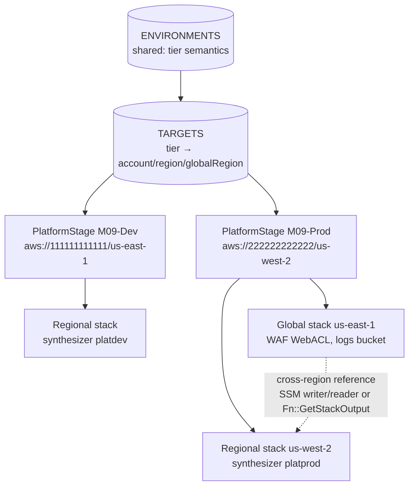

# 09 · Multi-account & multi-region

> After this module you can model every environment as `Stage × Environment` driven by one config table, bind each tier to its own bootstrap (qualifier, roles, buckets), pass values between regions and understand the two mechanisms CDK uses to do it, and manage feature flags as the pinned contract they are.

## Why this exists (the problem)

The first CDK app has one stack and one account. The second environment arrives as `if (isProd)` scattered through constructors; the second region as copy-pasted stacks with `-usw2` suffixes; the second account as a `deploy.sh` that switches profiles. Six months later nobody can answer "what is deployed where, with which permissions, from which bootstrap?" without reading shell history.

CDK has primitives for each axis — `Stage` for grouping, `Environment` for account/region, `DefaultStackSynthesizer` for the bootstrap contract, feature flags for library behaviour — and they compose. The work is deciding, once, how business tiers (`dev`/`staging`/`prod` from `@cdk-mastery/shared`) map onto AWS coordinates, and then letting everything derive from that table.

## Mental model



`Stage × Environment`: the *Stage* is the shape (which stacks), the *Environment* is the coordinates (which account/region). One class, many instances; the table is the only place coordinates live.

## How it works

### 1. One table drives everything — `targets.ts`

```ts
export const TARGETS: Record<EnvironmentName, DeploymentTarget> = {
  dev:     { tier: ENVIRONMENTS.dev,     env: { account: '111111111111', region: 'us-east-1' } },
  staging: { tier: ENVIRONMENTS.staging, env: { account: '111111111111', region: 'us-east-2' } },
  prod:    { tier: ENVIRONMENTS.prod,    env: { account: '222222222222', region: 'us-west-2' }, globalRegion: 'us-east-1' },
};
```

`targetFor(name, app)` layers context on top (`-c cdk-mastery:prod-account=333333333333`) so the same code deploys to a sandbox without edits — the test `context overrides the account/region of a tier` proves the static table stays untouched. Exercise 1 validates the table itself.

### 2. `PlatformStage` — `platform-stage.ts`

```ts
super(scope, id, { ...props, env: props.target.env });
if (globalRegion) this.global = new GlobalStack(this, 'Global', { env: { account: env.account, region: globalRegion }, stackName: …, synthesizer: platformSynthesizer(tier), crossRegionReferences: true });
this.regional = new RegionalStack(this, 'Regional', { env, stackName: …, synthesizer: platformSynthesizer(tier), crossRegionReferences: true, edgeWebAclArn: this.global?.webAclArn, edgeLogsBucketArn: this.global?.edgeLogsBucket.bucketArn });
```

Instantiated twice in `index.ts` (`M09-Dev`, `M09-Prod`); prod gets a global stack because its target says so. Stacks inherit the Stage's `env`; the module passes it explicitly anyway so `RegionalStack`'s account guard can run.

**Stack naming.** The construct id is the hierarchical id `cdk ls` prints (`M09-Prod/Regional`); `stackName` is what CloudFormation shows (`revan-platform-prod-regional-usw2`, built with `resourceName` + `regionShortCode`). Set it when humans read the console and when the name must encode the region; the default `<StageName>-<Id>` is fine for pipelines. The test asserts both forms from the assembly.

### 3. Account/region assertions and tokens — `regional-stack.ts`

```ts
if (!cdk.Token.isUnresolved(this.account) && this.account !== target.env.account) throw new Error(…);
bucketName: `${resourceName({…})}-${cdk.Aws.ACCOUNT_ID}-${cdk.Aws.REGION}`,
```

`Stack.of(this).account` is a literal string when the stack has a concrete env and a token (`${Token[AWS.AccountId.N]}`) otherwise; comparing a token to a string is always false, so guard with `Token.isUnresolved`. `Aws.ACCOUNT_ID` / `Aws.REGION` render as `{ "Ref": "AWS::AccountId" }` — the account never appears literally in *your* resources (the test checks; CDK's own export-reader role policy does embed it, legitimately, to scope SSM ARNs).

### 4. Cross-region references — the mechanism

`GlobalStack` (us-east-1) owns a CLOUDFRONT-scoped `CfnWebACL` and an S3 logs bucket; `RegionalStack` (us-west-2) stores both ARNs in SSM parameters. `Fn::ImportValue` is region-scoped, so CloudFormation cannot express this; CDK synthesizes one of two bridges depending on the reference **strength**, a context flag read on the *consumer* (`@aws-cdk/core:defaultCrossStackReferences`):

| | `"strong"` (default with no context) | `"weak"` (this repo's `cdk.json`) |
|---|---|---|
| Producer (us-east-1) | `Custom::CrossRegionExportWriter` — a Lambda that writes each value to SSM `/cdk/exports/<consumer stack>/<name>` **in the consumer's region**; its role may only touch `ssm:us-west-2:…:parameter/cdk/exports/*` | a plain `Output` (`PublishOutput…`) |
| Consumer (us-west-2) | `Custom::CrossRegionExportReader` — reads the parameters, exposes them via `Fn::GetAtt`, depends on the producer | `Fn::GetStackOutput { StackName, Region, OutputName }` — a newer intrinsic, no Lambdas, no SSM |
| Coupling | producer cannot be deleted while consumers import | none; consumers may briefly reference a missing stack |
| Migration | — | `strong → both` (deploy) `→ weak` (deploy) |

Both are pinned by tests (`strong mode …`, `weak mode …`). The strong mode's custom resources are also why CDK warns about the 4096-byte custom-resource response limit: many exports with long stack names can overflow it.

**`crossRegionReferences: true` in 2.269.** Reference wiring is now automatic for any token (`CfnWebACL.attrArn` crosses regions with no prop at all). The stack prop still gates one thing: the name/ARN *attributes of L2 `Resource`s* (`bucket.bucketArn`, `table.tableName`). Across environments those fall back to the resource's **physical name** unless the prop is `true` on both stacks — and with no explicit physical name the fallback is the synth error `Cannot use resource 'G/EdgeLogs' in a cross-environment fashion`. The test `crossRegionReferences: L1 attributes cross regions regardless; L2 name/ARN attributes need the prop` shows all three outcomes. Set the prop on every stack that takes part in a cross-region reference and stop thinking about it. Cross-*account* references are always weak (`Fn::GetStackOutput` plus a role) and require a synthesizer with a CloudFormation execution role.

### 5. Synthesizer and bootstrap — `synthesizer.ts`

```ts
new cdk.DefaultStackSynthesizer({
  qualifier: qualifierFor(tier),                       // platdev | platstg | platprod
  fileAssetsBucketName: 'cdk-${Qualifier}-assets-${AWS::AccountId}-${AWS::Region}',
  deployRoleArn: 'arn:${AWS::Partition}:iam::${AWS::AccountId}:role/cdk-${Qualifier}-deploy-role-${AWS::AccountId}-${AWS::Region}',
  cloudFormationExecutionRole: …, fileAssetPublishingRoleArn: …, imageAssetPublishingRoleArn: …, lookupRoleArn: …,
  bootstrapStackVersionSsmParameter: '/cdk-bootstrap/${Qualifier}/version',
  generateBootstrapVersionRule: true,
});
```

The synthesizer is the *contract with the bootstrap stack*: it decides where assets are uploaded and which roles the CLI/pipeline assume, and it writes those decisions into the cloud assembly manifest (`assumeRoleArn`, `cloudFormationExecutionRoleArn`, `stackTemplateAssetObjectUrl`, `bootstrapStackVersionSsmParameter` — the test reads them back). The CLI *reads* the manifest; it does not compute role names. Placeholders `${Qualifier}`, `${AWS::AccountId}`, `${AWS::Region}` are substituted by the synthesizer at synth time, not by CloudFormation.

A qualifier per tier (≤ 10 alphanumerics) means two bootstraps can coexist in one account/region with different execution policies, and an SCP can restrict which qualifier's roles a pipeline may assume. The matching bootstrap, once per account/region:

```bash
npx cdk bootstrap aws://222222222222/us-west-2 aws://222222222222/us-east-1 \
  --qualifier platprod \
  --trust 111111111111 \
  --cloudformation-execution-policies arn:aws:iam::222222222222:policy/cdk-exec-prod \
  --toolkit-stack-name CDKToolkit-platprod
```

`--trust` names the account whose principals may assume the deploy/publishing/lookup roles (the pipeline account). `--cloudformation-execution-policies` is what CloudFormation runs with; `AdministratorAccess` to start, a scoped customer policy for prod. A template synthesized for `platprod` fails fast in an account bootstrapped only with the default qualifier: the `CheckBootstrapVersion` rule reads `/cdk-bootstrap/platprod/version` and it does not exist.

### 6. `cdk.json`, `cdk.context.json` and per-env context

- `cdk.json` — the app command and **feature flags** plus stable project context (`cdk-mastery:account`). Committed.
- `cdk.context.json` — the cache of *lookups* (`Vpc.fromLookup`, AMI ids, hosted zones), keyed by account/region. Committed too, so CI synthesizes without lookup permissions and so a deploy is reproducible; refreshed deliberately with `cdk context --reset <key>`.
- Per-environment values that are not lookups (accounts, connection ARNs) belong in the table or in `-c` context, never in `cdk.context.json`.

### 7. Feature flags — `feature-flags.ts`

Flags are context and nothing else: `cdk.json` → `CDK_CONTEXT_JSON` → `App` → `FeatureFlags.of(scope).isEnabled(flag)`. Three consequences the tests pin:

1. A bare `new cdk.App()` sets **none** of them; it renders v2 unconfigured defaults. Pass `context` in tests whose behaviour depends on a flag.
2. Upgrading `aws-cdk-lib` is safe *because* new flags are opt-in: the unconfigured value is the old behaviour. `cdk.json` is the pin. `missingRecommendedFlags(app)` compares `cxapi.CURRENTLY_RECOMMENDED_FLAGS` against the App's context — the in-process `cdk flags`. The test asserts the exact list of recommended flags this repo does *not* pin (one today); review that list on every upgrade and adopt flags one at a time, reading the `cdk diff`.
3. `FeatureFlags.isEnabled` is boolean-only and throws on string-valued flags (`defaultCrossStackReferences`); `flagValue()` reads raw context for those.

CLI: `cdk flags` lists all flags with recommended vs configured values; `cdk flags <name> --set --value true` edits `cdk.json`; `cdk flags --set --unconfigured --recommended` adopts every unconfigured recommended flag; `--safe` only those that cannot change your templates.

### 8. StackSets, Organizations and Control Tower (described)

- **StackSets** deploy one template to many accounts/regions *outside* the CDK dependency graph: no references into or out of the set, parameters only, no per-target gates. Right for org-wide baselines (Config recorders, GuardDuty, IAM roles, the CDK bootstrap itself via a StackSet of the bootstrap template). CDK can *define* a StackSet (`CfnStackSet`, or `cdk-stacksets` from cdklabs) but the targets are opaque to the app. Workload stacks belong in a Stage (exercise 3 is the CDK-native fan-out).
- **Organizations / Control Tower** own account creation, OUs and SCPs. The interplay with this module: Control Tower's Account Factory creates the account; a bootstrap StackSet (or a `cdk bootstrap` step in the pipeline that creates accounts) makes it CDK-ready with the right `--trust`; SCPs deny `iam:CreateRole` without the permissions boundary (module 06) and restrict regions to the allow-list your table (exercise 1) also enforces; the pipeline account is the only one trusted by every workload account.

## Walkthrough

1. `targets.ts` — `DeploymentTarget`, `TARGETS`, `targetFor` with context overrides, `envUri`.
2. `synthesizer.ts` — `qualifierFor`, `platformSynthesizer`, the bootstrap commands.
3. `global-stack.ts` — us-east-1 only; L1 attribute (`webAclArn`) and L2 resource (`edgeLogsBucket`) on purpose.
4. `regional-stack.ts` — account/region guard, `Aws.*` tokens, cross-region consumers.
5. `platform-stage.ts` — `Stage × Environment`; naming; `crossRegionReferences`.
6. `feature-flags.ts` — `missingRecommendedFlags`, `flagValue`.
7. `index.ts` — `M09-Dev`, `M09-Prod`.
8. `test/09-multi-account-and-multi-region.test.ts` — assembly manifests, both reference strengths, synthesizer contract, flags.

```bash
cd aws-cdk
npx cdk ls                                     # M09-Dev/Regional, M09-Prod/Global, M09-Prod/Regional
npx cdk synth 'M09-Prod/**' --quiet            # weak references (cdk.json): Fn::GetStackOutput
npx cdk synth 'M09-Prod/**' -c @aws-cdk/core:defaultCrossStackReferences=strong --quiet   # custom resources
npx cdk synth -c cdk-mastery:prod-account=333333333333 'M09-Prod/**'
npx cdk flags
npx jest test/09-multi-account-and-multi-region.test.ts
```

## Production notes

- **One bootstrap per (account, region, qualifier).** Track bootstrap template versions; `cdk bootstrap` is idempotent, re-run it after CLI upgrades. The `CheckBootstrapVersion` rule is your early warning — do not disable it outside tests.
- **Scope the execution policy.** `--cloudformation-execution-policies` with `AdministratorAccess` means any template deployed through that bootstrap is admin. Prod gets a customer-managed policy; the permissions boundary from module 06 caps roles the templates create.
- **Reference strength migration** is a two-step deploy (`both`, then `weak`); doing it in one step orphans consumers. Weak references remove the "deadly embrace" (producer cannot remove an export while consumers exist) but move the safety to *you*: deleting a producer stack no longer fails, it breaks consumers on their next update.
- **Strong cross-region references cost** two Lambdas per stack pair and are bounded by the 4 KB custom-resource response; keep exported values few and stack names short.
- **Region allow-lists** belong in three places: the table (exercise 1, fails synth), an SCP (`aws:RequestedRegion`, fails the API), and the bootstrap (only bootstrapped regions can be deployed to).
- **Monitor** drift between the table and reality: a scheduled `cdk diff` per Stage; CloudTrail `AssumeRole` on `cdk-*-deploy-role-*` by principals outside the pipeline account.

## Gotchas

- **`Cross stack/region references are only supported for stacks with an explicit region defined`** → an env-agnostic stack on one side → give both stacks concrete `env`.
- **`Cannot use resource 'X' in a cross-environment fashion, the resource's physical name must be explicit`** → an L2 name/ARN attribute crossed environments without `crossRegionReferences: true` → set the prop on both stacks (or give the resource an explicit physical name if you really want name-based coupling).
- **Deploy fails with `SSM parameter /cdk-bootstrap/platprod/version not found`** → the account/region was bootstrapped with the default qualifier → bootstrap with `--qualifier platprod` (or set `@aws-cdk/core:bootstrapQualifier` context to match what exists).
- **`AccessDenied` assuming `cdk-platprod-deploy-role-…`** → bootstrap without `--trust <pipeline account>` → re-bootstrap with `--trust`.
- **Tests render `Fn::ImportValue`/custom resources but `cdk synth` renders `Fn::GetStackOutput`** → tests use a bare `App` (strong), `cdk.json` says weak → pass the flag in `context` when the mechanism matters.
- **`FeatureFlags.of(x).isEnabled` throws `should be boolean, got 'string'`** → string-valued flag → read `node.tryGetContext(flag)` (see `flagValue`).
- **Stack name collision across regions** → default `<Stage>-<Id>` ignores region → include `regionShortCode(region)` in `stackName` (exercise 3 asserts uniqueness).
- **`GlobalStack must be deployed to us-east-1`** → someone changed `globalRegion` or passed the wrong env → CLOUDFRONT-scoped WAF and CloudFront certificates only exist in us-east-1.

## Exercises

1. **Validate the table (easy).** Write `validateTargets(targets, allowedRegions)` returning violations for malformed accounts/regions, regions outside the allow-list, `globalRegion` not us-east-1, and prod sharing an account with a non-prod tier. Solution: `solutions/exercise-1-validate-targets.ts`.
2. **Region-dependent config for env-agnostic stacks (medium).** Write a `RegionConfig` construct over `CfnMapping` that returns `Fn::FindInMap` on `AWS::Region` when the region is a token, the literal when it is concrete, and throws at synth when a concrete region is not covered. Solution: `solutions/exercise-2-region-config.ts` — note why `Stack.of(this).region` is passed instead of `Aws.REGION`.
3. **Multi-region fan-out (hard).** Write `MultiRegionStage` that deploys the regional stack to a primary and N replica regions with unique names and the tier's synthesizer, plus one global stack in us-east-1 referenced from every region. Assert the assembly: N+1 stacks, distinct names, one writer with N target regions. Solution: `solutions/exercise-3-multi-region-stage.ts`.

## Checklist

- [ ] Every account/region lives in `TARGETS`; nothing else in the app hard-codes coordinates.
- [ ] Every stack that crosses environments has a concrete `env` and `crossRegionReferences: true`.
- [ ] Reference strength is set explicitly in `cdk.json` (`weak` here) and tests pass the same context where it matters.
- [ ] Each tier has its own qualifier; bootstrap commands are documented with `--trust` and a scoped execution policy.
- [ ] Stack names encode tier and region; hierarchical ids stay stable.
- [ ] `missingRecommendedFlags` runs in CI against `cdk.json`; the exception list is reviewed on every upgrade.
- [ ] Code review: no `if (account === '222222222222')`; no `Stack.of(this).region === 'x'` without `Token.isUnresolved`; no `generateBootstrapVersionRule: false` outside tests.

## Interview angle

1. *"How do you pass a WAF ARN from us-east-1 to a stack in us-west-2, and what does CDK generate?"* — Strong: an `ExportWriter` custom resource in the producer writes SSM parameters in the consumer's region, an `ExportReader` in the consumer reads them (`Fn::GetAtt` on the reader); dependency producer → consumer. Weak (`defaultCrossStackReferences=weak`): an Output plus `Fn::GetStackOutput`. Trade-off: deletion protection vs. no Lambdas and no deadly embrace.
2. *"What is the bootstrap qualifier for?"* — It namespaces the bootstrap resources (bucket, repo, roles, SSM version) so several bootstraps coexist per account/region with different trust and execution policies; the synthesizer bakes it into templates and the manifest, and `CheckBootstrapVersion` fails early if the environment does not have it.
3. *"Why is upgrading aws-cdk-lib safe if behaviour changes between versions?"* — Behaviour changes ship behind feature flags whose unconfigured value is the old behaviour; `cdk.json` pins the set you adopted. Upgrading the library without touching flags keeps templates stable; adopting a flag is a deliberate, diffable change.

## References

- Stages and environments: https://docs.aws.amazon.com/cdk/v2/guide/stages.html, https://docs.aws.amazon.com/cdk/v2/guide/environments.html
- Cross-stack references and reference strength: `node_modules/aws-cdk-lib/README.md` § "Accessing resources in a different stack" / "Reference strength"; implementation `aws-cdk-lib/core/lib/private/refs.js`
- Bootstrapping, qualifiers, `--trust`: https://docs.aws.amazon.com/cdk/v2/guide/bootstrapping-env.html; `aws-cdk-lib/core/lib/stack-synthesizers/default-synthesizer.d.ts`
- Feature flags: https://docs.aws.amazon.com/cdk/v2/guide/featureflags.html; `aws-cdk-lib/cx-api/lib/features.d.ts` (`FLAGS`, `CURRENTLY_RECOMMENDED_FLAGS`)
- StackSets: https://docs.aws.amazon.com/AWSCloudFormation/latest/UserGuide/what-is-cfnstacksets.html; https://github.com/cdklabs/cdk-stacksets
- Control Tower Account Factory: https://docs.aws.amazon.com/controltower/latest/userguide/account-factory.html
