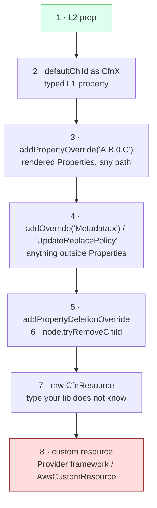

# 10 · Escape hatches, custom resources & migration

> After this module you can override anything CloudFormation accepts from inside an L2 — choosing the least invasive rung of the escape-hatch ladder and saying why — adopt legacy templates and live resources into CDK without replacement, and build the two kinds of custom resource (Provider framework, `AwsCustomResource`) that cover what CloudFormation cannot do.

## Why this exists (the problem)

Every abstraction leaks. An L2 does not expose a property CloudFormation shipped last month; a construct library renders an inline policy your IAM team forbids; a queue was created by a 2019 template and cannot be recreated; a deployment needs a value that only exists at deploy time in another account; an API has no CloudFormation coverage at all. Teams hit these within the first quarter and, without a disciplined answer, reach for the biggest hammer: a hand-written template, a bash step in the pipeline, or a `lambda.Function` that "fixes things up" after deploy.

CDK's answer is layered. L1 property bags remain writable after construction; the rendered JSON accepts path-addressed overrides; the construct tree can be pruned; logical IDs can be pinned; whole templates can be *included* as real constructs; and when CloudFormation itself lacks a capability, two custom-resource mechanisms exist with very different amounts of code to own. The discipline is choosing the smallest one.

## Mental model



Each rung down trades type-safety and refactor-safety for reach. The rule: use the highest rung that works, and leave a comment on every use saying why the one above did not.

## How it works

### 1–7. The ladder — `escape-hatches-stack.ts`

Each rung has one resource and one comment in the stack; the tests pin each rendered result.

**Rung 2 — `defaultChild as CfnBucket`.** `Bucket` has no prop for S3 Storage Class Analysis; `CfnBucket.analyticsConfigurations` exists. Assigning through the typed L1 keeps compile-time checks on the property shape:

```ts
const cfnBucket = this.bucket.node.defaultChild as s3.CfnBucket;
cfnBucket.analyticsConfigurations = [{ id: 'whole-bucket', storageClassAnalysis: { dataExport: { … destination: { bucketArn: analytics.bucketArn, … } } } }];
```

(The export targets a second bucket; a self-referencing `Fn::GetAtt` is a circular dependency that the built-in CloudFormation validator rejects at synth — `@aws-cdk/core:validateAgainstDefaultRules` is on in this repo's `cdk.json`.)

**Rung 3 — `addPropertyOverride`.** Applied to the *rendered JSON*, after the L1 property bag is serialised. Paths use `.` and may index arrays (`OwnershipControls.Rules.0.ObjectOwnership`) and may name properties this `aws-cdk-lib` has never heard of — that is what makes it the answer to "CloudFormation shipped it, CDK has not". The test `overrides are visible to Template assertions but not to aspects` shows the flip side: an aspect reading `cfnBucket.versioningConfiguration` sees `undefined` even though the template says `Enabled`, because overrides never touch the property bag. Validators that inspect L1 props (cdk-nag) miss overrides; validators that read templates (module 06's plugin) catch them.

**Rung 4 — `addOverride`.** Same mechanism, root of the resource: `Metadata.cdk-mastery.owner`, `UpdateReplacePolicy`, `DependsOn`, `Condition`. Overrides *merge*: CDK's `aws:cdk:path` metadata survives. `applyRemovalPolicy` sets both `DeletionPolicy` and `UpdateReplacePolicy`; the raw override lets you set one.

**Rung 5 — `addPropertyDeletionOverride`.** `SecurityGroup` always renders an allow-all egress; deleting `SecurityGroupEgress` hands the rule back to AWS's default so an external firewall automation is the single owner. Deletion overrides are the only way to *remove* something an L2 insists on.

**Rung 6 — `node.tryRemoveChild`.** `grantRead` created `Worker/ServiceRole/DefaultPolicy`; when IAM policy is owned elsewhere, removing the child removes the `AWS::IAM::Policy` resource (`resourceCountIs('AWS::IAM::Policy', 0)`). The externally-owned policy is attached by name with `ManagedPolicy.fromManagedPolicyName` — an import, no resource. This rung is the most refactor-fragile: the child id (`DefaultPolicy`) is an implementation detail of the L2, so the code throws if it is not found rather than silently doing nothing.

**`overrideLogicalId`.** Not an override of the template but of the *identity*. `AdoptedAssets` renders as `LegacyAssetsBucket`; combined with `RemovalPolicy.RETAIN` and `cdk import` it moves an existing resource into CDK with no replacement (§9).

**Rung 7 — raw `CfnResource`.** `new cdk.CfnResource(this, 'RawParameter', { type: 'AWS::SSM::Parameter', properties: {…} })` renders exactly what you pass. For a type newer than your library it is the only option; the example uses a type that *does* have an L1 so the stack stays deployable.

### 8. Adopting templates — `cfn-include-stack.ts` + `legacy-template.json`

```ts
this.include = new cfninc.CfnInclude(this, 'Legacy', {
  templateFile: path.join(__dirname, 'legacy-template.json'),
  parameters: { Environment: props.environment },
  preserveLogicalIds: true,
});
const cfnQueue = this.include.getResource('OrdersQueue') as sqs.CfnQueue;
this.legacyQueue = sqs.Queue.fromQueueAttributes(this, 'LegacyQueue', { queueArn: cfnQueue.attrArn, queueUrl: cfnQueue.ref });
```

`CfnInclude` parses the JSON and instantiates a real L1 per element — resources, parameters, conditions, outputs, mappings — **with the original logical IDs**. Deploy the CDK stack over the existing CloudFormation stack (same stack name) and CloudFormation sees no resource changes: adoption, not replacement. From there: wrap L1s in `fromXxxAttributes` interfaces so `grant*`/event sources work (the test shows the consumer's policy scoped to `OrdersQueue`'s ARN), apply escape hatches to included L1s (`SqsManagedSseEnabled`), edit outputs, and replace elements with L2s one at a time (an L2 that renders the same logical ID via `overrideLogicalId`).

`parameters` bakes a value in at synth: the `Environment` parameter disappears and every `Ref`/`Fn::Sub` is substituted (`orders-inbox-dev`). Parameters you omit remain deploy-time inputs (`MessageRetentionSeconds`). Baking a value that feeds a Condition makes the condition constant, which the built-in validator flags as `W8003`; the stack acknowledges it with `Validations.of(this).acknowledge({ id: 'CloudFormation-Validate::W8003', reason })` — the general pattern for accepting a built-in finding.

### 9. `cdk import`, `cdk migrate`, `cdk refactor`

- **`cdk import`** — adopt *live* resources into a stack, no template needed. Add the resource to your code with the identity CloudFormation needs (for a bucket, `BucketName`), keep everything else in the stack unchanged, then:
  ```bash
  npx cdk import M10-EscapeHatches                         # prompts for identifiers of new resources
  npx cdk import M10-EscapeHatches --resource-mapping ids.json   # non-interactive: { "LegacyAssetsBucket": { "BucketName": "orders-legacy-assets" } }
  npx cdk import M10-EscapeHatches --record-resource-mapping ids.json  # write the mapping for a later non-interactive run
  ```
  Constraints: the stack must exist (import cannot create), only the imported resources may change in that deployment, the resource must carry `DeletionPolicy: Retain` during the import (CDK adds it), and only import-supported types work. `overrideLogicalId` is how you pick the logical ID the resource will have forever.
- **`cdk migrate`** — generate a CDK app from a deployed stack, a template file, or a resource scan:
  ```bash
  npx cdk migrate --stack-name legacy-orders --from-stack --language typescript --output-path ./migrated
  npx cdk migrate --stack-name legacy-orders --from-path legacy-template.json --language typescript
  npx cdk migrate --stack-name discovered --from-scan new --filter type=AWS::SQS::Queue --language typescript
  ```
  It produces L1-only code (a `CfnInclude`-like translation), which is the honest starting point; the scan variant also writes a migrate.json you feed to `cdk import`.
- **`cdk refactor`** (preview; requires `--unstable=refactor`; behaviour is version-dependent, this CLI is 2.1141.x) — move resources between stacks or rename constructs *without replacement* by computing a logical-ID mapping between the deployed and synthesized templates and calling CloudFormation's stack refactoring API:
  ```bash
  npx cdk refactor --unstable=refactor --dry-run              # show the computed mapping
  npx cdk refactor --unstable=refactor --override-file map.json
  npx cdk refactor --unstable=refactor --revert --override-file map.json
  ```
  Until it is stable, `overrideLogicalId` plus a `cdk diff` that shows no `[-]/[+]` pairs is the conservative way to rename.

### 10. Custom resources — `custom-resources.ts`

Two mechanisms, chosen by how much code you want to own.

**`cr.Provider` (framework) — `SlowResource`.** You write `handlers/on-event.js` (Create/Update/Delete → return `PhysicalResourceId` and `Data`) and `handlers/is-complete.js` (return `IsComplete` and final `Data`). The framework deploys three Lambdas (`framework.onEvent`, `framework.isComplete`, `framework.onTimeout`) and a Step Functions waiter that retries `isComplete` every `queryInterval` up to `totalTimeout` (the test reads `IntervalSeconds: 10, MaxAttempts: 60` out of the state machine). The framework speaks the raw CloudFormation protocol — the pre-signed S3 response URL, the one-hour deadline, the exactly-once response — so your handlers never see it. Rules that matter: Create returns a physical id; Update returning a *different* physical id triggers a Delete of the old one (that is how replacement works); Delete must tolerate "already gone" (rollbacks retry it); the `resourceType` (`Custom::SlowResource`) is part of the contract and shows in CloudTrail. One Provider per resource *type* per stack — the test `constructs can be used on their own` deliberately shows two `SlowResource`s creating two providers; share the provider (a singleton construct) when you have many instances.

**`cr.AwsCustomResource` — `ParameterWriter`.** One SDK call per lifecycle event, no code:

```ts
const put: cr.AwsSdkCall = { service: 'SSM', action: 'PutParameter', parameters: {…}, physicalResourceId: cr.PhysicalResourceId.of(props.parameterName) };
new cr.AwsCustomResource(this, 'Resource', {
  onCreate: put, onUpdate: put,
  onDelete: { service: 'SSM', action: 'DeleteParameter', parameters: { Name }, ignoreErrorCodesMatching: 'ParameterNotFound' },
  policy: cr.AwsCustomResourcePolicy.fromSdkCalls({ resources: [parameterArn] }),
  installLatestAwsSdk: false,
});
```

A singleton Lambda (`AWS679f53fac002430cb0da5b7982bd2287`, one per stack) receives the serialised calls as resource properties (`Create`/`Update`/`Delete` — JSON strings; ours embeds a token, hence the `Fn::Join` the test flattens). `PhysicalResourceId.of(constant)` keeps updates in place; `fromResponse(path)` binds it to the API response and *replaces* when it changes. `fromSdkCalls` derives IAM actions from the calls (`ssm:PutParameter`, `ssm:DeleteParameter`) scoped to the ARNs you list; `ANY_RESOURCE` is `*`. **`installLatestAwsSdk: true`** runs `npm install` *inside the Lambda at deploy time* — slow, network-dependent, a supply-chain hole; the runtime's bundled SDK v3 is what you want. The flag `@aws-cdk/customresources:installLatestAwsSdkDefault: false` in `cdk.json` sets the default; the code sets it explicitly so tests (no `cdk.json`) agree.

### 11. Assets and local bundling — `assets.ts`

`s3_assets.Asset` = `AssetStaging` (copy to `cdk.out/asset.<hash>/`, compute the hash) + a reference in the template (`S3Bucket`/`S3Key` on the bootstrap bucket) + an entry in the asset manifest that `cdk-assets` publishes. `BundlingOptions` transforms the source first: `image` is the Docker path, `local.tryBundle(outputDir)` gets first refusal and, returning `true`, keeps Docker out of it. `assetHashType: OUTPUT` hashes the bundle, so a change in either input or in the merge logic changes the key — the tests write to a temp `outdir`, read `config.json` out of the staged directory, and prove the inputs were not copied. Lambda `Code.fromAsset`, `NodejsFunction` (esbuild), `ContainerImage.fromAsset` and `aws-s3-deployment` sit on the same three pieces.

## Walkthrough

1. `escape-hatches-stack.ts` — rungs 2–7 and `overrideLogicalId`, one resource each.
2. `legacy-template.json` — the 2019 template: parameters, a condition, SNS→SQS with a DLQ, outputs with exports.
3. `cfn-include-stack.ts` — adoption, L1→L2 bridging, a CDK consumer, the W8003 acknowledgement.
4. `handlers/on-event.js`, `handlers/is-complete.js` — the Provider handlers; read the contract comments.
5. `custom-resources.ts` — `SlowResource` (Provider) and `ParameterWriter` (`AwsCustomResource`).
6. `assets.ts` — `BundledConfigAsset` with local bundling; `assets/config/*.json` are the inputs.
7. `custom-resources-stack.ts`, `index.ts` — `M10-EscapeHatches`, `M10-LegacyInclude`, `M10-CustomResources`; all env-agnostic.
8. `test/10-escape-hatches-custom-resources-and-migration.test.ts`.

```bash
cd aws-cdk
npx cdk synth M10-EscapeHatches --quiet && sed -n '/LegacyAssetsBucket/,/^    },/p' cdk.out/M10-EscapeHatches.template.json
npx cdk synth M10-LegacyInclude --quiet
npx cdk synth M10-CustomResources --quiet     # "Bundling asset M10-CustomResources/Config/Asset/Stage..." — local, no Docker
npx jest test/10-escape-hatches-custom-resources-and-migration.test.ts
```

## Production notes

- **Every escape hatch is a maintenance liability.** Record them: a `Metadata.cdk-mastery.escape-hatches` list (rung 4 does this) or a comment with the upstream issue link. Re-check on every `aws-cdk-lib` upgrade whether the L2 caught up; delete the hatch when it did.
- **Overrides bypass validation.** L1 props are validated at synth; overrides are not. A typo in a path silently adds a property CloudFormation then rejects at deploy. Cover every override with a `Template` assertion (this module's tests are the pattern) and keep `validateAgainstDefaultRules` on.
- **Custom resources are code you run in production.** They need the same logging, retention, alarms and least-privilege as the workload: every handler here has an explicit `LogGroup` with retention, `fromSdkCalls` is scoped to ARNs, exercise 3 grants a single object key. Failure modes: a handler that throws on Delete blocks stack deletion (fix the handler, or `cdk destroy` fails until you set `DeletionPolicy: Retain` and clean up by hand); a handler that never responds holds the stack for an hour (`serviceTimeout` on `CustomResource` shortens that).
- **Cost**: Provider = 3 Lambdas + 1 state machine per provider, invoked only on deploys — negligible, but it is 4 resources per type; share providers. `AwsCustomResource` = 1 Lambda per stack. `installLatestAwsSdk: true` adds 30–90 s and an npm dependency to every deploy.
- **Migration safety**: before `cdk import`/adoption, snapshot the live stack template (`aws cloudformation get-template`), set `Retain` on everything stateful, run `cdk diff` and refuse any `[-]`. After adoption, the first "no-op" deploy is your proof.
- **Monitor**: custom-resource Lambda errors (`Errors` metric on the provider functions), state-machine `ExecutionsTimedOut`, stacks in `UPDATE_ROLLBACK_FAILED` (almost always a custom resource).

## Gotchas

- **`addPropertyOverride` has no effect** → overrides are always applied last, so the cause is a wrong path (`VersioningConfiguration.Status`, not `Versioning.Status`; array indices are numeric segments) → copy the key names from the rendered template in `cdk.out`.
- **Aspect/nag does not see the override** → overrides live outside the property bag → validate with a template-level check (`Template` assertions, a validation plugin, cfn-guard).
- **`tryRemoveChild` returned false** → the child id is an L2 implementation detail that changed → look at `construct.node.children.map(c => c.node.id)` and fail loudly, as the stack does.
- **Removed a child that another resource referenced** → a dangling `Ref`/dependency → synth error listing the path; remove the reference too or leave the child.
- **`cdk import` says the stack has other changes** → the import deployment must contain *only* the imported resources → commit and deploy other changes first.
- **`CfnInclude` throws on an unknown intrinsic or a `Transform`** → SAM/macro templates are not supported; some newer intrinsics need `@aws-cdk/core:cfnIncludeRejectComplexResourceUpdateCreatePolicyIntrinsics` semantics → run `aws cloudformation get-template` and compare; convert macros by hand.
- **Custom resource stuck in `CREATE_IN_PROGRESS` for an hour** → the handler crashed before the framework could respond (bad packaging, timeout) → read the framework `onEvent` log; set a smaller `serviceTimeout`.
- **`AwsCustomResource` re-runs on every deploy / never re-runs** → CloudFormation only sends Update when *properties* change → to force a refresh add a `Version` property (exercise 2); to stop churn, do not put `Date.now()` in properties.
- **`isComplete` never completes** → it returned `{ IsComplete: false }` forever or threw → the waiter fails at `totalTimeout` via `framework.onTimeout`; check the `is-complete` log group.
- **Bundling ran Docker** → `tryBundle` returned `false` or threw → return `true` after writing to `outputDir`; the `image` is only the fallback.

## Exercises

1. **Fleet-wide metadata (easy).** Write an aspect that adds `Metadata.cfn-lint.config.ignore_checks` to every resource of a configured type using `addOverride`, without clobbering CDK's own metadata. Solution: `solutions/exercise-1-cfn-lint-metadata-aspect.ts`.
2. **Deploy-time read (medium).** Write `ParameterReader` with `AwsCustomResource` calling `SSM.GetParameter`, exposing `Parameter.Value` via `getResponseField`, no `onDelete`, a constant physical id, IAM scoped to the parameter ARN, and a `version` property to force re-reads. Solution: `solutions/exercise-2-parameter-reader.ts` — note the two-hop path to the L1 for the override.
3. **Provider with least privilege (hard).** Write `Custom::S3ObjectWriter` on the Provider framework (`onEvent` only, handler in `handlers/s3-object-writer.js`) that writes one object and deletes it on stack delete, granting `s3:PutObject`/`DeleteObject` on exactly `bucket.arnForObjects(key)`, with a 2-minute `serviceTimeout`. Solution: `solutions/exercise-3-s3-object-writer.ts`.

## Checklist

- [ ] Every escape hatch has a comment naming the rung above it that did not work, and a `Template` assertion.
- [ ] `Metadata` records escape hatches per resource (or an equivalent registry); reviewed on library upgrades.
- [ ] Adopted resources: `overrideLogicalId` + `RemovalPolicy.RETAIN` + a no-op `cdk diff` before the first deploy.
- [ ] Custom resources: explicit log groups with retention, `installLatestAwsSdk: false`, IAM scoped to ARNs, Delete tolerates "not found", `serviceTimeout` set, providers shared per type.
- [ ] Bundling has a `local` path so CI needs no Docker; `assetHashType` matches what should invalidate the asset.
- [ ] Code review: no `ANY_RESOURCE`; no `addOverride` where an L2 prop exists; no `tryRemoveChild` without a thrown error on miss; no `Date.now()` in custom-resource properties.

## Interview angle

1. *"Walk me through how you would add a property to a bucket that CDK does not support yet, and how you would know when to remove the workaround."* — `defaultChild` if the L1 has it (typed), else `addPropertyOverride` with the CloudFormation path; pin it with a template assertion; record it in metadata; on each upgrade check the L2/L1 for the prop and delete the override when it lands.
2. *"How do you move a production DynamoDB table from a hand-written template into CDK without downtime?"* — `CfnInclude` the template into a CDK stack deployed over the same stack name (logical IDs preserved → no changes), or for a table outside CloudFormation `cdk import` with `RETAIN` and a resource mapping; then replace the L1 with an L2 whose logical ID is pinned via `overrideLogicalId`; prove each step with `cdk diff` showing no replacement.
3. *"Provider framework or AwsCustomResource?"* — `AwsCustomResource` when one SDK call per lifecycle event suffices (no code to own, singleton Lambda). Provider when you need logic, polling (`isComplete`), or multiple calls with error handling; you own the handlers but the framework owns the CloudFormation protocol. Both need scoped IAM, log retention, and idempotent Delete.

## References

- Escape hatches: https://docs.aws.amazon.com/cdk/v2/guide/cfn_layer.html; `aws-cdk-lib/core/lib/cfn-resource.d.ts` (`addOverride`, `addPropertyOverride`, `addPropertyDeletionOverride`), `cfn-element.d.ts` (`overrideLogicalId`)
- `cloudformation-include`: https://docs.aws.amazon.com/cdk/api/v2/docs/aws-cdk-lib.cloudformation_include-readme.html
- `cdk import`: https://docs.aws.amazon.com/cdk/v2/guide/ref-cli-cmd-import.html; `cdk migrate`: https://docs.aws.amazon.com/cdk/v2/guide/ref-cli-cmd-migrate.html; `cdk refactor`: https://docs.aws.amazon.com/cdk/v2/guide/ref-cli-cmd-refactor.html
- Custom resources: https://docs.aws.amazon.com/cdk/api/v2/docs/aws-cdk-lib.custom_resources-readme.html; CloudFormation custom resource protocol: https://docs.aws.amazon.com/AWSCloudFormation/latest/UserGuide/crpg-ref.html
- Assets and bundling: https://docs.aws.amazon.com/cdk/v2/guide/assets.html; `aws-cdk-lib/core/lib/bundling.d.ts` (`ILocalBundling`)
