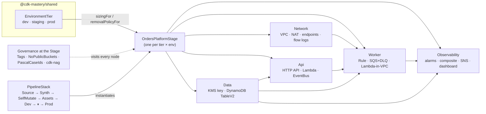

# 11 · Capstone: the Orders platform

> After this module you can ship a multi-account, multi-stack, governed, tested and pipelined platform from one environment model — and defend every decision in it to a Principal-level reviewer.

## Why this exists (the problem)

Modules 00–10 each isolate one idea. Production is where the ideas collide: the tag aspect from module 06 must not break the pipeline from module 08; the stateful/stateless split from module 02 has to survive the multi-account layout of module 09; the cdk-nag pack from module 06 will flag the Lambda roles module 04 creates. A platform is the set of decisions that make those forces coexist, written down as code, with the reasons next to them. That is what this module is.

The domain is deliberately small — an Orders API that writes to DynamoDB and hands work to an asynchronous worker — because the difficulty is not the domain. It is choosing where stack boundaries go, what a tier is allowed to change, what pages a human and what does not, what the pipeline must gate, and what you write down so the next engineer does not undo it.

## Mental model

One environment model, three views of it:



The **tier** is the only input a human chooses. Everything else — NAT count, PITR, deletion protection, retention, throttles, alarm sensitivity, whether prod needs an approval — is *derived* in `config.ts` (`sizingFor`) and in the shared model. Adding an environment is a table entry (exercise 1), not a branch.

## How it works

Read the files in this order.

### `config.ts` — the derivations

`PLATFORM_TARGETS` binds a tier to an `{ account, region }`. `sizingFor(tier)` turns `tier.highlyAvailable` into concrete knobs:

| Knob | dev | prod | Why |
|---|---|---|---|
| `maxAzs` / `natGateways` | 2 / 1 | 3 / 3 | A NAT gateway is ~$32/month idle; an AZ outage must not take prod's egress with it |
| `apiMemoryMb` / `workerMemoryMb` | 512 | 1024 | Memory buys CPU on Lambda; prod pays for p99 |
| `workerReservedConcurrency` | unset | 50 | A poison flood must not exhaust the table's on-demand ramp or a downstream partner |
| `pointInTimeRecovery` / `deletionProtection` | off | on | Dev is recreated in minutes; prod's table is the business |
| `alarmEvaluationPeriods` | 1 | 3 | Dev alarms are for developers watching; prod alarms page people at 3 a.m. |

`removalPolicyFor(tier)` maps `retainStatefulResources` to `RETAIN`/`DESTROY`. Only the Data stack (and its KMS key) consults it.

### `orders-platform-stage.ts` — the boundaries

Five stacks. The boundaries follow **rate of change and blast radius**, not service names:

- **Network** changes rarely and is expensive to replace. It owns the VPC, the gateway endpoints (so the worker's DynamoDB and S3 traffic never crosses the NAT) and the worker security group (egress 443 only; no ingress rule at all).
- **Data** is the only stack whose removal policy is a business decision. Nothing that deploys often lives there, so an API rollback can never take the table with it. The table is `TableV2` (it renders `AWS::DynamoDB::GlobalTable`, which is why the tests look for that type), on-demand, SSE-KMS with a rotated CMK, single-table `pk/sk` plus one GSI.
- **Api** owns the HTTP API, the handler and the **event bus** — the producer owns the bus; consumers own their rules. That ownership model survives more teams than "a shared events stack".
- **Worker** owns its rule, both queues and the in-VPC Lambda. The queue between EventBridge and Lambda is the difference between "retried for 24 h then dropped" and "visible, replayable, throttleable".
- **Observability** is deployed last because it references everything, and can be redeployed on its own.

Two reference styles are used on purpose, and the test `references the table by name, not by export` pins both. The **table** is passed as a *name* (deterministic via `resourceName`) and re-imported with `TableV2.fromTableAttributes`, so IAM statements contain a literal ARN instead of an export — the Data stack can be refactored without an "export in use" deadlock (module 02). The **KMS key** is passed as a *construct reference*, which renders `Fn::GetStackOutput` (the weak cross-stack reference enabled in `cdk.json`) and is what keeps Data → Api → Worker in deploy order without an explicit `addDependency`.

Stack names carry `org-service-tier-component-region` (`revan-orders-prod-data-usw2`), so the CloudFormation console reads like the diagram.

### `governance.ts` — applied once, at the Stage

`applyPlatformGovernance` adds, in priority order:

1. `Tags.of(stage).add(...)` for every key in `mandatoryTags(tier, 'orders')` — mutating, so it runs first.
2. `NoPublicBucketsAspect` and `PascalCaseIdsAspect` at `AspectPriority.READONLY` — they only call `Annotations.addError`.
3. `ScopedAwsSolutionsChecks` as a **validation plugin** (`Validations.of(stage).addPlugins`). cdk-nag 3's `NagPack.validate` walks the whole App, which in a multi-stage app (or this curriculum's twelve-module app) would fail one stage for another stage's findings; the wrapper calls `validateScope(stage)` instead.

`acknowledgeKnownFindings` lists every accepted finding **next to a reason a reviewer can evaluate**. The ids are cdk-nag 3's per-finding ids (`AwsSolutions-IAM5[Action::kms:ReEncrypt*]`), so acknowledging one wildcard action does not silence the rule. The test suite asserts a clean stage synthesizes, that a violating stack fails synthesis with both the nag finding and the house-rule annotation in the report, and that no IAM statement uses `Resource: *` except the X-Ray one the acknowledgement promises.

### `stacks/observability-stack.ts` — what pages

Five alarms describe *what* is wrong. One `CompositeAlarm` — `api-5xx OR worker-errors OR dlq-depth` — decides *whether a human is needed now*, and it is the only alarm with an action. Latency and queue age go to the dashboard; on their own they are not incidents. This is the single most common observability mistake in serverless platforms: paging on every alarm yields four pages per incident and a team that mutes the topic.

### `pipeline-stack.ts` — the delivery path

`Source → Synth (npm ci, tests, cdk synth --strict) → SelfMutate → Assets → M11-Dev → SmokeTest → [PromoteToProd] → M11-Prod`. The approval gate is read from `tier.requiresApproval`; it is not a pipeline constant. `crossAccountKeys` is derived from whether dev and prod share an account. The pipeline instantiates the **same** `OrdersPlatformStage` class the workstation entrypoint does, so `cdk deploy 'M11-Dev/**'` from a laptop during an incident produces byte-identical templates.

### Handlers

`handlers/api.js` and `handlers/worker.js` are plain JavaScript on the runtime-provided SDK v3 — no bundling, no Docker, ~10 KB assets — so the capstone synthesizes anywhere. The worker returns `batchItemFailures` (partial batch responses), which is what makes `maxReceiveCount: 5` meaningful per message rather than per batch.

## Walkthrough

```bash
cd aws-cdk
npx jest test/11-capstone-platform.test.ts        # 26 tests: shape, tier decisions, security, governance, pipeline, solutions
npx cdk ls | grep M11                              # M11-Dev/*, M11-Prod/*, M11-Pipeline, M11-Pipeline/M11-*/…
npx cdk synth 'M11-Prod/**' --quiet               # five prod templates, nag-clean
npx cdk diff 'M11-Dev/**'                         # against a bootstrapped dev account
```

Deploy runbook (once per account):

```bash
# 1. Bootstrap the pipeline/dev account (111111111111) and the prod account (222222222222), trusting the pipeline account.
npx cdk bootstrap aws://111111111111/us-east-1 aws://111111111111/us-west-2 \
  --cloudformation-execution-policies arn:aws:iam::aws:policy/AdministratorAccess
npx cdk bootstrap aws://222222222222/us-west-2 --trust 111111111111 \
  --cloudformation-execution-policies arn:aws:iam::aws:policy/AdministratorAccess
# 2. Create a CodeConnections connection to the repo in the console (it needs a one-time OAuth handshake) and pass its ARN:
npx cdk deploy M11-Pipeline -c cdk-mastery:connectionArn=arn:aws:codeconnections:us-east-1:111111111111:connection/…
# 3. Push to main. The pipeline self-mutates, deploys dev, runs the smoke test, waits for approval, deploys prod.
```

Replace `AdministratorAccess` with a permissions boundary–bounded policy before this touches a real prod account (module 06 shows `PermissionsBoundary.of(stage).apply(...)`).

## Production notes

**Cost, per month, idle vs. modest load** (see `solutions/exercise-2-cost-model.ts`, which reads the same `sizingFor`):

| | dev | prod |
|---|---:|---:|
| Fixed (NAT, KMS, alarms, dashboard, PITR) | ≈ $38 | ≈ $114 |
| Usage at 1M requests / 100k orders (dev) — 50M / 5M (prod) | ≈ $8 | ≈ $450 |
| **Total** | **≈ $46** | **≈ $563** |

The NAT gateways are 85% of dev's idle bill. If the worker never calls a third party, delete the NAT and the `PRIVATE_WITH_EGRESS` subnets become `PRIVATE_ISOLATED` with the gateway endpoints doing all the work.

**Teardown order**: `cdk destroy 'M11-Dev/**'` handles the dependency order (Observability → Worker → Api, then Data and Network). For prod, `terminationProtection` is on every stack and the table has `deletionProtection`; destroying it is a four-step, deliberately annoying process: disable termination protection on each stack, deploy with `deletionProtection: false`, then destroy, then delete the retained table and key by hand. That friction is the feature.

**What I'd change at 10× scale**

- Split the API by bounded context before splitting by region. The single-table design and the single bus assume one team; at ten teams each owns its bus and the platform stack becomes the *shared* pieces only (network, KMS, observability plumbing).
- Move from `Stage × Environment` in one app to one app per team consuming versioned constructs from an internal library (module 05). The pipeline in this module becomes the *platform* pipeline; product teams get their own.
- Replace the per-tier NAT with a centralised egress VPC (Transit Gateway) once there are more than ~5 VPCs; the NAT line in the cost model stops scaling with team count.
- Turn `TableV2` into a global table and make the API region-aware (exercise 3 wires DNS failover but deliberately does not replicate data — that is a product decision about write conflicts).
- Ship `ScopedAwsSolutionsChecks` and the house aspects as a package with its own release train, so a rule change is a version bump reviewed once, not a diff in every repo.

## Gotchas

- **`stack.dependencies` is empty before synth.** Cross-stack references are resolved in the prepare phase; the deploy order only exists on the cloud assembly (`assembly.getStackArtifact(id).dependencies`). The test shows the correct way to assert it.
- **cdk-nag 3 validates the whole App from any Stage.** Symptom: module 11's plugin fails the synth of a module 04 stack. Cause: `NagPack.validate(context)` uses `context.appConstruct`. Fix: `validateScope(stage)` (see `ScopedAwsSolutionsChecks`).
- **Acknowledgement ids are exact, including the bracket.** `AwsSolutions-IAM5` does not acknowledge `AwsSolutions-IAM5[Action::kms:ReEncrypt*]`; the wildcard is part of the id, not a pattern.
- **Every stack depends on its own `.assets` artifact.** When reading dependencies from the assembly, filter ids ending in `.assets` or your "Network has no dependencies" assertion fails.
- **`TableV2` renders `AWS::DynamoDB::GlobalTable`.** `resourceCountIs('AWS::DynamoDB::Table', 1)` finds nothing; deletion protection and PITR live under `Replicas[0]`.
- **`Fn::GetStackOutput` in templates** is not a mistake: it is the weak cross-stack reference (`@aws-cdk/core:defaultCrossStackReferences: "weak"` in `cdk.json`). A bare test `App` without that context renders the classic Export/`Fn::ImportValue` pair instead — which is why the tests pass `cdk.json`'s context into every `App`.
- **The composite alarm's rule is an `Fn::Join`**, not a string; match on the alarm logical ids inside it, not on alarm names.

## Exercises

1. **Add a staging tier** without touching any stack. Bind `ENVIRONMENTS.staging` to an account/region and make the pipeline's approval gate a function of the tier. — `solutions/exercise-1-staging-target.ts`
2. **Write a cost model** that reads `sizingFor(tier)` and splits the bill into fixed and usage lines, each citing the knob that drives it. — `solutions/exercise-2-cost-model.ts` (`renderCostTable` prints the markdown above).
3. **Active/passive across two regions** with Route 53 health checks and failover records, without changing the platform stacks, and write down what you deliberately did *not* do (data replication, write failover, custom domains). — `solutions/exercise-3-active-passive-region.ts`

## Checklist

- [ ] Every knob that differs between environments is derived from the tier in one place; no `if (env === 'prod')` inside a stack.
- [ ] Stateful resources live in a stack that deploys first and changes rarely; its removal policy is explicit and tested per tier.
- [ ] Cross-stack references are deliberate: by name where you want decoupling, by reference where you want ordering — and a comment says which.
- [ ] Governance (tags, house rules, nag pack) is applied once at the Stage; every acknowledgement has a reason; a test proves a violation fails synth.
- [ ] Exactly one alarm has a paging action, and it is a composite of customer-facing signals.
- [ ] The pipeline runs unit tests and `cdk synth --strict` before any deploy, gates prod on the tier's `requiresApproval`, and instantiates the same Stage class as the workstation entrypoint.
- [ ] Prod stacks have termination protection; the table has deletion protection; the teardown runbook is written and annoying.
- [ ] No IAM statement uses `Resource: *` without an acknowledged, documented reason.

## Interview angle

**"Where do you draw stack boundaries?"** — Rate of change and blast radius, not service names. Stateful and stateless separate; networking separate because it is slow to replace; observability last because it references everything and is safe to redeploy alone. Then justify each reference: name-based where you need decoupling, construct-based where you need ordering.

**"How do you keep a policy pack from becoming a wall of suppressions?"** — Scope the pack to the stage it governs, use per-finding ids, require a reason string a reviewer can reject, and assert in CI that a *clean* stage synthesizes and a *dirty* one does not. Suppressions are then a reviewed list, not a comment.

**"What actually pages?"** — One composite alarm: customer-facing errors or data-loss-adjacent signals. Everything else is a dashboard. Be ready to explain why p99 latency alone is not a page.

## References

- [`aws-cdk-lib.Stage`](https://docs.aws.amazon.com/cdk/api/v2/docs/aws-cdk-lib.Stage.html) and [`pipelines.CodePipeline`](https://docs.aws.amazon.com/cdk/api/v2/docs/aws-cdk-lib.pipelines-readme.html)
- [`Validations` and policy validation plugins](https://docs.aws.amazon.com/cdk/v2/guide/policy-validation-synthesis.html)
- [cdk-nag 3 rules and acknowledgements](https://github.com/cdklabs/cdk-nag)
- [`TableV2`](https://docs.aws.amazon.com/cdk/api/v2/docs/aws-cdk-lib.aws_dynamodb.TableV2.html) · [CompositeAlarm](https://docs.aws.amazon.com/cdk/api/v2/docs/aws-cdk-lib.aws_cloudwatch.CompositeAlarm.html) · [Route 53 failover](https://docs.aws.amazon.com/Route53/latest/DeveloperGuide/routing-policy-failover.html)
- Module 02 (references), 06 (governance), 08 (pipelines), 09 (multi-account) in this track.
