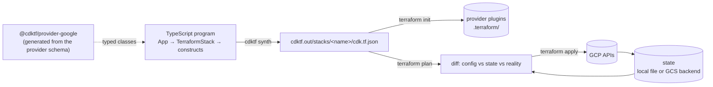

# 00 · Introduction: Terraform core, CDKTF & the synth → plan → apply loop

> After this module you can explain exactly what `cdktf synth` writes, what the Terraform binary does with it, where state goes when you configure nothing, and why a prebuilt provider package is 100 MB.

## Why this exists (the problem)

Terraform's engine is excellent and its language is not. HCL has no functions of your own, no types beyond `object({...})`, no loops beyond `for_each`/`count`, no unit tests worth the name, and no way to publish an abstraction except "a module" — a directory of files with an untyped `variables.tf` contract. Platform teams that manage hundreds of resources end up with `for_each` over nested maps three levels deep, `locals` blocks that are 400 lines of ternaries, and a review process that amounts to reading `terraform plan` output very carefully.

CDK for Terraform (CDKTF) keeps the engine and replaces the language. You write TypeScript against generated, typed bindings for every provider resource; `cdktf synth` turns your program into Terraform JSON; the Terraform binary does the rest exactly as it would for HCL. Nothing changes about state, providers, plan or apply. What changes is that your infrastructure is now a program: functions, classes, packages, tests, and a construct tree that AWS CDK users already know.

The cost is a second toolchain (Node, jsii, npm) and one more artefact to understand. This module makes that artefact boring.

## Mental model

Terraform is a **desired-state reconciler** with three inputs: configuration (what you want), state (what it believes exists), and the real world (what the provider reports). `plan` diffs the three; `apply` executes the diff and rewrites state.

CDKTF is a **code generator plus a CLI wrapper** in front of that. It contributes exactly one thing to the loop: it produces the configuration.



Hold on to two facts:

1. **Everything right of `cdk.tf.json` is plain Terraform.** `cdktf deploy` is `terraform apply` run in `cdktf.out/stacks/<name>/` with some output parsing. You can `cd` there and run the binary yourself; people do this when the CLI's rendering gets in the way.
2. **A `TerraformStack` is a Terraform root module.** One stack = one `cdk.tf.json` = one state file = one `terraform apply`. That single equivalence explains almost every design decision in later modules (why providers are per-stack, why cross-stack references need remote state, why stack-per-environment beats workspaces).

## How it works

### The tree: App → TerraformStack → constructs

[`hello-stack.ts`](hello-stack.ts) builds the smallest useful tree:

```ts
export class HelloStack extends TerraformStack {
  constructor(scope: Construct, id: string, props: HelloStackProps) {
    super(scope, id);
    new GoogleProvider(this, 'Google', { project, region });
    this.bucket = new StorageBucket(this, 'Artifacts', {
      name: resourceName({ org: 'cdkm', service: 'hello', env: tier.name, component: 'artifacts' }),
      location: 'US',
      uniformBucketLevelAccess: true,
      versioning: { enabled: true },
      forceDestroy: !tier.retainStatefulResources,
      labels: mandatoryTags(tier, 'hello'),
    });
    new TerraformOutput(this, 'BucketName', { value: this.bucket.name });
  }
}
```

`App` is the root of a `constructs` tree (the same `constructs` package AWS CDK uses — see `@cdk-mastery/shared`, which imports only that). `TerraformStack` is a construct that knows how to serialise its subtree into Terraform JSON. Every provider class (`GoogleProvider`, `StorageBucket`) is a `TerraformElement` that contributes one block. There is no L1/L2/L3 hierarchy as in AWS CDK: **every generated class maps 1:1 to a provider resource type and its schema**. `StorageBucket` *is* `google_storage_bucket`; the property names are the schema's attribute names in camelCase. Higher-level abstractions are something you write (module 05) or import from the Registry as a module.

### What `app.synth()` does

[`inspect.ts`](inspect.ts) does exactly what the CLI does, without the CLI:

```ts
const app = new App({ outdir });
const stack = new HelloStack(app, 'm00-hello', { tier: 'dev' });
app.synth();
```

`App.synth()` in cdktf 0.21 (`node_modules/cdktf/lib/app.js`):

1. Finds every `TerraformStack` in the tree.
2. Calls `stack.prepareStack()` on each: ensures a backend exists (adding a `LocalBackend` if you declared none) and does a *preparing* token resolution pass that discovers cross-stack references and creates the outputs/remote-state data sources they need (module 02).
3. Calls `stack.synthesizer.synthesize()`: runs aspects (module 06), runs `node.validate()` on every construct, collects `Annotations` into the manifest (an error annotation aborts synth), then serialises `stack.toTerraform()` with a stable key order to `stacks/<id>/cdk.tf.json`.
4. Writes `manifest.json`.

The stable key ordering (`json-stable-stringify`) is why `cdk.tf.json` diffs cleanly in code review.

Run it:

```
npx ts-node --prefer-ts-exts src/modules/00-introduction/inspect.ts
```

You get the construct paths (`m00-hello/Artifacts`), the output directory listing, and the JSON with every top-level key annotated. Note the `m00-hello/backend (LocalBackend)` node that you never wrote: `prepareStack()` added it.

### `cdktf.out/` anatomy

```
cdktf.out/
├── manifest.json                 # index: stack name → cdk.tf.json path, working dir, dependencies, annotations
└── stacks/
    └── m00-hello/                # one directory per TerraformStack; this is the Terraform working directory
        ├── cdk.tf.json           # the root module (or cdk.tf with --hcl)
        ├── assets/…              # TerraformAsset copies (module 04)
        └── .terraform/           # created by `terraform init` inside this directory, never by synth
```

`manifest.json` is what `cdktf list`, `cdktf deploy` and `cdktf output` read. Exercise 2 parses it.

### `cdk.tf.json` key by key

| Key | Meaning | Where it came from |
|---|---|---|
| `//` | Metadata: stack name, cdktf version, backend kind, and a map from construct path to output name. Terraform ignores `//` everywhere. | The synthesizer; also on each resource (`resource.google_storage_bucket.Artifacts.//.metadata.path`). |
| `provider` | `{"google": [ { project, region } ]}` — a **list** per provider name, because aliases (module 01) are additional entries. | `new GoogleProvider(...)` |
| `resource` | `resource[<type>][<logical id>]`. The logical id for a construct directly under the stack is its construct id (`Artifacts`); deeper paths get `Parent_Child_<8-char hash>` (module 01 and 05). | Every `TerraformResource` |
| `data` | Same layout as `resource`, for data sources. Absent here. | `DataGoogle*` classes |
| `output` | Root-module outputs. `terraform output -json` reads them from state after apply. | `TerraformOutput` |
| `variable` / `locals` | Input variables and named expressions. Absent here; module 01. | `TerraformVariable` / `TerraformLocal` |
| `terraform.required_providers` | `{"google": {"source": "google", "version": "6.50.0"}}` — the exact version the prebuilt package was generated from. `source: "google"` is shorthand Terraform resolves to `registry.terraform.io/hashicorp/google`. | `GoogleProvider`'s generator metadata |
| `terraform.backend` | `{"local": {"path": "/abs/cwd/terraform.m00-hello.tfstate"}}` when you configure nothing. | `prepareStack()` |

Two consequences worth internalising. The provider version is **pinned exactly**, not `~>`: upgrading the provider means upgrading the npm package, which is deliberate (the bindings and the schema must agree). And the default local backend path is **absolute and derived from `process.cwd()` at synth time**, which is one of several reasons `cdktf.out/` is gitignored and never shared between machines.

### Prebuilt providers vs `cdktf get`

There are two ways to get typed bindings:

**Prebuilt** (`@cdktf/provider-google`, what this repo uses). HashiCorp runs the generator on each provider release and publishes the result through jsii, so the same package exists for TypeScript, Python, Java, C# and Go. One npm package per provider. The google package is enormous (1,474 resource directories under `node_modules/@cdktf/provider-google/lib`) because the generator emits a class per resource *and* a `*OutputReference` class per nested block, all with jsii metadata in `.jsii`. That is why imports are one-per-path (`@cdktf/provider-google/lib/storage-bucket`) rather than a barrel — importing the barrel loads every module and takes seconds. Prebuilt packages track cdktf's minor version: `@cdktf/provider-google` 16.x is generated for cdktf 0.21.x and will refuse (peer dependency) or misbehave with other minors, so upgrading cdktf means upgrading every prebuilt provider in lock-step.

**`cdktf get`.** You list providers in `cdktf.json` (`"terraformProviders": ["hashicorp/google@~> 6.50"]`), run `cdktf get`, and the CLI downloads the provider schema (`terraform providers schema -json`) and generates TypeScript into `.gen/providers/google/`. Same code, generated locally, for exactly the version constraint you chose, and for providers nobody prebuilds (community providers, your own). Costs: `.gen/` is gitignored and regenerated in CI (slow), the generated code is not jsii-packaged so it is TypeScript-only, and the first `cdktf get` for the google provider takes minutes. Module 10 uses it for a community provider; this repo pins `terraformProviders: []` so nothing is generated on accident.

Rule of thumb: prebuilt when one exists for the version you need; `cdktf get` otherwise.

### The CLI tour

| Command | What it actually does |
|---|---|
| `cdktf init --template typescript --providers google` | Scaffolds `cdktf.json`, `main.ts`, installs prebuilt providers. Asks about HCP Terraform; `--local` skips it. |
| `cdktf get` | Generates `.gen/` from `terraformProviders` / `terraformModules` in `cdktf.json`. |
| `cdktf synth` | Runs the `app` command from `cdktf.json` (here `npx ts-node --prefer-ts-exts src/main.ts`) with `CDKTF_OUTDIR` set; validates the manifest. `--hcl` sets `SYNTH_HCL_OUTPUT=true` so stacks write `cdk.tf` instead of `cdk.tf.json`. |
| `cdktf list` | Prints stack names from `manifest.json` (synths first). |
| `cdktf diff [stack]` | `terraform init` + `terraform plan` in the stack directory, rendered by the CLI. |
| `cdktf deploy [stacks...]` | `plan` then `apply` per stack in dependency order. `'*'` for all; `--auto-approve`; `--ignore-missing-stack-dependencies` to deploy a consumer whose producer you already applied elsewhere (module 02). |
| `cdktf destroy` | `terraform destroy`, reverse dependency order. |
| `cdktf output [stack]` | `terraform output -json`; `--outputs-file` writes it for the next job. |
| `cdktf watch` | Re-synth + `deploy --auto-approve` on file change. Dev sandboxes only. |
| `cdktf convert < main.tf` | HCL → TypeScript (module 10). Needs the Terraform binary for schema. |
| `cdktf provider add/list/upgrade` | Manages prebuilt provider packages and checks the cdktf/provider version matrix. |
| `cdktf debug` | Prints versions of node, cdktf, cdktf-cli, terraform, and the language runtime; the first thing support asks for. |
| `cdktf login` | Stores an HCP Terraform token for the `CloudBackend` (module 02, 08). |

The CLI locates the Terraform binary through `TERRAFORM_BINARY_NAME` (`node_modules/cdktf/lib/util.js`: `process.env.TERRAFORM_BINARY_NAME || "terraform"`). **OpenTofu**: `export TERRAFORM_BINARY_NAME=tofu` and every command above shells out to `tofu` instead. Nothing else changes, because nothing else in CDKTF touches the binary.

### Authentication

Synth never talks to Google. Only `terraform plan/apply` (through the provider plugin) does, and the provider resolves credentials in this order: `credentials`/`access_token` in the provider block → `GOOGLE_CREDENTIALS` / `GOOGLE_APPLICATION_CREDENTIALS` env → **Application Default Credentials** (`~/.config/gcloud/application_default_credentials.json`, written by `gcloud auth application-default login`) → the metadata server on GCE/Cloud Run/GKE. For a laptop, ADC is the answer; do not put key files anywhere near this repository.

Impersonation is the production pattern: your identity holds only `roles/iam.serviceAccountTokenCreator` on a deployer service account, and the provider does the work as that account. Set `impersonateServiceAccount` on the provider (module 01) or `GOOGLE_IMPERSONATE_SERVICE_ACCOUNT` in the environment. Audit logs then show `principal: deployer@…, principalSubject: you@…`, which is exactly the trail you want. Module 08 replaces the human with Workload Identity Federation.

### State when nothing is configured

With no backend, Terraform keeps state in `terraform.tfstate` in the working directory; CDKTF is slightly more helpful and configures a `local` backend with `path: <cwd>/terraform.<stack>.tfstate`, so two stacks in one project cannot clobber each other's state. That file contains every attribute of every resource in plaintext, including the `random_password` module 03 generates. It is unlocked (Terraform's local backend uses a file lock that only protects against two processes on the *same* machine), unversioned and unshared. Fine for the first hour; module 02 moves it to GCS.

## Walkthrough

Read in this order:

1. [`gcp-config.ts`](gcp-config.ts) — where project/region come from (`CDKM_GCP_PROJECT`, `CDKM_GCP_REGION`) and why they are resolved at synth time rather than left to the provider.
2. [`hello-stack.ts`](hello-stack.ts) — the stack. Note that `GoogleProvider` lives *inside* the stack.
3. [`index.ts`](index.ts) — `addToApp(app)`, the only integration point the root `main.ts` uses. The stack id `m00-hello` is lowercase kebab because it becomes a directory name and a state file name.
4. [`inspect.ts`](inspect.ts) — run it. Compare its output with the table above.
5. [`../../../test/00-introduction.test.ts`](../../../test/00-introduction.test.ts) — every claim above as an assertion. `Testing.synth(stack)` returns the JSON string; `Testing.fullSynth(stack)` writes a real output directory to a temp dir. Neither calls `prepareStack()`, which is why the test that wants to see the default backend uses `new App({ outdir }).synth()` instead.

Commands:

```
npx ts-node --prefer-ts-exts src/modules/00-introduction/inspect.ts
npx jest test/00-introduction.test.ts
bash ../scripts/typecheck-module.sh cdktf-gcp 00-introduction   # from the repo root
```

With a Terraform binary and ADC configured: `npx cdktf synth && npx cdktf diff m00-hello`.

## Production notes

- **Bucket names are global.** `resourceName()` gives you deterministic names; a collision with someone else's bucket surfaces as a 409 at apply time, not at plan. Module 01 adds a `random_id` suffix pattern for names that must be unique across projects.
- **`force_destroy`** is the difference between "destroy fails, bucket survives" and "destroy deletes 4 TB". The tier drives it here; module 06 makes an aspect refuse `force_destroy = true` in prod.
- **Versioning without lifecycle rules is a cost leak.** Every overwrite keeps the old generation forever. Exercise 1 adds the rule.
- **The prebuilt provider package size** (hundreds of MB installed) is a CI concern: cache `node_modules` by lockfile hash or your synth job spends its time in `npm ci`.
- **Exact provider pinning** means Dependabot-style bumps of `@cdktf/provider-google` are provider upgrades. Read the provider changelog; 6.x → 7.x will rename attributes and the TypeScript compiler will tell you — which is the point.
- **Monitor synth time.** A tree of a few thousand constructs synths in seconds; if it takes minutes you are probably importing barrels (`@cdktf/provider-google` without `/lib/...`).

## Gotchas

- Symptom: `cdktf synth` prints nothing and exits 0, but `cdktf.out/` is stale → cause: `app.synth()` was never called (the `app` command in `cdktf.json` ran a file that only defines classes) → fix: the entrypoint must construct an `App`, add stacks, and call `synth()`.
- Symptom: `Error: Cannot find module '@cdktf/provider-google/lib/storage-bucket'` → cause: prebuilt provider major does not match the cdktf minor (or it was never installed) → fix: `cdktf provider list` / `cdktf provider upgrade`, and keep `cdktf`, `cdktf-cli` and every `@cdktf/provider-*` upgraded together.
- Symptom: `terraform init` in `cdktf.out/stacks/x` says "Backend configuration changed" after you moved directories → cause: the default local backend path is absolute → fix: configure a real backend (module 02) or accept `-reconfigure` on a laptop.
- Symptom: tests report `toHaveResourceWithProperties is not a function` → cause: importing `cdktf/lib/testing/adapters/jest` does not register the matchers; `Testing.setupJest()` does → fix: call it in a setup file or at the top of the test.
- Symptom: `Testing.fullSynth()` output has no `terraform.backend` → cause: the testing helpers skip `prepareStack()` → fix: use `App.synth()` when the assertion is about backend or cross-stack blocks.
- Symptom: `cdktf deploy` uses `terraform` even though you installed OpenTofu → cause: `TERRAFORM_BINARY_NAME` unset → fix: export it; put it in `.envrc`/CI env, not in `cdktf.json` (there is no key for it).

## Exercises

1. **Harden the bucket.** Add `publicAccessPrevention: 'enforced'` and lifecycle rules that delete archived versions after the tier's `logRetentionDays` and keep at most 3 non-current versions. Solution: [`solutions/01-hardened-hello-stack.ts`](solutions/01-hardened-hello-stack.ts).
2. **Read the manifest back.** Write `describeSynth(outdir)` returning each stack's name, config path, dependencies and resource count, and `deployOrder(summary)` that sorts stacks topologically and throws on a cycle. Solution: [`solutions/02-read-manifest.ts`](solutions/02-read-manifest.ts).
3. **HCL and explicit local state.** Render the stack as HCL with `stack.toHclTerraform()` (what `cdktf synth --hcl` does), extract resource addresses from the text, and subclass `HelloStack` to configure a `LocalBackend` with a relative `path`. Prove that a second backend on the same stack throws. Solution: [`solutions/03-hcl-and-local-state.ts`](solutions/03-hcl-and-local-state.ts).

## Checklist

- [ ] `cdktf.out/` is gitignored; `cdk.tf.json` is reviewed via `cdktf diff` output or a CI artefact, never committed.
- [ ] Provider project/region are resolved at synth time from explicit configuration, not left to `gcloud config`.
- [ ] `cdktf`, `cdktf-cli` and every `@cdktf/provider-*` share a compatible version line in `package.json`.
- [ ] `TERRAFORM_BINARY_NAME` is set consistently across developers and CI if you use OpenTofu.
- [ ] Nobody has a service-account key file; ADC or impersonation only.
- [ ] Code review: every `StorageBucket` sets `uniformBucketLevelAccess`, and `forceDestroy` is tier-driven.
- [ ] Code review: imports are `@cdktf/provider-google/lib/<resource>`, never the package barrel.

## Interview angle

1. *"What does CDKTF add to Terraform, and what does it not touch?"* — It adds a typed program that generates the root module (`cdk.tf.json`) and a CLI that wraps `terraform init/plan/apply` per stack. It does not touch providers, state, locking, plan semantics or the apply graph; those are unchanged Terraform. Consequence: every Terraform failure mode still exists, plus the toolchain's own.
2. *"Why is one prebuilt provider package hundreds of megabytes, and what does that imply for upgrades?"* — A generated class per resource and per nested block, times jsii metadata for five languages. The package is generated for a specific cdktf minor and pins an exact provider version in `required_providers`, so upgrading either the provider or cdktf is an explicit, lock-step dependency bump — better than `~>` drift, more ceremony.
3. *"Where is state after a fresh `cdktf deploy` with no backend, and what is wrong with that?"* — `terraform.<stack>.tfstate` under the directory where synth ran, absolute path baked into the config; plaintext secrets, no shared locking, no versioning, not portable between machines. The fix is a GCS backend with object versioning (module 02).

## References

- CDKTF concepts: https://developer.hashicorp.com/terraform/cdktf/concepts/cdktf-architecture
- Synthesized output and `manifest.json`: https://developer.hashicorp.com/terraform/cdktf/concepts/stacks
- Providers (prebuilt vs `cdktf get`): https://developer.hashicorp.com/terraform/cdktf/concepts/providers
- CLI reference: https://developer.hashicorp.com/terraform/cdktf/cli-reference/commands
- Terraform JSON configuration syntax: https://developer.hashicorp.com/terraform/language/syntax/json
- Google provider authentication: https://registry.terraform.io/providers/hashicorp/google/latest/docs/guides/provider_reference#authentication
- OpenTofu with CDKTF: https://developer.hashicorp.com/terraform/cdktf/cli-reference/commands (see `TERRAFORM_BINARY_NAME`)
- cdktf 0.21 source read for this module: `node_modules/cdktf/lib/app.js`, `terraform-stack.js`, `synthesize/synthesizer.js`, `testing/index.js`
