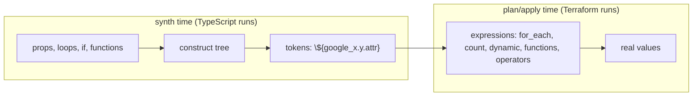

# 01 · Providers, resources, data sources & tokens

> After this module you can configure the Google provider the way a platform team needs it (impersonation, quota project, default labels, a beta alias), drive `for_each`/`count`/`dynamic` from TypeScript, and read any `cdk.tf.json` expression back to the line of code that produced it.

## Why this exists (the problem)

Every value that flows through a CDKTF program is one of two things: a real TypeScript value known at synth time, or a **token** — a placeholder for something only Terraform will know at plan or apply time (`google_storage_bucket.x.self_link`, `var.prefix`, `each.key`). Both are typed `string` (or `number`, `string[]`) so the compiler cannot tell them apart. Nearly every non-obvious CDKTF bug is a token being treated as a value: `zones.names[0]`, `name.length > 63`, `if (bucket.location === 'US')`, `JSON.stringify(labels)`. The framework cannot stop you; it can only give you the tools (`Fn.*`, `Op.*`, `propertyAccess`, `Token.*`) to push the computation into Terraform, where the value exists.

The second problem is that Terraform-the-language has features (`for_each`, `count`, `dynamic`, `depends_on`, `lifecycle`, `validation`, `precondition`) that have no TypeScript equivalent and must be requested explicitly. CDKTF maps each onto an API; this module uses all of them once, in one stack, so you can see the JSON each one produces.

## Mental model

Think of your program as a **compiler front-end** and Terraform as the **runtime**.



- Anything you can decide in TypeScript, decide in TypeScript: a `for` loop over a props map creates N resources with N distinct logical ids, fully visible to tests. That is the default.
- Anything that depends on a token must be expressed as a Terraform expression: `TerraformIterator` (for_each), `TerraformCount` (count), `iterator.dynamic()` (dynamic blocks), `Fn.conditional` (ternary), `Fn.*` (functions), `Op.*` (operators), `propertyAccess` (`x[*].y`, `x["k"]`).
- Tokens are strings with markers (`${TfToken[TOKEN.17]}`), so template literals and string concatenation *work* — the resolver splices interpolations back in. Everything else (`.length`, `===`, regex, `JSON.stringify`) silently operates on the marker.

## How it works

### Provider configuration ([`providers.ts`](providers.ts))

```ts
const google = new GoogleProvider(scope, 'Google', {
  project, region, zone,
  impersonateServiceAccount: props.impersonateServiceAccount,
  userProjectOverride: true,
  billingProject: project,
  requestReason: 'cdk-mastery',
});
applyDefaultLabels(google, props.defaultLabels);   // addOverride('default_labels', …), see below

const beta = new GoogleBetaProvider(scope, 'GoogleBeta', { alias: 'beta', project, region, zone, … });
```

- `project`/`region`/`zone` are provider-level defaults that every resource inherits and may override per resource. Setting `zone` avoids "zone is required" surprises on zonal resources.
- `impersonateServiceAccount`: the provider exchanges your ADC credential for a short-lived token of the deployer SA. Your identity needs only `roles/iam.serviceAccountTokenCreator` on that SA. This is how humans deploy to prod without holding prod roles.
- `userProjectOverride` + `billingProject`: sends `X-Goog-User-Project` so quota and billing for *requester-pays buckets*, Cloud Resource Manager and several org-level APIs are charged to a project you control. Without it, calls that need a quota project fail with a 403 that mentions "consumer".
- `defaultLabels`: the provider merges these into every resource that has `labels`; resource-level labels win. This is the cheapest fleet-wide labelling you will get — module 06 adds an aspect for resources the provider does not cover.
- **cdktf quirk**: provider configuration is serialised through `keysToSnakeCase`, which recurses into map *values* (only `tags` and `environment` are exempt — an AWS-ism; `node_modules/cdktf/lib/util.js`). `{ 'cost-center': … }` becomes `cost_center`. Resources are not affected because their generated code already emits snake_case. `applyDefaultLabels` writes the map with `provider.addOverride('default_labels', labels)` because overrides are merged *after* the snake-casing. The test pins the keys.
- The beta provider is the same schema one release ahead; classes are prefixed `Google…` (`GooglePubsubTopic`). `alias: 'beta'` renders as a second entry under `provider['google-beta']`, and a resource opts in with `provider: beta`, which renders `"provider": "google-beta.beta"`. Both providers pin `6.50.0` in `required_providers`.

### Data sources ([`project-facts.ts`](project-facts.ts))

A resource asserts "make this exist"; a data source asks "tell me about this" at plan time. Both live in state, both return tokens. The three you will use constantly:

| Data source | Why |
|---|---|
| `google_project` | the project **number**, needed for Google-managed service agent principals (`service-<number>@gcp-sa-*.iam.gserviceaccount.com`) |
| `google_client_config` | what the provider resolved (project, region, zone) and an OAuth `access_token` for kubernetes/helm providers |
| `google_compute_zones` | UP zones of a region, so `-a` is never hard-coded |

Because `ProjectFacts` is a `Construct` nested under the stack, its children get hashed logical ids: `data.google_project.Facts_Project_7EC5F241`. Top-level elements keep their construct id (`google_storage_bucket.Tiered`). The hash is derived from the path, so it is stable across synths and machines (module 05 explains `makeUniqueId`).

### Tokens ([`tokens-stack.ts`](tokens-stack.ts), outputs section)

Same resource, four different attributes, four different strings:

```ts
new TerraformOutput(this, 'tiered_name',      { value: tiered.name });      // ${google_storage_bucket.Tiered.name}
new TerraformOutput(this, 'tiered_id',        { value: tiered.id });        // …Tiered.id  (== name for buckets; provider-defined)
new TerraformOutput(this, 'tiered_self_link', { value: tiered.selfLink });  // …Tiered.self_link  (https://www.googleapis.com/storage/v1/b/…)
new TerraformOutput(this, 'tiered_export_uri', { value: `gs://${tiered.name}/exports/${tier.name}` });
```

Which one another resource wants is defined by *that* resource's docs: `google_storage_bucket_iam_member.bucket` wants `name`, `google_compute_subnetwork.network` accepts `id` or `self_link`, Cloud SQL's `private_network` wants `id`. When in doubt, `id` is the canonical full path for most GCP resources.

The `Token` API:

| Call | Meaning |
|---|---|
| `Token.asString(x)` / `asNumber(x)` / `asList(x)` | wrap any token so TypeScript treats it as that type; no conversion happens, Terraform still receives the expression |
| `Token.isUnresolved(x)` | true if `x` contains a token; use it in constructs that want to validate real values but pass tokens through |
| `Fn.element(list, 0)` | `element(list, 0)` — the correct way to index a list token |
| `Fn.lengthOf(list)` | `length(list)` — the correct way to count one |
| `Fn.lookup(map, key, default)` | `lookup(map, key, default)` |
| `Fn.format('%s-%s', [a, b])`, `Fn.join`, `Fn.replace` | string building that must happen after resolution |
| `Fn.cidrsubnet('10.10.0.0/16', 8, 1)` | network math at plan time |
| `Fn.jsonencode(obj)` | serialise an object *that contains tokens*; `JSON.stringify` would freeze the markers |
| `Fn.conditional(cond, a, b)` | `cond ? a : b` |
| `Op.eq/neq/gt/gte/lt/lte/and/or/not/add/mul…` | operators; see the gotcha about falsy right operands |
| `propertyAccess(target, ['*', 'name'])` | `target[*].name`; `propertyAccess(x, ['k'])` → `x.k` or `x["k"]` |
| `ref('self.project_number')` | a raw reference for identifiers the typed API has no accessor for (`self`, `path.module`) |

`Fn.templatefile` exists, but you rarely need it: build the string in TypeScript with a template literal (`` `gs://${bucket.name}/x` ``) or with `Fn.format`, and hand objects to `Fn.jsonencode`. Files on disk are for `TerraformAsset` (module 04).

### Variables, locals, outputs

```ts
const bucketPrefix = new TerraformVariable(this, 'bucket_prefix', { type: VariableType.STRING, default: 'cdkm', description: '…' });
bucketPrefix.addValidation({ condition: Fn.can(Fn.regex('^[a-z][a-z0-9-]{1,20}$', bucketPrefix.stringValue)), errorMessage: '…' });
const auditPrincipal = new TerraformVariable(this, 'audit_reader', { type: VariableType.STRING, default: '', sensitive: true });
const transitions = new TerraformVariable(this, 'archive_transitions', {
  type: VariableType.list(VariableType.object({ age: VariableType.NUMBER, storage_class: VariableType.STRING })), default: […] });
const namePrefix = new TerraformLocal(this, 'name_prefix', Fn.format('%s-%s', [bucketPrefix.stringValue, tier.name]));
new TerraformOutput(this, 'audit_reader_principal', { value: auditPrincipal.stringValue, sensitive: true });
```

Opinion: a `TerraformVariable` is for values the *operator* supplies at plan time (`-var`, `TF_VAR_x`, `.tfvars`). If TypeScript already knows the value, pass a prop. Variables are invisible to the type checker and to tests, and they push validation to plan time. The variable's own validation must reference itself, so it goes through `addValidation` after construction. A `TerraformLocal` is worth it when the same expression appears several times *in the JSON*; for TypeScript-only reuse a `const` is cheaper. `sensitive: true` on an output redacts it from CLI output and requires `terraform output -json` (or `-raw`) to read.

### Meta-arguments

**`dependsOn`** — for ordering with no data edge. The canonical GCP case: `google_project_service` must enable `storage.googleapis.com` before the first bucket, but nothing references it:

```ts
const storageApi = new ProjectService(this, 'StorageApi', { service: 'storage.googleapis.com', disableOnDestroy: false });
new StorageBucket(this, 'Buckets', { dependsOn: [storageApi], … });   // "depends_on": ["google_project_service.StorageApi"]
```

`disableOnDestroy: false` matters: the default (`true`) disables the API on `destroy`, which breaks every other stack in the project that uses it.

**`lifecycle`** — on the audit bucket:

```ts
lifecycle: {
  preventDestroy: tier.retainStatefulResources,          // plan fails rather than deleting; still deletable by removing the block first
  ignoreChanges: ['labels'],                             // external label edits do not show as drift
  precondition: [{ condition: Op.or(Op.not(enableAudit.value), Op.gte(auditRetentionDays.numberValue, 365)), errorMessage: '…' }],
}
```

`createBeforeDestroy: true` lives on the `random_id` suffix, where it is correct: when a keeper changes, the new id (and the new bucket name) exists before the old is dropped. On a bucket with a fixed name it would be wrong — the new one cannot be created while the old holds the name.

**`for_each` over a map** — `TerraformIterator.fromMap(props.buckets)`:

```ts
const it = TerraformIterator.fromMap(props.buckets);
this.bucketsByKey = new StorageBucket(this, 'Buckets', {
  forEach: it,
  name: Fn.format('%s-%s', [namePrefix.asString, it.key]),                // each.key
  storageClass: it.getString('storageClass'),                             // each.value.storageClass
  labels: Fn.merge([commonLabels.asStringMap, { purpose: it.getString('purpose'), key: it.key }]),
  lifecycleRule: [{ action: { type: 'Delete' }, condition: { age: it.getNumber('retentionDays') } }],
});
```

This is one `resource` block with `"for_each": {…the map…}`, three instances addressed `google_storage_bucket.Buckets["raw"]`. Contrast with a TypeScript `for` loop over the same map, which produces three resource blocks with three logical ids. The loop is better when you want per-entry construct ids, per-entry tests and per-entry `addOverride`; `for_each` is better when the collection is itself a token (a variable, a data source result) or when you want one plan line to cover N instances.

**`count` on a ternary** — the conditional resource:

```ts
this.auditBucket = new StorageBucket(this, 'Audit', { count: Fn.conditional(enableAudit.value, 1, 0), … });
new TerraformOutput(this, 'audit_bucket_name', { value: Fn.one(propertyAccess(this.auditBucket.fqn, ['*', 'name'])) });
```

A `count` resource is addressed as a list (`Audit[0]`), so reading from it goes through `one(Audit[*].name)`, which yields `null` when the count is 0. `TerraformCount.of(n)` + `count.index` is the other use of `count`; exercise 1 shows why `for_each` is preferred for anything that is not truly interchangeable.

**`dynamic` blocks** — `iterator.dynamic({...})` on a block-typed attribute:

```ts
const transitionIterator = TerraformIterator.fromList(transitions.listValue);
new StorageBucket(this, 'Tiered', {
  lifecycleRule: transitionIterator.dynamic({
    action: { type: 'SetStorageClass', storageClass: transitionIterator.getString('storage_class') },
    condition: { age: transitionIterator.getNumber('age') },
  }),
});
```

renders `"dynamic": { "lifecycle_rule": { "for_each": "${toset(var.archive_transitions)}", "iterator": "each", "content": {…} } }`. Note that CDKTF always names the iterator `each`; keep dynamic blocks and `forEach` on *different* resources, or use a TypeScript loop for the inner collection, so the two `each`es never meet in one block.

### The escape hatch

```ts
events.addOverride('lifecycle.ignore_changes', ['labels["last-published"]']);
```

`addOverride(path, value)` writes into the element's JSON after the typed attributes, so it can set things the bindings do not know (a provider attribute newer than the package), express syntax they cannot (an index expression in `ignore_changes`), or fix serialisation quirks (`default_labels`). Paths are dotted; a `value` of `undefined` deletes. Exercise 3 covers `overrideLogicalId`, `importFrom` and raw `TerraformResource`; module 10 goes further.

## Walkthrough

1. [`gcp-config.ts`](gcp-config.ts) — env-driven project/region.
2. [`providers.ts`](providers.ts) — `configureProviders()`: google + beta alias, impersonation, quota project, default labels via override.
3. [`project-facts.ts`](project-facts.ts) — data sources and the `Token.*` wrappers.
4. [`tokens-stack.ts`](tokens-stack.ts) — top to bottom: validation in TypeScript, providers, data sources, variables, locals, `dependsOn`, `for_each`, conditional `count`, `dynamic`, beta resource, override, outputs.
5. [`index.ts`](index.ts) — `addToApp` registers `m01-tokens` with `DEFAULT_BUCKETS`.
6. [`../../../test/01-providers-resources-and-tokens.test.ts`](../../../test/01-providers-resources-and-tokens.test.ts) — asserts the rendered expressions literally.

```
npx jest test/01-providers-resources-and-tokens.test.ts
bash ../scripts/typecheck-module.sh cdktf-gcp 01-providers-resources-and-tokens
npx cdktf synth && cat cdktf.out/stacks/m01-tokens/cdk.tf.json     # with the CLI
```

## Production notes

- **Impersonation everywhere.** Humans get `roles/iam.serviceAccountTokenCreator` on a per-environment deployer SA; the SA holds the real roles. Put `impersonateServiceAccount` in the provider (visible in the diff) rather than only in `GOOGLE_IMPERSONATE_SERVICE_ACCOUNT` (invisible).
- **`default_labels` is cheap FinOps.** Combined with `mandatoryTags()` it labels everything the provider supports without touching resource code. Verify with `gcloud asset search-all-resources --query='labels.managed-by=cdk-mastery'`.
- **`prevent_destroy` is a speed bump, not a lock.** It only protects while the block is in the config; whoever can edit the config can remove it. Real protection is IAM (no `storage.buckets.delete` for the deployer in prod) and bucket retention-policy locks (`isLocked: true` is irreversible — the audit bucket does this in prod).
- **`ignore_changes: ['labels']` hides drift.** Use the narrowest key you can (`labels["k"]` via override) and revisit when the external writer goes away.
- **Variables cost visibility.** Every `TerraformVariable` is a value your tests do not see and your reviewer has to chase into a `.tfvars`. Prefer props; keep variables for secrets injected at plan time and for genuinely per-run knobs.
- **`for_each` keys are forever.** Renaming a map key destroys and recreates that instance. Choose keys that will not change (`raw`, not `raw-v1`).

## Gotchas

- Symptom: `zones.names[0]` yields a string that starts with `${TfToken` and Terraform errors on it → cause: indexing a list token in TypeScript → fix: `Fn.element(zones.names, 0)`.
- Symptom: a name-length check passes at synth and fails at apply ("must be ≤ 63 chars") → cause: `token.length` is the marker's length → fix: validate real strings only (`if (!Token.isUnresolved(name) && name.length > 63)`), or let Terraform enforce with `precondition` + `length()`.
- Symptom: `${(var.x == undefined)}` in the JSON → cause: cdktf 0.21's `OperatorExpression` renders a falsy right operand (`0`, `false`, `""`) as `undefined` → fix: put the literal on the left (`Op.eq(0, x)`) or use `Op.lt(x, 1)`. The test pins this.
- Symptom: `Fn.lookup(map, key, false)` renders `map.key` instead of `lookup(map, key, false)` and plans with "Unsupported attribute" → cause: `Fn.lookup` treats a falsy default (`false`, `0`, `""`) as "no default" → fix: use a truthy default with the intended semantics (module 02, exercise 2 uses `true`), or `Fn.try([propertyAccess(map, [key]), false])`.
- Symptom: `"$${self.x}"` in a condition → cause: plain strings containing `${` are *escaped* as literals → fix: `ref('self.x')` for raw references; typed accessors otherwise.
- Symptom: provider `default_labels` keys have underscores where you wrote hyphens → cause: `keysToSnakeCase` on provider config → fix: `provider.addOverride('default_labels', labels)`.
- Symptom: inside a `for_each` resource, `each.value` in a `dynamic` block shadows the resource's own `each` (CDKTF hard-codes `iterator: "each"`), so the outer entry is unreachable from the block → cause: `iterator.dynamic()` on a resource that also has `forEach` → fix: keep them on separate resources, or unroll the inner list with a TypeScript loop.
- Symptom: `terraform destroy` of one stack breaks every other stack's plan → cause: `google_project_service` with the default `disable_on_destroy = true` → fix: always `disableOnDestroy: false`.
- Symptom: "There is already a Construct with name 'x'" → cause: two elements share a construct id in the same scope (outputs and variables count) → fix: unique ids per scope; outputs are elements too.

## Exercises

1. **List iteration vs count.** Build one bucket per region from a `string[]` with `TerraformIterator.fromList`, and `n` numbered shard buckets with `TerraformCount`. Output both name lists. Explain (in a comment) what `terraform plan` shows when the first region is removed versus when `n` shrinks by one. Solution: [`solutions/01-list-iterator.ts`](solutions/01-list-iterator.ts).
2. **Validation at every layer.** Enforce "bucket location must be in an allowed list" in TypeScript (throw), in a `variable.validation` (subset check with `setsubtract`), and in a `lifecycle.precondition` (`contains`). Add a `postcondition` on `self.project_number`. Solution: [`solutions/02-validated-inputs.ts`](solutions/02-validated-inputs.ts).
3. **Escape hatches.** Adopt an existing bucket under its legacy HCL address (`overrideLogicalId('legacy')` + `importFrom`), set an attribute through `addOverride`, and declare a resource type the bindings do not have with raw `TerraformResource`. Assert the `import` block in the JSON. Solution: [`solutions/03-escape-hatches.ts`](solutions/03-escape-hatches.ts).

## Checklist

- [ ] Provider sets `project`, `region`, `zone`, `userProjectOverride`, `billingProject`; prod deployments set `impersonateServiceAccount`.
- [ ] `default_labels` carries the `mandatoryTags()` set and is written through `addOverride`.
- [ ] Every `google_project_service` has `disableOnDestroy: false`.
- [ ] No `.length`, `===`, regex or `JSON.stringify` on a value that may be a token; `Token.isUnresolved` guards where both are possible.
- [ ] Code review: `Op.*` calls never have a literal `0`/`false`/`""` as the right operand.
- [ ] Code review: `for_each` keys are stable identifiers; `count` only for interchangeable instances.
- [ ] Code review: every `TerraformVariable` has a `description`, a `type`, and a reason it is not a prop.

## Interview angle

1. *"What is a token, and why does `bucket.name.length` compile but misbehave?"* — A token is a placeholder string (`${TfToken[TOKEN.n]}`) for a value only Terraform knows; the TypeScript type is `string` so all string operations compile, but they operate on the marker. Correct handling pushes the operation into Terraform (`Fn.lengthOf`) or guards with `Token.isUnresolved`.
2. *"When would you write a `for` loop and when `TerraformIterator`?"* — Loop when the collection is known at synth: distinct construct ids, per-instance tests and overrides, clearer plans. Iterator when the collection is a token (variable, data source) or when you need one resource block for N instances. Both keep state keyed by something; choose keys that never change.
3. *"How do you get the Google provider to act as a service account without key files?"* — `impersonateServiceAccount` on the provider (or the env var): ADC identity gets a short-lived token via `generateAccessToken`, needs only `serviceAccountTokenCreator` on the target SA. In CI, replace ADC with Workload Identity Federation (module 08). Audit logs carry both principals.

## References

- Google provider reference (all provider arguments): https://registry.terraform.io/providers/hashicorp/google/6.50.0/docs/guides/provider_reference
- google-beta provider: https://registry.terraform.io/providers/hashicorp/google-beta/6.50.0/docs
- CDKTF tokens: https://developer.hashicorp.com/terraform/cdktf/concepts/tokens
- CDKTF iterators (`for_each`, `dynamic`): https://developer.hashicorp.com/terraform/cdktf/concepts/iterators
- CDKTF variables and outputs: https://developer.hashicorp.com/terraform/cdktf/concepts/variables-and-outputs
- CDKTF functions and operators: https://developer.hashicorp.com/terraform/cdktf/concepts/functions
- Terraform meta-arguments: https://developer.hashicorp.com/terraform/language/meta-arguments/lifecycle
- Custom conditions (`precondition`/`postcondition`/`validation`): https://developer.hashicorp.com/terraform/language/expressions/custom-conditions
- cdktf 0.21 source read for this module: `node_modules/cdktf/lib/tfExpression.js` (`OperatorExpression`, `RawString`, `Reference`), `util.js` (`keysToSnakeCase`), `terraform-iterator.js`
