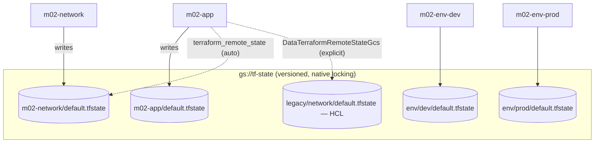

# 02 · State, backends & environments

> After this module you can put state where it belongs (GCS, locked and versioned), wire stacks together and predict the deploy order that creates, model dev/staging/prod as stacks rather than workspaces, consume outputs from stacks you do not own, and rename or adopt resources without a destroy/create.

## Why this exists (the problem)

In AWS CDK, CloudFormation owns state: you never see it, cannot corrupt it, and cannot share it. Terraform's state is a JSON file *you* own. It is the only record of which real resource corresponds to which address in your configuration, it contains every attribute the provider read (passwords included), and if two people apply against it at once, the loser silently overwrites the winner. Everything in this module follows from that one fact:

- state must live somewhere shared, locked and versioned → **backends**;
- one stack = one state file, so splitting an app into stacks means splitting state, and a reference across the split is a **remote state read** with a deploy-order consequence;
- an "environment" is a state file plus a provider configuration → **stack-per-environment**;
- moving a resource between addresses is a state edit → **`moved`/`import` blocks**, or the `terraform state` CLI when you must.

## Mental model

A `TerraformStack` is a root module with exactly one state file. Arrows between stacks are `terraform_remote_state` reads; the arrow's direction is the deploy order.



## How it works

### The GCS backend ([`backend.ts`](backend.ts))

```ts
export function configureBackend(stack: TerraformStack, prefix: string, options: StateBackendOptions = {}) {
  const bucket = options.bucket ?? process.env.CDKM_STATE_BUCKET;
  if (!bucket) return undefined;                      // offline synth keeps the local backend
  return new GcsBackend(stack, { bucket, prefix, kmsEncryptionKey: …, impersonateServiceAccount: … });
}
```

Renders `terraform.backend.gcs = { bucket, prefix }`. State lands at `gs://<bucket>/<prefix>/default.tfstate` (`<workspace>.tfstate` for non-default workspaces).

Why GCS is the right default on GCP:

- **Locking is native.** The backend creates `<prefix>/default.tflock` with an `ifGenerationMatch: 0` precondition; a second apply fails fast with "Error acquiring the state lock" and the lock's holder/time. No DynamoDB-style table. A crashed apply leaves the lock; `terraform force-unlock <id>` clears it (after you have checked nobody is running).
- **Object versioning is the safety net.** Enable it on the state bucket (`versioning: { enabled: true }`, plus a lifecycle rule to cap noncurrent versions). Every write is a new generation, so a corrupted state or a wrong `state push` is recovered by copying an older generation back. Without versioning, a bad push is unrecoverable.
- **Encryption is on** (Google-managed keys). `kmsEncryptionKey` switches the state objects to CMEK when policy demands.
- **Access is IAM.** The deployer needs `roles/storage.objectAdmin` (or `objectUser` + `objectViewer`) on the bucket; humans get `objectViewer` at most. `impersonateServiceAccount` on the backend is independent of the provider's, so state access and resource access can use different identities.

The backend is conditional so the tests and `cdktf synth` stay offline. `CDKM_STATE_BUCKET=… npx cdktf synth` switches all module 02 stacks over.

**Other backends** (same file, exercised in the test): `useCloudBackend()` renders `terraform.cloud { organization, hostname, workspaces { name } }` for HCP Terraform — state, locking, run history and Sentinel/OPA policy in one place; `cdktf login` stores the token, `TF_TOKEN_app_terraform_io` in CI. `useHttpBackend()` renders `backend.http` with lock/unlock endpoints for GitLab-managed state or your own service. Module 08 uses the cloud backend end to end.

### Cross-stack references ([`network-stack.ts`](network-stack.ts) → [`app-stack.ts`](app-stack.ts))

The consumer just uses the producer's attribute:

```ts
this.firewall = new ComputeFirewall(this, 'AllowIapSsh', { network: props.network.network.id, … });
```

Nothing in the code says "remote state". The mechanics live in `App.synth()` → `prepareStack()` (`node_modules/cdktf/lib/terraform-stack.js`, `app.js`): a *preparing* token-resolution pass finds a `Reference` whose origin stack differs from the resolving stack and calls `app.crossStackReference(from, to, identifier)`, which

1. `to.addDependency(from)` — recorded in `manifest.json` as `dependencies: ["m02-network"]`;
2. `from.registerOutgoingCrossStackReference(id)` — adds `output "cross-stack-output-google_compute_networkVpcid" { value = google_compute_network.Vpc.id, sensitive = true }` to the producer;
3. `to.registerIncomingCrossStackReference(from)` — adds `data "terraform_remote_state" "cross-stack-reference-input-m02-network"` to the consumer, configured with the **producer's backend** (`gcs { bucket, prefix }` — or `local { path }` when nothing is configured), and rewrites the token to `data.terraform_remote_state.….outputs.cross-stack-output-google_compute_networkVpcid`.

Consequences you must know:

- **Deploy order is real.** The consumer's plan *reads the producer's state*; if the producer has never been applied, the consumer's `terraform init`/`plan` fails with "Unsupported attribute" on the missing output. `cdktf deploy '*'` (or `cdktf deploy m02-network m02-app`) orders by the manifest. `cdktf deploy m02-app` alone refuses because of the missing dependency unless you pass `--ignore-missing-stack-dependencies`, which says "I applied `m02-network` some other way; trust me".
- **The producer changes when the consumer does.** Adding a new reference adds an output to the producer's config, so the producer must be re-applied before the consumer can read it. A change in the consumer's PR that touches only consumer files still needs a producer deploy. Reviewers should look for new `cross-stack-output-*` outputs in the producer's diff.
- **Backends must be readable by the consumer's identity.** With GCS, the consumer's deployer SA needs `objectViewer` on the producer's prefix. With local backends the path is absolute — cross-stack references with local state only work on one machine.
- **The testing helpers skip `prepareStack()`.** `Testing.synth(consumer)` shows `${google_compute_network.Vpc.id}` — which would not apply. Call `consumer.prepareStack()` first (the test does), or use `App.synth()`.
- **Cycles are refused** at prepare time ("Cannot add dependency … circular dependency"). Exercise 3 makes one and breaks it.

### Explicit remote state: consuming stacks you do not own

```ts
const legacy = new DataTerraformRemoteStateGcs(this, 'LegacyNetwork', { bucket, prefix, defaults: {} });
new ComputeAddress(this, 'LegacyInternalIp', { subnetwork: legacy.getString('subnet_self_link'), … });
```

Same data source, written by hand, pointing at a state file that an HCL repository (or another team's CDKTF app) writes. No manifest dependency is recorded — the consumer's `cdktf deploy` neither waits for nor triggers the producer. The **output name is the integration contract**; treat it as an API:

- name outputs like API fields (`network_id`, `subnet_self_link`), describe them, never rename without a deprecation period (emit both names for a release);
- `defaults` turns a missing output into a value instead of an error. Use it only when the consumer genuinely works without the value; otherwise a missing output should fail the plan, not produce an empty-string subnetwork that fails ten minutes later at apply;
- failure modes: the producer re-applies with a renamed output (consumer plan breaks), the producer marks an output `sensitive` (still readable via remote state — sensitivity is display-only), the consumer's identity loses read access (init fails with 403), the producer's state moves to a new bucket (consumer keeps reading the stale copy — the most dangerous one, because nothing errors). Mitigate the last with a `precondition` on a value that must be non-empty and a scheduled drift check (module 08).

### Stack-per-environment ([`environments.ts`](environments.ts))

```ts
export function addEnvironmentStacks(app: App, idPrefix = 'm02-env') {
  for (const tier of Object.values(ENVIRONMENTS)) {
    stacks[tier.name] = new EnvironmentStack(app, `${idPrefix}-${tier.name}`, { tier });
  }
}
// inside EnvironmentStack: configureBackend(this, `env/${tier.name}`); forceDestroy: !tier.retainStatefulResources; …
```

Three stacks, three state prefixes (`env/dev`, `env/staging`, `env/prod`), three provider blocks (so three projects and three impersonated SAs in real life), three independent `cdktf deploy` targets that can be gated differently in CI. Every difference is a TypeScript decision, so the test asserts `prod` has `force_destroy = false` and `prevent_destroy = true` while `dev` does not — without Terraform.

Terraform **workspaces** are the alternative: one configuration, N state files selected by `terraform workspace select`. CDKTF supports them (the CLI honours `TF_WORKSPACE`; the GCS backend stores `<prefix>/<workspace>.tfstate`), but every difference becomes `terraform.workspace == "prod" ? … : …` — a token, invisible to tests, and one wrong `select` away from applying dev sizing to prod. Workspaces are fine for ephemeral copies of *the same* configuration (a per-PR preview environment); they are the wrong tool for environments that differ. Exercise 2 builds the workspace flavour so the comparison is concrete.

### State surgery ([`state-surgery.ts`](state-surgery.ts))

Declarative, in code, Terraform ≥ 1.5:

```ts
this.network.moveFromId('google_compute_network.legacy_network');   // moved { from, to = google_compute_network.Vpc }
this.buckets.addMoveTarget('buckets-by-key');
rawBucket.moveTo('buckets-by-key', 'raw');                           // moved { from = …RawBucket, to = …Buckets["raw"] }
this.adopted.importFrom(props.adoptBucketName, google);              // import { id, to = google_storage_bucket.Adopted }
```

`moved` blocks rename addresses in state during the next apply without touching the resource; the old construct is still declared (so the move has a `from`) but is not rendered as a resource. `import` blocks adopt existing resources; the config must match reality closely enough that the post-import plan is empty (write the config, run `terraform plan -generate-config-out` in the stack directory if you want Terraform to draft it). Both are reviewable in the PR and idempotent.

Imperative alternatives, for one-off repairs only:

| Command | Use |
|---|---|
| `terraform state mv A B` | same as `moved`, but immediate and untracked |
| `terraform import ADDR ID` | same as `import`, immediate |
| `terraform state rm ADDR` | forget a resource without destroying it (hand-over to another stack, then `import` there) |
| `terraform state pull > s.json` / `state push s.json` | last resort: edit JSON by hand (bump `serial`), push, and pray you had versioning on |
| `terraform state list` / `show ADDR` | read-only; use freely |

Run them inside `cdktf.out/stacks/<name>/` after `cdktf synth` so they see the right backend. `cdktf` has no wrapper for them.

**Migrating between backends.** Change the backend in code (e.g. add `configureBackend` where there was none), `cdktf synth`, then in `cdktf.out/stacks/<name>/` run `terraform init -migrate-state` — Terraform copies the local state to GCS and asks for confirmation. Going the other way (GCS → HCP Terraform) is the same command with the `cloud` block. `cdktf` does not automate this; do it once per stack, with the bucket already versioned, and commit the code change in the same PR as the runbook note.

### Gating note

`moveTo`/`importFrom` register a `ValidateTerraformVersion(">=1.5")` validation on the construct. `App.synth()` runs validations, and this one shells out to `terraform version`; with no binary on PATH synth fails. `index.ts` therefore registers `m02-refactor` only when `CDKM_ENABLE_REFACTOR_STACK` is set, so `cdktf synth` stays binary-free by default. `Testing.synth` does not run validations, so the tests cover the stack unconditionally.

## Walkthrough

1. [`backend.ts`](backend.ts) — `configureBackend`, `useCloudBackend`, `useHttpBackend`.
2. [`network-stack.ts`](network-stack.ts) — producer: VPC + subnet, TypeScript properties *and* an explicit `network_id` output.
3. [`app-stack.ts`](app-stack.ts) — consumer: implicit reference to the VPC, optional explicit `DataTerraformRemoteStateGcs` read of an HCL stack.
4. [`environments.ts`](environments.ts) — `EnvironmentStack` + `addEnvironmentStacks` factory.
5. [`state-surgery.ts`](state-surgery.ts) — `moveFromId`, `addMoveTarget`/`moveTo`, `importFrom`.
6. [`index.ts`](index.ts) — stack ids `m02-network`, `m02-app`, `m02-env-{dev,staging,prod}`, optional `m02-refactor`.
7. [`../../../test/02-state-backends-and-environments.test.ts`](../../../test/02-state-backends-and-environments.test.ts) — the cross-stack test is the one to read slowly: it shows the JSON before and after `prepareStack()`.

```
npx jest test/02-state-backends-and-environments.test.ts
CDKM_STATE_BUCKET=my-tf-state npx cdktf synth && cat cdktf.out/stacks/m02-app/cdk.tf.json | jq .data
npx cdktf deploy m02-network m02-app          # ordered; or: cdktf deploy '*'
npx cdktf deploy m02-app --ignore-missing-stack-dependencies   # when m02-network was applied elsewhere
```

## Production notes

- **State bucket first, by hand or by a bootstrap stack with local state.** Versioning on, uniform access, public-access prevention enforced, a lifecycle rule keeping ~30 noncurrent versions, retention as your audit policy requires. Never let the stack that uses the bucket also manage it.
- **State is sensitive.** `random_password.result`, database user passwords, service-account keys, OAuth client secrets — all in plaintext in state. IAM on the bucket is your secret boundary; CMEK adds a second one. `sensitive = true` on an output changes CLI display only.
- **One deployer SA per environment**, each with `objectAdmin` only on its own prefix (IAM conditions on `resource.name.startsWith("projects/_/buckets/b/objects/env/prod/")`). Then a dev pipeline physically cannot touch prod state.
- **Cross-stack references are coupling.** They are perfect inside one team's app (network → app → jobs). Between teams, use explicit `DataTerraformRemoteState*` against documented outputs, or better, a registry of values that is not state at all (Secret Manager, a config bucket, Cloud Deploy parameters) so the consumer does not need read access to someone else's state.
- **Monitor lock age and state size.** A `.tflock` older than your longest apply is a stuck lock; a state file growing past tens of MB makes every plan slow (split the stack).
- **Cost:** none of this costs anything measurable. The bucket is cents; HCP Terraform is per-resource-under-management on paid tiers.

## Gotchas

- Symptom: consumer `plan` fails with `Unsupported attribute … outputs` → cause: producer not applied since the reference was added → fix: deploy the producer first (`cdktf deploy '*'` orders it); check the producer diff for new `cross-stack-output-*`.
- Symptom: `Error acquiring the state lock` with an ID and a timestamp from an hour ago → cause: a crashed apply left `default.tflock` → fix: confirm no run is active, then `terraform force-unlock <ID>` in the stack directory.
- Symptom: `Backend configuration changed` on `init` → cause: you changed backend settings in code → fix: `terraform init -migrate-state` (to move state) or `-reconfigure` (to just switch, state stays where it was).
- Symptom: cross-stack reference works on your laptop, fails in CI → cause: local backend with an absolute path baked in at synth → fix: a real backend for every stack that participates in references.
- Symptom: `Testing.synth(consumer)` shows `${google_compute_network.Vpc.id}` and you think references are broken → cause: testing helpers skip `prepareStack()` → fix: call it, or use `App.synth()`.
- Symptom: `cdktf synth` fails with "Could not determine version of terraform" → cause: `moveTo`/`importFrom` validation shelling out to a missing binary → fix: install Terraform ≥ 1.5, or keep such stacks gated as this module does.
- Symptom: `terraform.workspace == "prod"` logic applied dev sizing to prod → cause: someone ran `workspace select dev` and forgot → fix: stack-per-environment; if you must use workspaces, add the `var.environment == terraform.workspace` precondition from exercise 2.
- Symptom: removing a stack from `addToApp` leaves its resources running → cause: Terraform only destroys what is in a state it is asked to apply → fix: `cdktf destroy <stack>` *before* deleting the code, then delete the code.

## Exercises

1. **Explicit contract.** Rewrite the VPC consumption as a `DataTerraformRemoteStateGcs` (and `…Local` for laptops) read of `network_id`, with no `defaults`, and show that the manifest records no dependency. Solution: [`solutions/01-explicit-contract.ts`](solutions/01-explicit-contract.ts).
2. **Workspace style.** Build the same environment split with one stack and `terraform.workspace`: a `TerraformLocal` table of tiers, `Fn.lookup` on the workspace, and a `var.environment == terraform.workspace` precondition. List which stack-per-env tests you can no longer write. Solution: [`solutions/02-workspace-style.ts`](solutions/02-workspace-style.ts).
3. **Break the cycle.** Make two stacks reference each other, prove `prepareStack()` throws, then break the cycle by computing the service-account email at synth time instead of reading it from the other stack. Solution: [`solutions/03-break-the-cycle.ts`](solutions/03-break-the-cycle.ts).

## Checklist

- [ ] State bucket: versioning on, uniform access, PAP enforced, lifecycle rule on noncurrent versions, IAM limited to deployer SAs per prefix.
- [ ] Every stack that participates in a cross-stack reference has a non-local backend.
- [ ] Producer outputs used by other teams are named, described and treated as an API.
- [ ] Environments are stacks; workspaces only for ephemeral copies of identical configuration.
- [ ] Refactors that change addresses ship `moved` blocks in the same PR; `terraform state mv` is a documented one-off.
- [ ] Code review: a consumer PR that adds a reference is deployed producer-first; the reviewer checks the producer diff.
- [ ] Code review: no `defaults` on a remote-state read unless the consumer genuinely runs without the value.

## Interview angle

1. *"How does CDKTF implement a reference between two stacks, and what does it cost?"* — At `prepareStack` it turns the token into a sensitive output on the producer and a `terraform_remote_state` data source (configured with the producer's backend) on the consumer, and records a manifest dependency. Cost: a strict deploy order, a producer re-apply whenever a new reference appears, and read access from the consumer's identity to the producer's state.
2. *"Why stacks per environment rather than workspaces?"* — Each stack has its own state, provider, project, identity and pipeline gate, and every difference is a synth-time decision that tests can assert. Workspaces share one configuration and push differences into Terraform expressions selected by a mutable CLI setting.
3. *"A resource needs to move from stack A to stack B without downtime."* — In A: `terraform state rm` (or remove from code with a documented `state rm`), keeping the real resource; in B: declare it with matching config and `importFrom` (or `terraform import`); apply B and confirm an empty plan; then remove it from A's code. Never let both stacks manage it at once; never destroy in A.

## References

- GCS backend: https://developer.hashicorp.com/terraform/language/backend/gcs
- Remote state data source: https://developer.hashicorp.com/terraform/language/state/remote-state-data
- CDKTF stacks and cross-stack references: https://developer.hashicorp.com/terraform/cdktf/concepts/stacks
- CDKTF remote backends: https://developer.hashicorp.com/terraform/cdktf/concepts/remote-backends
- `moved` blocks: https://developer.hashicorp.com/terraform/language/moved
- `import` blocks: https://developer.hashicorp.com/terraform/language/import
- CDKTF resource refactoring (`moveTo`, `importFrom`): https://developer.hashicorp.com/terraform/cdktf/concepts/resources#refactoring--moving-resources
- Workspaces: https://developer.hashicorp.com/terraform/language/state/workspaces
- HCP Terraform `cloud` block: https://developer.hashicorp.com/terraform/cli/cloud/settings
- cdktf 0.21 source read for this module: `node_modules/cdktf/lib/app.js` (`crossStackReference`), `terraform-stack.js` (`prepareStack`, `registerIncomingCrossStackReference`), `backends/gcs-backend.js`, `terraform-resource.js` (`moveTo`, `importFrom`)
