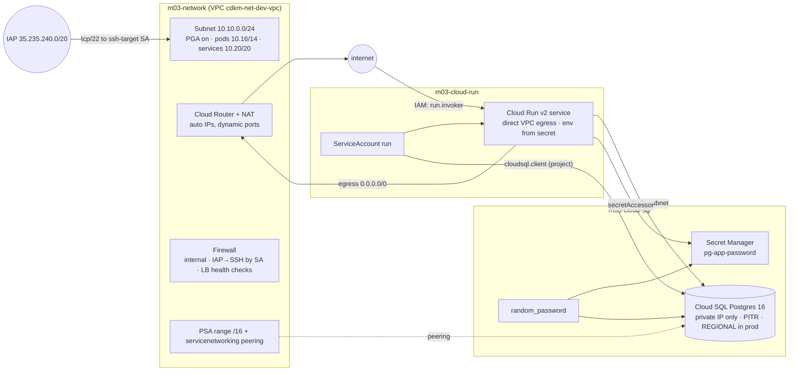

# 03 · Networking & compute

> After this module you can stand up a private, cost-aware GCP landing zone for one workload — custom VPC, Cloud NAT, Private Service Access, a private Cloud SQL Postgres, and a Cloud Run v2 service that reaches it with its own identity — and explain every IAM grant in it.

## Why this exists (the problem)

The default network in a new GCP project is an auto-mode VPC with a subnet in every region, a firewall rule that allows SSH from `0.0.0.0/0`, and workloads that run as the project's default compute service account, which holds `roles/editor`. Every one of those defaults is a finding in your first security review. The correct shape — custom-mode VPC, no public IPs, identity-based firewalls, NAT for egress, private paths to managed services, one service account per workload with the minimum roles — is not hard, but it is ten resources with ordering constraints (APIs before anything, peering before Cloud SQL, network before Cloud Run) that people get wrong under time pressure.

This module encodes that shape once, in three stacks whose deploy order falls out of their references.

## Mental model



Deploy order is the arrow direction between stacks: `m03-network → m03-cloud-sql → m03-cloud-run`, enforced by cross-stack references (module 02).

## How it works

### APIs first ([`services.ts`](services.ts))

```ts
const apis = new ProjectServices(this, 'Apis', ['compute.googleapis.com', 'servicenetworking.googleapis.com']);
this.network = new ComputeNetwork(this, 'Vpc', { …, dependsOn: apis.services });
```

`google_project_service` with `disableOnDestroy: false` (the default `true` would switch the API off for every other stack in the project on `destroy`) and `disableDependentServices: false`. Each stack declares the APIs it needs and points its first resource at them with `dependsOn`, because nothing references an API enablement and Terraform cannot infer the order. In a fresh project this is the difference between a clean first apply and a 403.

### The VPC ([`network-stack.ts`](network-stack.ts))

| Resource | Setting | Why |
|---|---|---|
| `ComputeNetwork` | `autoCreateSubnetworks: false`, `routingMode: 'REGIONAL'` | no surprise subnets in 40 regions; regional dynamic routing unless you run multi-region interconnect |
| `ComputeSubnetwork` | `privateIpGoogleAccess: true` | instances with no external IP still reach GCS, Secret Manager, Artifact Registry |
| | `secondaryIpRange` `pods` /14, `services` /20 | reserved now so a GKE cluster later is a one-liner, not a subnet migration |
| | `logConfig` only when `tier.highlyAvailable` | VPC flow logs bill as Logging ingestion; sample 50% in prod, none in dev |
| `ComputeRouter` + `ComputeRouterNat` | `AUTO_ONLY`, `ALL_SUBNETWORKS_ALL_IP_RANGES`, `enableDynamicPortAllocation`, `logConfig ERRORS_ONLY` | egress for everything private; dynamic ports prevent the classic port-exhaustion outage; error logs show drops |
| `ComputeFirewall` `AllowInternal` | source = all three ranges | east-west traffic |
| `ComputeFirewall` `AllowIapSsh` | `sourceRanges: [35.235.240.0/20]`, `targetServiceAccounts: [ssh-target]` | SSH arrives only via IAP TCP forwarding and only at instances running as that SA |
| `ComputeFirewall` `AllowHealthChecks` | `35.191.0.0/16`, `130.211.0.0/22` | Google LB health checkers |
| `ComputeGlobalAddress` | `purpose: 'VPC_PEERING'`, `/16` | address space handed to Google for managed services |
| `ServiceNetworkingConnection` | `service: 'servicenetworking.googleapis.com'`, `deletionPolicy: 'ABANDON'` | the peering itself; ABANDON lets `destroy` proceed when a Cloud SQL instance still pins it |

Firewall rules target **service accounts, not network tags**. A tag is set by anyone with `compute.instances.setTags` on the instance; a service account is chosen at instance creation and controlled by `iam.serviceAccountUser`. The `ssh-target` SA exists only to be targeted. Cloud Run direct VPC egress uses network *tags* (`tags: ['cloud-run']` on the network interface) because Cloud Run revisions cannot carry an SA for firewall purposes — the SA is the runtime identity — so a rule for Cloud Run traffic would use `targetTags`.

### Cloud SQL ([`cloud-sql-stack.ts`](cloud-sql-stack.ts))

```ts
this.instance = new SqlDatabaseInstance(this, 'Postgres', {
  databaseVersion: 'POSTGRES_16',
  deletionProtection: tier.retainStatefulResources,             // Terraform-side guard
  settings: {
    tier: sqlMachineTier(tier),                                  // db-f1-micro | db-custom-2-7680
    availabilityType: tier.highlyAvailable ? 'REGIONAL' : 'ZONAL',
    deletionProtectionEnabled: tier.retainStatefulResources,     // API-side guard
    ipConfiguration: { ipv4Enabled: false, privateNetwork: props.network.network.id, enablePrivatePathForGoogleCloudServices: true, sslMode: 'ENCRYPTED_ONLY' },
    backupConfiguration: { enabled: true, pointInTimeRecoveryEnabled: true, transactionLogRetentionDays: 7, backupRetentionSettings: { retainedBackups: … } },
    …
  },
});
```

- **Private IP only.** `ipv4Enabled: false` means no public address exists to firewall. `privateNetwork` is the VPC id; the address comes from the PSA range. Because the peering lives in the network stack and that stack is applied first (cross-stack order), no `dependsOn` is needed — and none is possible across stacks.
- **Two deletion guards.** `deletionProtection` is Terraform refusing to plan a destroy; `settings.deletionProtectionEnabled` is the Cloud SQL API refusing a delete from anyone, console included. Prod sets both.
- **Backups + PITR.** Daily backups at 03:00, transaction logs for 7 days (the maximum), 30 retained backups in prod. PITR is the thing that saves you from `DELETE FROM orders` without a `WHERE`; backups alone give you yesterday.
- **The password.** `random_password` generates it at apply; from then on it is in state (plaintext) and in Secret Manager. `SqlUser.password` and `SecretManagerSecretVersion.secretData` both reference `password.result`. Rotate by replacing the `random_password` resource (`terraform apply -replace=random_password.AppPassword`); the user and the secret version follow. `cloudsql.iam_authentication = on` is enabled so the *next* step — IAM database authentication, no password at all — is a flag away.
- `SqlDatabase`/`SqlUser` `deletionPolicy: 'ABANDON'` in prod: `destroy` forgets them instead of dropping them.

### Cloud Run v2 ([`cloud-run-stack.ts`](cloud-run-stack.ts))

```ts
template: {
  serviceAccount: this.serviceAccount.email,
  scaling: { minInstanceCount: tier.highlyAvailable ? 1 : 0, maxInstanceCount: … },
  vpcAccess: { egress: 'PRIVATE_RANGES_ONLY', networkInterfaces: [{ network, subnetwork, tags: ['cloud-run'] }] },
  containers: [{ image, env: [ …, { name: 'DB_PASSWORD', valueSource: { secretKeyRef: { secret: passwordSecret.secretId, version: 'latest' } } } ], … }],
}
```

- **Own identity.** Never the default compute SA. `ProjectIamMember` grants `roles/cloudsql.client` (project-level because the Cloud SQL Admin API has no per-instance IAM); `SecretManagerSecretIamMember` grants `secretAccessor` on *one* secret. Both are `_iam_member` — additive, never touching other principals (module 04 covers the `_binding`/`_policy` trap).
- **Direct VPC egress.** `vpcAccess.networkInterfaces` puts each instance on the subnet with its own IP (the typings: `CloudRunV2ServiceTemplateVpcAccessNetworkInterfaces { network, subnetwork, tags }`). `PRIVATE_RANGES_ONLY` sends RFC 1918 traffic through the VPC and everything else straight out; `ALL_TRAFFIC` forces everything through the VPC (and Cloud NAT), which you want when egress IPs must be allow-listed. A /24 subnet supports ~100 instances; size accordingly. Exercise 1 builds the connector alternative.
- **Secrets as env.** `valueSource.secretKeyRef` mounts the secret at start-up; the container never sees Secret Manager. `version: 'latest'` re-reads on each new instance — pin a version when you need rotation to be a deploy.
- **Invokers.** `CloudRunV2ServiceIamMember` with `roles/run.invoker`: `allUsers` is the public internet (IAM still applies — to everyone). Anything else must send an OIDC identity token minted for the service URL (`gcloud auth print-identity-token`, or a `google_service_account` calling from another service). Dev defaults to public; prod requires explicit principals.
- `deletionProtection` on the service defaults to `true` in provider 6.x and blocks `destroy`; it is tier-driven here.

### Deploy

```
npx cdktf deploy m03-network m03-cloud-sql m03-cloud-run     # or 'm03-*'
```

Expect ~10 minutes for Cloud SQL. First-time PSA peering occasionally races with the SQL create ("Failed to create subnetwork… private network"): a second apply succeeds; a `time_sleep` after the peering is the known workaround if it bites in CI.

## Walkthrough

1. [`services.ts`](services.ts) — `ProjectServices`.
2. [`network-stack.ts`](network-stack.ts) — VPC, subnet, NAT, firewalls, PSA, `ssh-target` SA. Constants `IAP_RANGE`, `HEALTH_CHECK_RANGES`.
3. [`cloud-sql-stack.ts`](cloud-sql-stack.ts) — instance, database, user, password, secret. `sqlMachineTier()`.
4. [`cloud-run-stack.ts`](cloud-run-stack.ts) — SA, IAM members, service, invokers.
5. [`index.ts`](index.ts) — `m03-network`, `m03-cloud-sql`, `m03-cloud-run`.
6. [`../../../test/03-networking-and-compute.test.ts`](../../../test/03-networking-and-compute.test.ts) — per-stack assertions and the deploy-order test.

```
npx jest test/03-networking-and-compute.test.ts
bash ../scripts/typecheck-module.sh cdktf-gcp 03-networking-and-compute
```

## Production notes

### Cost (list prices, us-central1, approximate — check the calculator before quoting)

| Resource | Dev (this module) | Prod (this module) | Notes |
|---|---|---|---|
| VPC, subnets, firewall, PSA range | $0 | $0 | free |
| Cloud NAT gateway | ~$32/mo + $0.045/GB | same | $0.044/h per gateway (up to 32 VMs), data processing per GB |
| VPC flow logs | $0 (off) | ingestion at ~$0.50/GB after free tier | 50% sampling; set an exclusion for chatty flows |
| Cloud SQL Postgres | db-f1-micro ZONAL ≈ $10/mo + 10 GB SSD ≈ $2 | db-custom-2-7680 REGIONAL ≈ $200/mo + storage + backups | REGIONAL doubles compute+storage; PITR logs bill as storage |
| Cloud SQL backups | 7 × ~size | 30 × ~size | $0.08/GB/mo |
| Secret Manager | ~$0 | ~$0 | $0.06 per active version-month, $0.03 per 10k accesses |
| Cloud Run | scale-to-zero, ~$0 idle; request-time CPU | 1 min instance ≈ $50–60/mo (1 vCPU, 512 MiB, always-allocated) | `cpuIdle: true` bills CPU only during requests; min instances bill continuously |
| Read replica (exercise 3) | none | + another db-custom-2-7680 ZONAL ≈ $100/mo | |
| Serverless VPC connector (exercise 1) | 2 × e2-micro ≈ $15/mo | 2–10 × e2-standard-4 ≈ $200–1000/mo | direct VPC egress has no standing cost |
| Bastion (exercise 2) | e2-micro ≈ $7/mo | — | destroy when unused |

The two decisions that dominate: Cloud SQL `availabilityType` and Cloud Run `minInstanceCount`. Both are tier-driven in code so the decision is reviewable.

### Security

- No resource has an external IP. Egress is NAT; ingress is Cloud Run's Google-fronted URL or IAP.
- Every workload has its own service account with roles scoped to a resource where the API allows it (secret-level for secrets; project-level for `cloudsql.client` because that is all Cloud SQL offers).
- Cloud SQL enforces TLS (`ENCRYPTED_ONLY`) and enables IAM authentication; move the app to IAM DB auth and delete the password user when the client library supports it.
- `allUsers` on Cloud Run is a deliberate dev-only default; an org policy (`iam.allowedPolicyMemberDomains`) blocks it in prod projects regardless of code.

### Monitoring

- Cloud NAT: `nat/dropped_sent_packets_count` and `nat/port_usage` — port exhaustion shows up here before customers notice.
- Cloud SQL: `database/cpu/utilization`, `database/disk/utilization` (autoresize has a limit), `database/postgresql/num_backends`, replication lag if exercise 3 is in.
- Cloud Run: `request_count` by response code, `container/instance_count`, `container/startup_latencies`; alert on 5xx ratio and on instance count hitting `maxInstanceCount`.
- Secret Manager access logs (Data Access audit logs must be enabled for `secretmanager.googleapis.com`).

## Gotchas

- Symptom: Cloud SQL create fails with "Failed to create subnetwork. Couldn't find free blocks in allocated IP ranges" → cause: PSA range too small or already consumed → fix: `/16` for the PSA range (as here); one range per VPC, reused by all managed services.
- Symptom: `destroy` of the network stack hangs on `google_service_networking_connection` → cause: a Cloud SQL instance still uses the peering → fix: destroy the SQL stack first (dependency order), and `deletionPolicy: 'ABANDON'` for the day someone does it by hand.
- Symptom: Cloud Run revision fails with "The user-provided container failed to start and listen on the port" → cause: image listens on a port other than `containerPort`, or the startup probe path 404s → fix: align `ports.containerPort` and `startupProbe.httpGet.path` with the image.
- Symptom: Cloud Run cannot reach the DB private IP → cause: `vpcAccess` missing, or the subnet is in another region than the service → fix: same region for subnet and service; check `egress` is at least `PRIVATE_RANGES_ONLY`.
- Symptom: "Permission denied on secret" at revision start → cause: `secretAccessor` missing for the *runtime* SA, or granted at project level to the wrong principal → fix: `SecretManagerSecretIamMember` on the secret for `serviceAccount.member`.
- Symptom: `cdktf destroy m03-cloud-run` fails with deletion protection → cause: provider 6.x defaults `deletionProtection: true` on Cloud Run v2 services → fix: set it from the tier (as here); to destroy prod, flip it, apply, then destroy.
- Symptom: SSH via IAP times out → cause: instance not running as the `ssh-target` SA, or caller lacks `iap.tunnelResourceAccessor` → fix: exercise 2's bastion shows the full set.
- Symptom: `random_password` shows in `terraform plan` output → cause: it is sensitive in state, redacted in plan, but *present* in state → fix: this is inherent; protect state (module 02).

## Exercises

1. **Connector instead of direct egress.** Build a `ServerlessConnector` construct (a dedicated `/28` subnet + `VpcAccessConnector`) and two helpers returning the `vpcAccess` block for each model, so a service can switch with one prop. Reject non-/28 CIDRs in TypeScript. Solution: [`solutions/01-vpc-connector.ts`](solutions/01-vpc-connector.ts).
2. **IAP-only bastion.** An `e2-micro` with no external IP, Shielded VM, OS Login, running as the network stack's `ssh-target` SA, plus the IAM an operator needs (`iap.tunnelResourceAccessor`, `compute.osLogin`, `iam.serviceAccountUser`). Output the `gcloud compute ssh --tunnel-through-iap` command. Solution: [`solutions/02-bastion.ts`](solutions/02-bastion.ts).
3. **Read replica for HA tiers.** `addReadReplica()` creates a private-IP replica (`masterInstanceName`) in another region only when `tier.highlyAvailable`, never with its own backup configuration. Solution: [`solutions/03-read-replica.ts`](solutions/03-read-replica.ts).

## Checklist

- [ ] Custom-mode VPC; no `default` network in the project (delete it, or block it with the `compute.skipDefaultNetworkCreation` org policy).
- [ ] No external IPs; `compute.vmExternalIpAccess` org policy enforces it.
- [ ] Firewall rules target service accounts; the only `0.0.0.0/0`-style source is Google's IAP and health-check ranges.
- [ ] Cloud SQL: private IP, TLS required, PITR on, both deletion guards in prod, `db-f1-micro` nowhere near prod.
- [ ] One service account per workload; `roles/editor` and the default compute SA are unused.
- [ ] Secrets reach containers via `secretKeyRef`, never as plaintext env values.
- [ ] Code review: every `ProjectService` has `disableOnDestroy: false`; every stack declares the APIs it needs.
- [ ] Code review: `minInstanceCount`, `availabilityType`, `deletionProtection` are tier-driven, not literals.

## Interview angle

1. *"Walk me through how a Cloud Run request reaches a private Cloud SQL instance."* — Google front end → Cloud Run instance (IAM `run.invoker` checked) → direct VPC egress interface on the workload subnet → VPC route to the PSA range → servicenetworking peering → Cloud SQL private IP; TLS enforced by `sslMode`, password from Secret Manager mounted at start, `cloudsql.client` needed if the Cloud SQL connector/IAM auth is used.
2. *"Why service accounts rather than tags in firewall rules?"* — Tags are mutable instance metadata; anyone with `setTags` can put an instance in scope of a rule. A service account requires `iam.serviceAccountUser` and is an audited IAM decision. Tags remain for Cloud Run direct egress, where the SA is the runtime identity rather than a firewall target.
3. *"What does Private Service Access actually create, and what breaks on destroy?"* — A reserved internal range in your VPC and a VPC peering to a Google-managed producer VPC (`servicenetworking-googleapis-com`). The peering cannot be deleted while a managed instance uses the range, so destroy order is consumer stacks first; `deletionPolicy: ABANDON` prevents a stuck destroy when order is violated.

## References

- VPC design best practices: https://cloud.google.com/architecture/best-practices-vpc-design
- Cloud NAT and dynamic port allocation: https://cloud.google.com/nat/docs/ports-and-addresses
- IAP TCP forwarding (SSH): https://cloud.google.com/iap/docs/using-tcp-forwarding
- Private Service Access: https://cloud.google.com/vpc/docs/configure-private-services-access
- Cloud SQL private IP: https://cloud.google.com/sql/docs/postgres/configure-private-ip
- Cloud SQL backups and PITR: https://cloud.google.com/sql/docs/postgres/backup-recovery/pitr
- Cloud Run direct VPC egress: https://cloud.google.com/run/docs/configuring/vpc-direct-vpc
- Cloud Run secrets: https://cloud.google.com/run/docs/configuring/services/secrets
- `google_sql_database_instance`: https://registry.terraform.io/providers/hashicorp/google/6.50.0/docs/resources/sql_database_instance
- `google_cloud_run_v2_service`: https://registry.terraform.io/providers/hashicorp/google/6.50.0/docs/resources/cloud_run_v2_service
- Pricing: https://cloud.google.com/sql/pricing, https://cloud.google.com/run/pricing, https://cloud.google.com/nat/pricing
