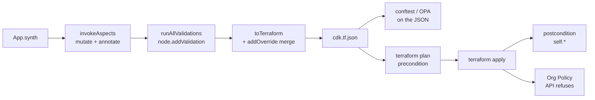

# 06 · Aspects, labels & governance

> After this module you can label every resource with one line, fail `cdktf synth` on a public bucket or a
missing CMEK, know exactly which of the five enforcement layers (aspects, node validations, Terraform
conditions, conftest, org policy) catches what and when, and plug a framework-agnostic policy into CDKTF's
aspect machinery.

## Why this exists (the problem)

Governance by convention does not scale past one team. "Every resource must carry `cost-center`" is a sentence
in a wiki until the FinOps report shows 30% unattributed spend. "No public buckets" is a code-review checklist
item until the reviewer is on holiday. Terraform HCL has no answer to this except copy-pasting `labels =
local.labels` into every block and hoping; Sentinel/OPA catch it after the fact, on the rendered plan, with
error messages that name Terraform addresses instead of the code that produced them.

CDKTF inherits the construct tree from AWS CDK, and with it `Aspects`: a visitor that runs over every node
after the app is built and before anything is rendered. A mutating aspect can *add* the label. A validating
aspect can *refuse* to synthesize. Both run in TypeScript, in unit tests, with no cloud and no Terraform
binary, and their errors point at construct paths. That is one layer. This module positions it against the
other four, because each catches a different class of mistake and you need all of them.

## Mental model



Left to right is also cheapest to most expensive to fail. An aspect failure costs a second of CI; an
org-policy failure costs a half-applied stack. Push every check as far left as the information allows: what is
known at synth goes in an aspect, what is only known from a variable or data source goes in a `precondition`,
what only the real object can tell you goes in a `postcondition`, and what must hold even for people who never
run your code goes in an org policy. Conftest sits beside aspects as the check *other teams* can run on your
output without reading your TypeScript.

## How it works

### Detecting "this resource accepts labels" (`labels-aspect.ts`)

The prebuilt provider is generated from the schema. For every optional argument `foo` the generator emits on
the class prototype a getter `foo` (returns an interpolation token), a setter `foo`, `resetFoo()` and a getter
`fooInput` (returns what was passed in). `labelsInput` is therefore a fingerprint:

```ts
export function isLabelledResource(node: IConstruct): node is LabelledResource {
  if (!(node instanceof TerraformResource)) return false;
  if (!('labelsInput' in node)) return false;
  // Belt and braces: confirm a setter exists somewhere up the prototype chain.
  let proto = Object.getPrototypeOf(node);
  while (proto && proto !== Object.prototype) {
    const desc = Object.getOwnPropertyDescriptor(proto, 'labels');
    if (desc) return typeof desc.set === 'function';
    proto = Object.getPrototypeOf(proto);
  }
  return false;
}
```

Three details verified against `@cdktf/provider-google@16.12`:
- `'labelsInput' in node` works because `in` walks the prototype chain; `Object.keys(node)` would not find it
  (it is an accessor on the prototype, not an own property).
- Read `labelsInput`, never `labels`: `node.labels` returns `${google_storage_bucket.X.labels}` and spreading
  that into a new object gives garbage.
- Restrict to `TerraformResource`. Data sources also have `*Input` accessors but their `labels` is a read-only
  attribute.

The aspect merges (`existingWins` decides precedence) and normalises through the shared
`normaliseLabelKey`/`normaliseLabelValue` — except for values that are tokens (`Token.isUnresolved`), which
must pass through untouched or the token id gets lower-cased and the reference silently breaks.

Not every resource calls it `labels`. Cloud SQL has `settings.user_labels`, alert policies `user_labels`, GKE
`resource_labels`. The exercise-1 validator (`RequireLabelKeysAspect`) is how you discover which resources in
*your* tree the mutator missed.

### Validating aspects and how errors surface (`no-public-buckets-aspect.ts`, `require-cmek-aspect.ts`)

`Annotations.of(node).addError(msg)` does **not** throw. It appends `{ type: '@cdktf/error', data: msg }` to
`node.node.metadata`. What happens next depends on the entry point, verified against cdktf 0.21.0 source:

| Entry point | Runs aspects | Runs `node.addValidation` | Throws on error annotations |
|---|---|---|---|
| `Testing.synth(stack)` | yes | no | **no** — returns the JSON as if nothing happened |
| `Testing.synth(stack, true)` | yes | yes | no (validations throw, annotations do not) |
| `Testing.fullSynth(stack)` | yes | yes | **yes**: `Encountered Annotations with level "ERROR"` listing every `[path] message` |
| `app.synth()` / `cdktf synth` | yes | yes | yes, same synthesizer (`StackSynthesizer.synthesize`) |
| `cdktf synth` with `CDKTF_CONTINUE_SYNTH_ON_ERROR_ANNOTATIONS` set | yes | yes | no; errors are written to `manifest.json` and the CLI prints them |

So a unit test that asserts "the aspect blocks this" must either inspect `node.node.metadata` after
`Testing.synth`, or call `Testing.fullSynth` and expect the throw. The test file has a helper
`errorsIn(stack)` for the first and uses the second for the real thing. `addWarning`/`addInfo` never abort.

The checks themselves read `*Input` getters: `memberInput`, `membersInput`, `publicAccessPreventionInput`,
`encryptionInput?.defaultKmsKeyName`, `encryptionKeyNameInput`, `diskEncryptionKeyInput?.kmsKeySelfLink`. CMEK
is not about "encryption" (Google encrypts everything at rest already); it is about key *control*: rotation,
revocation, audit logs on key use, and separating the data admin from the key admin. That is why the capstone
requires it in prod only.

### Bridging the shared `ConstructPolicy` (`policy-bridge.ts`)

`shared/src/policy.ts` is written against `constructs` only, and its `visit(node)` is structurally an
`IAspect`. `Aspects.of(stack).add(policy)` compiles — but the policy only *collects* into `policy.violations`;
nothing fails unless someone remembers `throwIfViolated()`. `ConstructPolicyAspect` wraps it, turns each
violation into an `Annotations` error on the offending node, skips ids cdktf assigns itself
(`isFrameworkManagedId`: stacks, whose ids are contractually kebab-case in this track; the `backend` node;
`cross-stack-*` outputs and remote-state inputs), and de-duplicates because **aspects re-run on every synth call** —
the "already visited" bookkeeping in `invokeAspects` is per call, so a test that calls `Testing.synth` and
then `Testing.fullSynth` runs your aspect twice. Write aspects idempotently.

### Mutating from an aspect: typed surface vs `addOverride` (`stateful-protection-aspect.ts`)

Two mechanisms, deliberately side by side:

```ts
// (A) typed: prevent_destroy through the public lifecycle field
node.lifecycle = { ...(node.lifecycle ?? {}), preventDestroy: protect };
// (B) raw: API-side deletion protection inside Cloud SQL's settings block
node.addOverride('settings.deletion_protection_enabled', protect);
```

Prefer (A): it is type-checked and round-trips through `*Input` getters so later aspects and tests can see it.
Use (B) when the key is unreachable: a nested block attribute you do not want to rebuild wholesale, a provider
argument newer than your bindings, a key the generator mangled. Two facts about overrides, both verified:

- Overrides are deep-merged **after** `toTerraform()`, so nothing you write is visible to `*Input` getters or
  to later validating aspects.
- Lists are **concatenated** (`deepMerge` in `cdktf/lib/util.js`): `addOverride('lifecycle.ignore_changes',
  ['cors'])` on a resource that already ignores `labels` renders `["labels","cors"]`. The test proves it.

Key-path syntax: blocks that Terraform models as a list of objects (`template.containers`) render as JSON
arrays, so you index numerically (`template.containers.0.image`). Single nested blocks (`settings`,
`encryption`) render as JSON **objects** in `cdk.tf.json`, so the path is `settings.tier`, **not**
`settings.0.tier` as HCL attribute references would suggest. Get it wrong and you get a bogus `"0"` key that
Terraform rejects at validate time, not at synth.

### Terraform-time conditions (`governed-stack.ts`)

```ts
lifecycle: {
  precondition: [{ condition: Op.eq(Fn.upper(ring.location), region.toUpperCase()), errorMessage: '...' }],
  postcondition: [{ condition: Op.eq(ref('self.public_access_prevention'), 'enforced'), errorMessage: '...' }],
}
```

`precondition` runs before the resource is planned and may reference variables, data sources and other
resources — never `self`. `postcondition` runs after apply against the real object and `self` is the only way
to reach it. Build the expression with `Op.*`/`Fn.*` and `ref('self.attr')` — **not** `Fn.rawString`, which
escapes `${` and gives you a literal string, not an expression. The rendered JSON is
`"${(self.public_access_prevention == \"enforced\")}"`, asserted in the test. A `validation` block on
`TerraformVariable` is the same idea for inputs that arrive via `TF_VAR_*` after synth.

### Org policy (`org-policies-stack.ts`)

`google_org_policy_policy` (the v2 API) at `projects/<id>` by default; at folder/org level in a landing zone
(module 09). Boolean constraints use `spec.rules[].enforce: 'TRUE'` — the API models booleans as strings.
`compute.vmExternalIpAccess` is a list constraint, so it is `denyAll: 'TRUE'`. These are enforced by the
control plane against every caller, which is the property no code-side check has.

### conftest on `cdk.tf.json` (`policy/*.rego`)

After `cdktf synth`:

```
conftest test cdktf.out/stacks/*/cdk.tf.json -p src/modules/06-aspects-labels-and-governance/policy/
```

Rules deny buckets without uniform bucket-level access or enforced public-access prevention, any
`*_iam_member`/`*_iam_binding` with `allUsers`/`allAuthenticatedUsers`, any authoritative `*_iam_policy`,
primitive roles, and `google_service_account_key`; they warn on buckets without CMEK; and they check the
mandatory labels from `shared/src/environment.ts` on every resource that has a `labels` object. The rules are
written in Rego v1 syntax (`import rego.v1`, `deny contains msg if`), which needs conftest ≥ 0.46. Not run in
the test suite (no conftest binary in CI here); the aspects cover the same rules in-process.

## Walkthrough

Read in this order:

1. `gcp-config.ts` — project/region from env, resolved at synth time.
2. `labels-aspect.ts` — the mutator and the detection technique.
3. `no-public-buckets-aspect.ts`, `require-cmek-aspect.ts` — validators via `Annotations`.
4. `policy-bridge.ts` — the shared `ConstructPolicy` as an `IAspect`.
5. `stateful-protection-aspect.ts` — typed mutation vs `addOverride`.
6. `governed-stack.ts` — a normal stack made compliant by its last ten lines; `precondition`/`postcondition`;
   `overrideLogicalId` to keep a PascalCase construct id but a snake_case variable name.
7. `org-policies-stack.ts` — the outer wall.
8. `policy/buckets.rego`, `policy/iam.rego` — the same rules for people who only see JSON.
9. `index.ts` — `m06-governed` (prod) and `m06-org-policies`.

Commands:

```
cd cdktf-gcp
npx jest test/06-aspects-labels-and-governance.test.ts
npx cdktf synth                       # after the integrator wires main.ts
conftest test cdktf.out/stacks/m06-governed/cdk.tf.json -p src/modules/06-aspects-labels-and-governance/policy/
```

## Production notes

- **`Aspects.of(app)` is a silent no-op in cdktf 0.21.** `StackSynthesizer.synthesize` calls
  `invokeAspects(this.stack)`, which starts the traversal at the stack with an empty inherited list. App-level
  aspects are never visited. Add aspects per stack (a factory that creates stacks is the natural place; the
  capstone does this). AWS CDK behaves differently here, so this bites people coming from Track A.
- **Aspect order is add order, depth-first, once per node per synth.** Mutators before validators, or the
  validator sees the pre-mutation state. `LabelsAspect` then `RequireLabelKeysAspect` is the pattern.
- **An aspect that adds an aspect** is ignored with a warning (`invokeAspects` checks `aspects.all.length`
  before/after each visit).
- **Overrides are invisible to validators.** If a security rule must see a value, set it through the typed
  API.
- **`prevent_destroy` blocks replacement too.** Any plan that would replace the bucket (rename, location
  change) fails. That is the point in prod; it is why `StatefulProtectionAspect` flips it by tier.
- **KMS resources cannot be deleted.** `terraform destroy` on a key ring fails unless it was removed from
  state; `preventDestroy` on the key just makes that explicit. Budget for abandoned key rings in dev projects
  you tear down often.
- **Org policies are inherited and merged**, with `inheritFromParent` and `reset` semantics that surprise
  people. `storage.publicAccessPrevention` at org level cannot be undone by a project-level policy unless the
  org policy allows exceptions.
- **Label limits**: 64 labels per resource, keys/values ≤ 63 chars, lowercase `[a-z0-9_-]`, keys start with a
  letter. `normaliseLabelKey` prepends `k_` to keys that start with a digit.
- Cost: the governed stack creates a Cloud SQL instance (`db-custom-2-7680` in prod ≈ $100/month before
  storage; `db-f1-micro` in dev ≈ $8/month) and a KMS key (≈ $0.06/version/month + $0.03 per 10k operations).
  Everything else is free at rest.

## Gotchas

- Symptom: `Testing.synth` returns fine but `cdktf synth` fails with `Encountered Annotations with level
  "ERROR"`. Cause: `Testing.synth` never checks annotations. Fix: assert with `Testing.fullSynth` or inspect
  metadata.
- Symptom: aspect labels nothing. Cause: added to the App. Fix: `Aspects.of(stack)`.
- Symptom: label value becomes `${tftoken[token.3]}` and Terraform errors on an unknown token. Cause:
  normalising a token. Fix: `Token.isUnresolved` guard (built into `normaliseLabels`).
- Symptom: `settings.0.tier` override yields `settings: { "0": {...}, tier: ... }`. Cause: single nested
  blocks render as objects in JSON. Fix: `settings.tier`.
- Symptom: `ignore_changes` has duplicates after an override. Cause: list overrides concatenate. Fix: set
  `lifecycle` via the typed field when replacing is intended.
- Symptom: a postcondition renders as the literal string `$${self.x}`. Cause: `Fn.rawString` escapes. Fix:
  `ref('self.x')` with `Op`/`Fn`.
- Symptom: a validating aspect reports each violation twice in tests. Cause: aspects re-run per synth call.
  Fix: de-duplicate as `ConstructPolicyAspect` does.
- Symptom: the PascalCase rule flags the stack or a `cross-stack-reference-input-*` node. Cause: ids cdktf
  assigns itself. Fix: the bridge skips them by default (`isFrameworkManagedId`).
- Symptom: `Validation failed ... resources without a matching provider construct`. Cause: a stack with
  resources but no `GoogleProvider` under `fullSynth`. Fix: every stack declares its provider.

## Exercises

1. **Easy — `RequireLabelKeysAspect`.** A validator that errors on any labelled resource missing a given set
   of keys. Pair it with `LabelsAspect` and prove the pair is clean on a tree containing a Cloud SQL instance
   (which has `user_labels`, not `labels`, and therefore must be skipped, not flagged). Solution:
   `solutions/require-label-keys-aspect.ts`.
2. **Medium — `RegionAllowlistAspect`.** Data residency: flag any resource whose `region`, `location` or
   `zone` is outside an allow-list, without enumerating resource classes (fingerprint
   `regionInput`/`locationInput`/`zoneInput`), mapping zones to regions, accepting multi-region codes for
   GCS/KMS, skipping tokens and `global`, and supporting `warn` for a report-only rollout. Solution:
   `solutions/region-allowlist-aspect.ts`.
3. **Hard — `CmekLocationAspect`.** A bucket's CMEK key ring must be in a compatible location or every object
   write fails at runtime. The bucket references the key by token, every attribute read mints a *different*
   token, and siblings are visited in construction order, so the aspect must (a) resolve tokens to
   `${google_kms_crypto_key.K.id}` via `Tokenization.reverseString` and a minimal `IResolveContext`, and (b)
   defer validation to a `node.addValidation` on the stack. Solution: `solutions/cmek-location-aspect.ts`.

## Checklist

- [ ] Every stack adds its governance aspects itself (or via a factory); nothing relies on `Aspects.of(app)`.
- [ ] Mutating aspects are added before validating aspects.
- [ ] Validators read `*Input` getters, never the token-returning getters.
- [ ] Values that may be tokens are guarded with `Token.isUnresolved` before string manipulation.
- [ ] Aspects are idempotent across repeated synth calls.
- [ ] Anything a validator must see is set through the typed API, not `addOverride`.
- [ ] Stateful resources get `prevent_destroy` / `deletion_protection` from the tier, not by hand.
- [ ] Org policies for public access, external IPs and SA keys exist at folder or org level and are owned by
  the security team.
- [ ] `conftest test cdktf.out/stacks/*/cdk.tf.json -p policy/` runs in CI after synth.
- [ ] Code review: a new resource type with `labels` needs no code change (the aspect finds it); a new type
  with `user_labels` needs the aspect extended.

## Interview angle

- *"How would you guarantee every GCP resource is labelled, across 40 stacks written by 10 teams?"* One
  mutating aspect applied by the stack factory, detecting the `labels` argument by fingerprinting the
  generated bindings; a validating aspect right behind it to catch resources with differently named label
  arguments; a conftest rule on the synthesized JSON as the check other teams can run without reading
  TypeScript; a label-based cost report as the feedback loop.
- *"Aspects vs Sentinel/OPA vs org policy — when each?"* Aspects: synth-time, know the construct tree,
  cheapest, cannot see runtime values. conftest/Sentinel: plan/JSON-time, language-agnostic, sees the same
  values plus (for plan-based) computed ones, runs in a separate stage. Org policy: API-time, sees every
  caller including humans and leaked keys, cannot be bypassed by not running the pipeline; coarse-grained and
  slow to change. Use all three; make the inner layers redundant with the outer.
- *"Why does `Annotations.addError` not throw?"* So every violation in the tree is collected and printed
  together instead of stopping at the first; the synthesizer throws once at the end. Consequence:
  `Testing.synth` does not fail, `Testing.fullSynth` does — and a test that forgets this is green while CI is
  red.

## References

- cdktf Aspects: https://developer.hashicorp.com/terraform/cdktf/concepts/aspects
- cdktf Annotations and synthesis source: `node_modules/cdktf/lib/synthesize/synthesizer.js`,
  `node_modules/cdktf/lib/testing/index.js`
- Terraform custom conditions:
  https://developer.hashicorp.com/terraform/language/expressions/custom-conditions
- GCS public access prevention: https://cloud.google.com/storage/docs/public-access-prevention
- GCS CMEK location requirements:
  https://cloud.google.com/storage/docs/encryption/customer-managed-keys#restrictions
- Org policy constraints list:
  https://cloud.google.com/resource-manager/docs/organization-policy/org-policy-constraints
- `google_org_policy_policy`:
  https://registry.terraform.io/providers/hashicorp/google/latest/docs/resources/org_policy_policy
- conftest: https://www.conftest.dev/ ; Rego v1: https://www.openpolicyagent.org/docs/latest/v0-upgrade/
