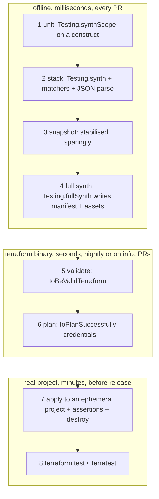

# 07 · Testing

> After this module you can prove, offline and in under three seconds, that a CDKTF stack renders what you
intended — down to `depends_on`, `lifecycle`, the backend and the effect of an aspect — and you know which
rungs of the IaC testing pyramid need a Terraform binary, credentials, or a real project, and what each one is
actually worth.

## Why this exists (the problem)

Terraform HCL is tested by applying it. Everything before `apply` is a syntax check (`validate`) or a read of
the plan by a human. That is why infrastructure teams have change-failure rates that application teams would
not tolerate: the feedback loop is minutes to hours, costs money, and needs credentials that nobody wants in a
unit-test runner.

CDKTF moves the decision-making into TypeScript, and TypeScript can be unit tested. `Testing.synth(stack)`
renders the Terraform JSON in memory, with no binary, no network and no state. A test that asserts
`deletion_protection: true` on the prod Cloud SQL instance runs in milliseconds and fails the PR that removes
it. The catch is knowing what the synth-time view can and cannot see: it sees every value you wrote and every
reference you made; it cannot see provider defaults, computed attributes, quota, IAM propagation, or whether
the API accepts the combination. That boundary defines the pyramid.

## Mental model



Cost rises going down; certainty rises going down; the number of tests should fall going down. Most bugs are
"I wrote the wrong thing" (rungs 1–4). The rest are "the provider/API disagrees with me" (5–7). Nothing in
rung 8 finds bugs that 7 does not; it finds them in a language other teams can share.

## How it works

The module's code (`testable-stack.ts`, `private-bucket.ts`, `aspects-under-test.ts`,
`snapshot-stabiliser.ts`) exists to be tested; `test/07-testing.test.ts` is the material. Verified facts about
the cdktf 0.21 testing API, all asserted in that file:

**Registration.** `import 'cdktf/lib/testing/adapters/jest'` provides only the *types*. The matchers are
registered by `Testing.setupJest()` (it calls `expect.extend`). The repo's `test/setup.ts` only does the
import, so the test files of modules 06–11 call `Testing.setupJest()` themselves; it is idempotent, and the
cleanest fix is one call in `test/setup.ts`.

**`Testing.app()`** returns an `App` with a temp outdir, stubbed version (`"stubbed"` in the manifest), future
flags on and stack traces off. **`Testing.synth(stack)`** invokes aspects, calls `stack.toTerraform()`, strips
the `//` metadata, sorts keys and returns a JSON *string*. It does **not** run `prepareStack()` (so no default
local backend, no cross-stack wiring) and does **not** run node validations or check `Annotations` errors.
`Testing.synth(stack, true)` adds validations. **`Testing.synthScope(fn)`** creates a throwaway stack and
hands you its scope; the idiom for constructs. **`Testing.fullSynth(stack)`** runs the real `StackSynthesizer`
into a temp dir and returns the path: aspects, validations, annotations (throws on errors), assets copied,
`manifest.json` written; still no `prepareStack()`.

**Matchers.** `toHaveResource(Ctor)`, `toHaveResourceWithProperties(Ctor, props)`,
`toHaveDataSource(WithProperties)`, `toHaveProvider(WithProperties)`. The constructor is used only for its
static `tfResourceType`. With the jest adapter, `props` is evaluated with
`expect.arrayContaining([expect.objectContaining(props)])` over all instances of that type, which means: keys
must be **snake_case exactly as rendered** (the camelCase translation exists only in the non-jest
`Testing.toHaveResourceWithProperties`), nested plain objects match as subsets, arrays must match in length
and order, and asymmetric matchers (`expect.stringContaining`, `expect.objectContaining`) work anywhere. "Some
instance matches" is the semantics — there is no "exactly one".

**Hand assertions** on `JSON.parse(synth)` cover what matchers cannot: counts
(`Object.keys(json.resource.google_pubsub_topic).length`), `depends_on` (`['google_service_account.Worker']`),
`lifecycle`, `terraform.backend`, `output`, `variable`, and the shape of interpolations
(`${data.google_project.Current.number}`). Logical ids: top-level children of the stack render verbatim
(`Orders`); nested constructs render as `<path segments joined by _>_<8-hex hash of the path>`
(`Artifacts_Bucket_ADA78AEC`) — stable across runs and machines because it hashes the path, not the content.

**Aspects.** Mutating: assert the mutation in the output. Validating: after `Testing.synth`, read
`node.node.metadata` for `@cdktf/error` entries; then `expect(() =>
Testing.fullSynth(stack)).toThrow(/Encountered Annotations with level "ERROR"/)` to prove the real synthesizer
aborts. `Aspects.of(app)` is never invoked in 0.21 — the test proves it so nobody relies on it.

**Snapshots.** `stabilise(synth)` replaces the asset hash (`assets/<id>/<32-hex md5>/archive.zip`), the local
backend path (contains `process.cwd()`) and provider version pins, then `toMatchSnapshot()` on the object.
Alternative: pin `assetHash` on the `TerraformAsset`. Inline snapshots of a *derived* view (the resource
inventory) are cheaper to review than a 140-line stack.

**Gated rungs.** `toBeValidTerraform()` and `toPlanSuccessfully()` take the directory from `fullSynth` and
shell out to `terraform init` + `validate -json` / `plan -input=false -lock=false` per stack in the manifest.
They need the binary and registry access (plan needs credentials for data sources). Gated with `const
itIfTerraform = process.env.CDKM_TERRAFORM ? it : it.skip;`. Run them with `CDKM_TERRAFORM=1 npx jest
test/07-testing.test.ts`.

## Walkthrough

1. `private-bucket.ts` — a construct with defaults and a constructor-time validation (throws on `allUsers`).
   Tested with `synthScope`.
2. `testable-stack.ts` — provider, data source, variable (with `overrideLogicalId` for a snake_case name),
   bucket via the construct, `TerraformAsset` + `StorageBucketObject`, two topics, subscription with DLQ and
   `dependsOn`, `lifecycle.ignoreChanges`, two outputs, conditional `GcsBackend`.
3. `aspects-under-test.ts` — a minimal mutator and validator.
4. `snapshot-stabiliser.ts` — what to neutralise and why.
5. `index.ts` — `m07-testable-dev` and `m07-testable-prod`.
6. `test/07-testing.test.ts` — read top to bottom; every `describe` is a rung.

```
cd cdktf-gcp
npx jest test/07-testing.test.ts
CDKM_TERRAFORM=1 npx jest test/07-testing.test.ts     # adds validate + plan
npx jest test/07-testing.test.ts -u                   # after an intended snapshot change, and only then
```

## Production notes

- **Snapshot discipline.** A snapshot is a regression test with no stated intent. Use it for (a) a small stack
  whose whole shape is the contract (a shared module's output), (b) a derived view (inventory, IAM matrix), or
  (c) a migration where "nothing changed" is the requirement. Do not snapshot every stack; the first provider
  bump produces 40 diffs that everyone rubber-stamps, and from then on the snapshot protects nothing.
- **Do not share stacks between tests.** Aspects re-run on every synth and validating aspects accumulate
  annotations; build a fresh `Testing.app()` per test (`prodStack()` in the test file).
- **Asset hashes are content hashes** (md5 of the tree, 32 upper-hex). That is what you want for deploys (a
  changed file re-uploads) and not what you want in a snapshot.
- **`fullSynth` writes real files** to `os.tmpdir()`; CI runners with a small tmpfs and thousands of tests can
  fill it. It is the only rung that touches disk.
- **Plan-level tests cost money** in a shared project (data-source reads are free; `plan` against a real Cloud
  SQL instance is free; `apply` is not). Rung 7 belongs in a dedicated, budget-capped, auto-deleted project
  (module 09's factory + `BillingBudget`).
- **`terraform test`** (Terraform ≥ 1.6) runs `.tftest.hcl` files against a module with `plan` or `apply`
  mode; it works on the synthesized `cdk.tf.json` directory but its assertions reference Terraform addresses,
  so it belongs to teams that consume your output as HCL (module 10). Terratest (Go) does the same with real
  applies and is the right tool when the assertion is "the Cloud Run URL returns 200".

## Gotchas

- Symptom: `expect(...).toHaveResourceWithProperties is not a function`. Cause: adapter imported,
  `setupJest()` never called. Fix: `Testing.setupJest()` at the top of the file.
- Symptom: camelCase property never matches. Cause: jest adapter uses `objectContaining`. Fix: snake_case
  keys.
- Symptom: `terraform.backend` missing in `Testing.synth` output. Cause: default backend is added by
  `prepareStack()`. Fix: call `stack.prepareStack()` first if you need it, or assert on `fullSynth` output of
  an app-level synth.
- Symptom: cross-stack reference renders as a direct `${google_x.y.z}` in the consumer. Cause: no
  `prepareStack()`. Fix: `consumer.prepareStack()` before `Testing.synth(consumer)`.
- Symptom: `Validation failed ... resources without a matching provider construct` from `fullSynth`. Cause:
  stack has resources but no provider. Fix: declare the provider in every stack (or `Testing.synth` for
  construct tests, which skips validations).
- Symptom: snapshot differs between laptop and CI. Cause: local backend path. Fix: `stabilise` or pin a
  backend.
- Symptom: a validating aspect "does nothing" in a test. Cause: `Testing.synth` never throws on annotations.
  Fix: inspect metadata or use `fullSynth`.
- Symptom: `Cannot use tokens in construct id`. Cause: a variable/attribute in an id. Fix: ids are
  compile-time strings; tokens go in properties.

## Exercises

1. **Easy — counting helpers.** `countResources`, `countDataSources`, `resourceInventory`, `logicalIds` over
   the synthesized JSON, so "exactly one" and "none" become one-liners. Solution:
   `solutions/count-resources.ts`.
2. **Medium — custom matchers.** `toHaveOutput(name, {sensitive})`, `toHaveVariableWithDefault`,
   `toHaveBackend(kind, props)`, `toHaveNoResource(Ctor)`, with jest declaration merging for types and useful
   failure messages (including the negative paths). Solution: `solutions/custom-matchers.ts`.
3. **Hard — environment matrix.** `synthAllEnvironments(factory)` synthesizes a factory for every tier in
   `ENVIRONMENTS` (running `prepareStack()`), plus `get(json, 'dotted.path')` and `compareTiers(a, b, path)`
   so tests assert *differences between tiers* — the regression that actually ships ("prod lost deletion
   protection in a refactor"). Solution: `solutions/env-matrix.ts`.

## Checklist

- [ ] Every stack has a `fullSynth` test for every tier it supports.
- [ ] Every tier-dependent property has a dev-vs-prod assertion, not just a prod assertion.
- [ ] Every construct with validation logic has a `synthScope` test for the happy path and each rejection.
- [ ] Every aspect has a test for the mutation or the annotation, and one `fullSynth` throw test.
- [ ] Snapshots: only where justified in a comment; stabilised; reviewed on update.
- [ ] `toBeValidTerraform`/`toPlanSuccessfully` gated behind an env var and run in a job that has the binary.
- [ ] Code review: a test that asserts an interpolation string (`${google_x.y.z}`) is asserting *wiring*; a
  test that asserts a literal is asserting *configuration*; both are needed.

## Interview angle

- *"What can a synth-time test not catch?"* Provider defaults and computed values, API-side validation
  (invalid combinations, quotas), IAM propagation and eventual consistency, anything decided by a
  `TF_VAR_`/data source at plan time, and drift. Those are rungs 5–7 and monitoring.
- *"When are snapshot tests harmful?"* When they are the only test: they fail on every intended change, get
  updated with `-u` without review, and lose their power. Keep them for small stable contracts and derived
  views; stabilise volatile fields.
- *"How do you test an aspect that fails synthesis?"* `Testing.synth` never throws on `Annotations` errors;
  read `node.node.metadata`, then assert `Testing.fullSynth` throws with the construct path in the message.
  Also assert the compliant tree produces zero annotations, or the aspect is a lint that never runs.

## References

- cdktf unit testing: https://developer.hashicorp.com/terraform/cdktf/test/unit-tests
- Matcher and Testing source: `node_modules/cdktf/lib/testing/index.js`,
  `node_modules/cdktf/lib/testing/matchers.js`, `node_modules/cdktf/lib/testing/adapters/jest.js`
- `terraform test`: https://developer.hashicorp.com/terraform/language/tests
- Terratest GCP modules: https://terratest.gruntwork.io/docs/getting-started/quick-start/
- Jest snapshot best practices: https://jestjs.io/docs/snapshot-testing#best-practices
