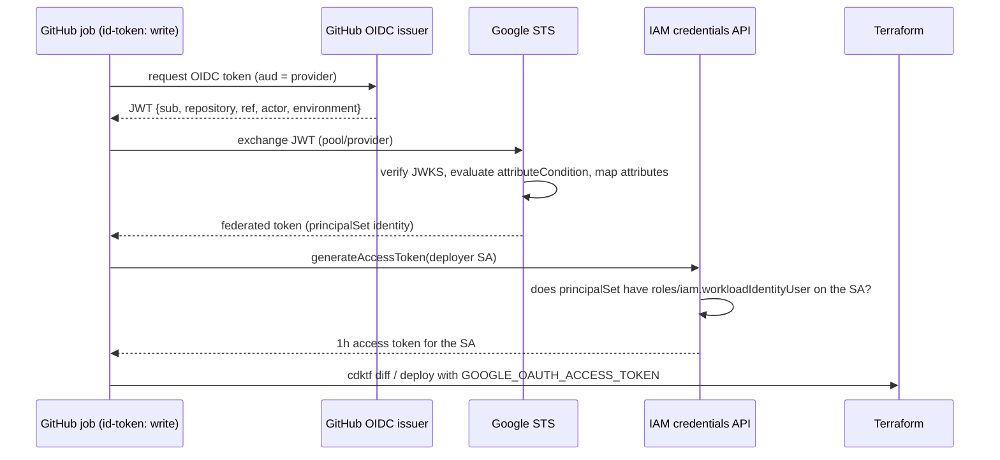

# 08 · CI/CD & Workload Identity Federation

> After this module you can deploy CDKTF from GitHub Actions with no long-lived credential anywhere, post
plans on pull requests, detect drift nightly, order dependent stacks correctly, and choose between GCS and HCP
Terraform as the state backend with code for both.

## Why this exists (the problem)

The traditional way to let CI talk to GCP is a service-account key: a JSON file that never expires, that
GitHub stores as a secret, that gets copied into a laptop "just to debug", and that ends up in a public
repository at a rate Google measures in thousands per week. Rotating it is a ticket nobody picks up. Every
audit finds one.

Workload Identity Federation removes the key. GitHub signs a short-lived OIDC token per job that says *which
repository, ref, actor and environment* is running. Google's STS verifies the signature against GitHub's
public JWKS, checks your attribute condition, and issues a short-lived access token for a service account that
a binding says this identity may impersonate. Nothing is stored, everything expires in an hour, and Cloud
Audit Logs record `repo:org/name:ref:refs/heads/main` as the caller. The remaining problems are then the
ordinary CI/CD ones: showing a plan before merging, refusing concurrent applies, ordering dependent stacks,
and noticing when someone changed prod by hand.

## Mental model



Two independent gates: the provider's **attribute condition** decides who gets *into the pool*; the
**service-account binding** decides which pool identities may *become the deployer*. Restrict the repository
at the first, restrict the ref or environment at the second.

## How it works

### `WifStack` (`wif-stack.ts`)

```ts
this.provider = new IamWorkloadIdentityPoolProvider(this, 'GithubProvider', {
  workloadIdentityPoolId: this.pool.workloadIdentityPoolId,
  workloadIdentityPoolProviderId: 'github-actions',
  oidc: { issuerUri: 'https://token.actions.githubusercontent.com' },
  attributeMapping: GITHUB_ATTRIBUTE_MAPPING,          // google.subject, attribute.repository, .repository_owner, .ref, .actor
  attributeCondition: githubAttributeCondition({ repository }), // attribute.repository == "owner/repo"
});
this.repositoryPrincipalSet = `principalSet://iam.googleapis.com/${this.pool.name}/attribute.repository/${repository}`;
new ServiceAccountIamMember(this, 'DeployerWorkloadIdentityUser', {
  serviceAccountId: this.deployer.name, role: 'roles/iam.workloadIdentityUser', member: this.repositoryPrincipalSet,
});
```

`pool.name` is `projects/<number>/locations/global/workloadIdentityPools/<id>` — using the attribute keeps the
project *number* (not id) out of your code. Project roles come from `DEPLOYER_PROJECT_ROLES`
(`deployer-roles.ts`), one `google_project_iam_member` each with PascalCase ids from `roleToId`. Optionally
the stack creates the state bucket (versioned, `prevent_destroy`, 20 noncurrent versions kept) and always
grants the deployer `objectAdmin` on it — bucket-scoped, not project-wide. Outputs
`workload_identity_provider` (`provider.name`) and `service_account` (`deployer.email`) are exactly the two
inputs of `google-github-actions/auth@v2`.

### The attribute-condition pitfalls

- **Google rejects a GitHub OIDC provider without an attribute condition** (since 2023-ish; the error names
  the missing condition). Without one, every repository on github.com could obtain an identity in your pool.
- **`attribute.*` vs `assertion.*`**: both are legal in the condition, but only *mapped* attributes can appear
  in `principalSet://` members. Keep one vocabulary; map what you will bind on.
- **Repository casing**: the `repository` claim is the canonical name; `Org/Repo` ≠ `org/repo`.
- **Refs are fully qualified**: `refs/heads/main`, `refs/tags/v1.2`, `refs/pull/42/merge`. A PR job's `ref` is
  the merge ref, not the branch.
- **`environment` claim exists only for jobs with `environment:`** — and then `sub` becomes
  `repo:o/r:environment:prod` instead of `...:ref:refs/heads/main`. Conditions on `sub` break when you add
  environments; conditions on mapped attributes do not.
- **`google.subject` ≤ 127 chars**; long org/repo/branch names overflow. Map to `assertion.repository + ":" +
  assertion.ref` only if you have checked lengths.
- **Pool ids are soft-deleted for 30 days**; you cannot recreate `github` right after destroying it. Name
  pools deliberately.
- **Provider `attributeCondition` changes are in-place**; binding changes propagate within seconds but the
  *job* caches nothing, so a revoked repo is cut off on its next token exchange.

### The workflow (`.github-workflows-example/cdktf-deploy.yml`)

Four jobs. `verify` runs offline on every event: `npm ci`, type-check, tests, `cdktf synth`, conftest on
`cdktf.out/stacks/*/cdk.tf.json`. `plan` (pull requests) authenticates with `google-github-actions/auth@v2` —
`permissions: id-token: write` is what lets the job mint the OIDC token — runs `npx cdktf diff <stack>` per
stack, strips ANSI, and upserts one PR comment keyed by a marker so re-pushes update rather than spam.
`deploy` (push to `main`) runs `npx cdktf deploy <stack> --auto-approve --ignore-missing-stack-dependencies`
in explicit order, under `environment: prod` so GitHub's required reviewers gate it. `drift` (schedule)
synths, then runs `terraform plan -detailed-exitcode -lock=false` inside each `cdktf.out/stacks/<stack>`
directory — exit 2 means drift — and opens or updates an issue labelled `drift`.

`hashicorp/setup-terraform@v3` with `terraform_wrapper: false`: the wrapper rewrites stdout and breaks cdktf's
parsing of Terraform's output. `concurrency.group` is per PR (cancellable) and a single group for `main` (not
cancellable: killing a half-applied run is worse than waiting).

### `--auto-approve` safety

Auto-approve is safe when, and only when, all of: the plan that will be applied was shown on the PR (same
commit, same stack list); nothing else can write to the state (concurrency group + the deployer is the only
principal with `objectAdmin` on the bucket); prod applies are behind a GitHub environment with required
reviewers; and destructive changes are caught before merge — `prevent_destroy` on stateful resources (module
06) makes a bad plan fail instead of apply. If any of those is missing, keep a human `cdktf deploy` step with
the plan in front of them.

### Deploy order for dependent stacks

Cross-stack references (module 02) make `cdktf deploy a b` order the applies by data dependency, and
`--ignore-missing-stack-dependencies` lets you deploy one stack whose dependencies are already applied. The
example deploys the list explicitly (`STACKS` env) because: failures are attributable to one stack, a re-run
can target one stack, and dependencies that are *not* data dependencies (API enablement before resource
creation, IAM propagation before use) do not exist in the graph and must be encoded in the order. Foundation →
network → data → messaging → compute → observability is the capstone's order; teardown is the reverse.

### Backends (`backend.ts`)

```ts
export type BackendConfig =
  | { kind: 'gcs'; bucket: string; prefix: string }
  | { kind: 'cloud'; organization: string; workspace: string | { tags: string[] }; hostname?: string }
  | { kind: 'local' };
```

`configureBackend` renders `GcsBackend`, `CloudBackend` (with `NamedCloudWorkspace` or
`TaggedCloudWorkspaces`; the output is a `terraform.cloud` block, not `terraform.backend`) or `LocalBackend`.
`backendFromEnv(stackId)` keeps offline synth local: `CDKM_STATE_BUCKET` → GCS, else `CDKM_TFC_ORG` → HCP
Terraform, else local. HCP Terraform gives you remote runs, run history, Sentinel/OPA policy sets and a UI at
the cost of another SaaS in the trust boundary; with WIF you can still use *GCS* state and run Terraform in
GitHub, which is what most GCP-native teams do.

## Walkthrough

1. `deployer-roles.ts` — the role lists, with the reasoning per role.
2. `wif-stack.ts` — pool, provider, SA, bindings, roles, state bucket, outputs; `githubAttributeCondition`,
   `roleToId`.
3. `backend.ts`, `backend-demo-stack.ts` — the three backends.
4. `.github-workflows-example/cdktf-deploy.yml` — the workflow; read the comments.
5. `index.ts` — `m08-wif` (bootstrap) and `m08-backend-demo`.

Bootstrap runbook (once, by a human with `roles/owner`):

```
gcloud services enable iam.googleapis.com iamcredentials.googleapis.com sts.googleapis.com cloudresourcemanager.googleapis.com
cd cdktf-gcp
CDKM_GITHUB_OWNER=<org> CDKM_GITHUB_REPO=<repo> CDKM_STATE_BUCKET=<bucket> npx cdktf deploy m08-wif   # local state
# copy outputs into repository variables: WORKLOAD_IDENTITY_PROVIDER, DEPLOYER_SERVICE_ACCOUNT, STATE_BUCKET, GCP_PROJECT
# then migrate the bootstrap stack's own state into the bucket it created:
cd cdktf.out/stacks/m08-wif && terraform init -migrate-state   # after re-synthesizing with CDKM_STATE_BUCKET set
```

Tests: `npx jest test/08-cicd-and-workload-identity.test.ts`.

## Production notes

- **One deployer per project/environment.** The blast radius of a compromised workflow is one project.
  Exercise 3 shows per-environment deployers bound to GitHub environments.
- **`roles/resourcemanager.projectIamAdmin`** lets the deployer grant itself anything. It is unavoidable if
  the stacks manage IAM; compensate with the `iam.disableServiceAccountKeyCreation` org policy, an alert on
  `SetIamPolicy` by the deployer outside a workflow window, and a plan-only identity for PRs (exercise 2) so a
  malicious PR cannot apply.
- **The GCS backend lock is a write** (`<prefix>/default.tflock`). A read-only planner needs `-lock=false`,
  which `cdktf diff` does not pass; run `terraform plan -lock=false` in `cdktf.out/stacks/<s>` for read-only
  plans (the drift job does).
- **State bucket**: versioning on, `prevent_destroy`, uniform access, no public access, a lifecycle rule to
  cap noncurrent versions, and ideally in a separate "seed" project that workloads cannot delete. Consider
  `kmsEncryptionKey` on the backend for CMEK on state (state contains secrets).
- **Forks**: `pull_request` from a fork gets no `id-token` and no repository variables; the plan job fails
  safely. `pull_request_target` would run with your credentials on untrusted code — never use it here.
- **Runner minutes cost money**; `paths:` filters on the triggers keep docs-only PRs from planning six stacks.
- **Token lifetime is 1h**; a long `cdktf deploy` of a Cloud SQL HA instance (20+ minutes) is fine, a
  90-minute migration is not — split stacks.
- Monitor: `iam.googleapis.com/workload_identity_pool` token-exchange metrics (failed exchanges spike when a
  condition is wrong), and Cloud Audit Logs filtered on `protoPayload.authenticationInfo.principalSubject` for
  the deployer.

## Gotchas

- Symptom: `Error: google-github-actions/auth failed with: retry function failed after 4 attempts: ... Unable
  to acquire impersonated credentials`. Cause: the principalSet binding is missing or names a different
  attribute than the mapping. Fix: bind on a mapped attribute; compare repository casing.
- Symptom: `The attribute condition must reference one of the provider's claims`. Cause: no condition or a
  condition on an unmapped attribute. Fix: `attribute.repository == "owner/repo"`.
- Symptom: `permission 'iam.serviceAccounts.getAccessToken' denied`. Cause: `roles/iam.workloadIdentityUser`
  granted on the project instead of the SA, or `id-token: write` missing. Fix: grant on the SA
  (`ServiceAccountIamMember`), add the permission to the job.
- Symptom: plan output in the comment is empty or mangled. Cause: `terraform_wrapper: true`. Fix:
  `terraform_wrapper: false`.
- Symptom: two `main` deploys interleave and state is corrupted/locked. Cause: no concurrency group. Fix:
  `concurrency: { group: cdktf-main, cancel-in-progress: false }`.
- Symptom: drift job says drift on every run for `labels`. Cause: cost tooling mutates labels. Fix:
  `lifecycle.ignore_changes = ["labels"]` on those resources, or fix the tooling.
- Symptom: `terraform.cloud` block and `-backend-config` conflict. Cause: HCP Terraform uses `cloud`, not
  `backend`. Fix: pick one; `configureBackend` renders the right block.
- Symptom: cannot recreate the pool after destroy. Cause: 30-day soft delete. Fix: `gcloud iam
  workload-identity-pools undelete`, or a new id.

## Exercises

1. **Easy — deploy only from `main`.** Keep the provider condition on the repository (so PRs can plan) and add
   a second SA binding on `attribute.ref/refs/heads/main`; reject unqualified refs. Solution:
   `solutions/ref-restricted-binding.ts`.
2. **Medium — plan-only identity.** A second SA with `PLANNER_PROJECT_ROLES` (viewer, securityReviewer,
   secretmanager.viewer) and `objectViewer` on the state bucket, bound to the repository principalSet, with
   the lock caveat documented. Solution: `solutions/plan-only-deployer.ts`.
3. **Hard — per-environment deployers.** One pool and provider, `attribute.environment` mapped from
   `assertion.environment`, one deployer SA per tier in `ENVIRONMENTS` bound to `attribute.environment/<name>`
   with roles in that environment's project, so GitHub environment protection rules become the approval gate
   `tier.requiresApproval` asks for. Solution: `solutions/multi-env-wif-stack.ts`.

## Checklist

- [ ] No `google_service_account_key` in any stack; `iam.disableServiceAccountKeyCreation` enforced.
- [ ] Provider has an attribute condition naming the repository; bindings use mapped attributes.
- [ ] `id-token: write` on exactly the jobs that authenticate; `contents: read` elsewhere.
- [ ] Plan posted on PRs; the deploy applies the same commit.
- [ ] `--auto-approve` only behind a concurrency group and (for prod) a protected environment.
- [ ] State bucket versioned, `prevent_destroy`, deployer bound at bucket scope.
- [ ] Drift job scheduled; drift creates a ticket, not a silent apply.
- [ ] Deploy order explicit and documented; teardown order is the reverse.
- [ ] Code review: a role added to `DEPLOYER_PROJECT_ROLES` needs a justification comment.

## Interview angle

- *"Why is WIF better than a key with 90-day rotation?"* No secret at rest anywhere; tokens are per-job, one
  hour, and carry repository/ref/actor claims into audit logs; revocation is a binding change, not a key hunt;
  and the org policy can ban keys entirely so the exception cannot creep back.
- *"How do you stop a malicious PR from deploying?"* PRs authenticate as a plan-only SA (viewer roles), the
  deployer is bound only to `refs/heads/main` or to a protected GitHub environment, applies run only on `push`
  to `main` after review, and `pull_request_target` is never used.
- *"How would you detect and handle drift?"* Scheduled `terraform plan -detailed-exitcode` per stack
  directory; exit 2 opens a ticket with the diff; the fix is either code (adopt the change) or a deploy
  (revert it), decided by a human; `ignore_changes` for known benign mutators.

## References

- WIF with GitHub: https://cloud.google.com/iam/docs/workload-identity-federation-with-deployment-pipelines
- `google-github-actions/auth`: https://github.com/google-github-actions/auth
- GitHub OIDC claims:
  https://docs.github.com/en/actions/deployment/security-hardening-your-deployments/about-security-hardening-with-openid-connect
- Attribute conditions (CEL): https://cloud.google.com/iam/docs/workload-identity-federation#conditions
- `google_iam_workload_identity_pool_provider`:
  https://registry.terraform.io/providers/hashicorp/google/latest/docs/resources/iam_workload_identity_pool_provider
- cdktf CLI (`deploy`, `diff`, `--ignore-missing-stack-dependencies`):
  https://developer.hashicorp.com/terraform/cdktf/cli-reference/commands
- GCS backend: https://developer.hashicorp.com/terraform/language/backend/gcs ; HCP Terraform `cloud` block:
  https://developer.hashicorp.com/terraform/cli/cloud/settings
- `terraform plan -detailed-exitcode`:
  https://developer.hashicorp.com/terraform/cli/commands/plan#detailed-exitcode
