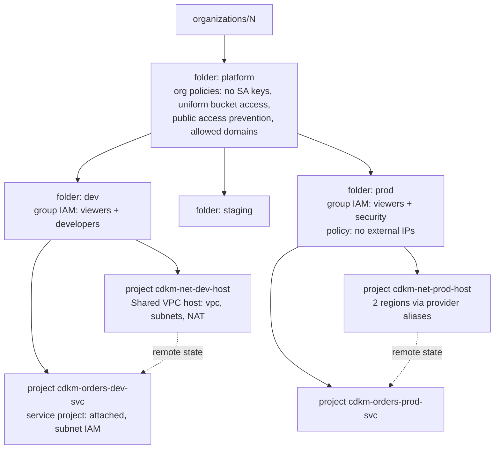

# 09 · Multi-project & org scale

> After this module you can stamp out projects from a factory (APIs, group IAM, budget, deletion policy), hang
them under folders that carry inherited IAM and org policies, share one VPC across projects with subnet-level
grants, use per-region provider aliases and a beta-only resource where they are actually needed, and structure
it all as one stack per project with cross-stack references and a deploy order you can defend.

## Why this exists (the problem)

A single project is a sandbox. At org scale the project is the unit of *everything*: IAM boundary, quota,
billing attribution, API enablement, VPC ownership, deletion. Teams that put dev and prod in one project
discover this at the first incident, when a developer's `roles/editor` turns out to cover the prod database.
Teams that create projects by hand discover it at the first audit, when nobody can say which of 300 projects
still has a default network with `allow-all-internal`.

Google's own answer is the landing zone (Cloud Foundation Fabric, Terraform Example Foundation): a folder tree
that mirrors the org, a project factory, a Shared VPC per environment, and org policies at the top. This
module builds the same shape in CDKTF, small enough to read in one sitting, with the parts that bite — API
enablement ordering, the `deletionPolicy` footgun, service agents in Shared VPC — explained instead of hidden
in a module you did not write.

## Mental model



Everything inherits downward: a policy on `platform` binds every project that will ever exist below it.
Everything is a separate state: `m09-folders`, `m09-<env>-host`, `m09-<env>-orders`, so a mistake in a service
project cannot plan a change to the folder tree.

## How it works

### Project factory (`project-factory.ts`)

```ts
this.project = new Project(this, 'Project', {
  projectId, name, folderId, billingAccount,
  autoCreateNetwork: false,                 // never the default network
  labels: mandatoryTags(props.tier, props.service),
  deletionPolicy: props.deletionPolicy ?? (props.tier.retainStatefulResources ? 'PREVENT' : 'DELETE'),
});
this.services = enableApis(this, this.project, [...BASE_APIS, ...props.apis]);
```

`enableApis` enables `cloudresourcemanager`, `serviceusage`, `iam`, `cloudbilling` **serially** (each
`dependsOn` the previous) and every other API `dependsOn` the last of those. Enabling `run.googleapis.com`
before Service Usage is on fails with an error that looks like IAM and is not. Every `ProjectService` has
`disableOnDestroy: false`: disabling an API deletes every resource behind it, and the provider will do it in
whatever order the graph allows. IAM members must be `group:` (a user in a project is a future audit finding)
and `dependsOn` the first service, because IAM on a project younger than a few seconds races the resource
manager. `BillingBudget` is filtered to `projects/${project.number}` (the number, not the id) with 50% and 90%
of actual spend and 100% of *forecast* — the forecast alert is the one that fires before the money is gone.

### The `deletionPolicy` footgun

`google_project.deletion_policy` defaults to `PREVENT` in provider 6.x: `terraform destroy` **fails** on the
project. Set `DELETE` and destroy deletes the project (30-day recovery, billing stops immediately, everything
inside gone). Set `ABANDON` and destroy removes it from state and leaves it running and billing. The factory
derives it from `tier.retainStatefulResources`: prod `PREVENT`, others `DELETE`. Two consequences worth
stating aloud: a prod stack cannot be destroyed without a code change (good), and a `DELETE` project's *id is
unusable for 30 days* after destroy, so dev projects you recreate need new ids or an undelete.

### Folders (`folders.ts`)

`LandingZoneFolders` builds `platform` → one folder per `ENVIRONMENTS` entry. On `platform`:
`iam.disableServiceAccountKeyCreation`, `storage.uniformBucketLevelAccess`, `storage.publicAccessPrevention`,
`compute.skipDefaultNetworkCreation` (boolean, `enforce: 'TRUE'`) and `iam.allowedPolicyMemberDomains` (list,
`allowedValues: [customerId]` — the Cloud Identity customer id `C0…`, not the DNS domain). Per environment:
`FolderIamMember` for `gcp-<env>-viewers@`, curated `DEVELOPER_ROLES` for `gcp-<env>-developers@` where
`!tier.requiresApproval`, `roles/iam.securityReviewer` for `gcp-security@` and a `compute.vmExternalIpAccess`
deny-all where it does. No `roles/editor` anywhere — the conftest rule from module 06 would reject it and so
should you.

### Shared VPC (`shared-vpc.ts`) and provider aliases (`regional-providers.ts`)

```ts
out[region] = new GoogleProvider(scope, isDefault ? 'Google' : `Google${short.toUpperCase()}`, {
  project, region, alias: isDefault ? undefined : regionShortCode(region),   // 'euw4'
});
```

Exactly one un-aliased Google provider per stack; every other needs `alias`. GCP resources mostly take
`region` explicitly, so aliases matter less than on AWS; they still matter for `google_compute_router` (region
from the provider when omitted), for cross-*project* resources (the alias carries the project), and as a
review cue: `provider = google.euw4` on every EU resource in `cdktf diff`. `SharedVpcHost` creates the VPC,
one subnet + router + NAT per region through that region's provider, and `ComputeSharedVpcHostProject`, all
`dependsOn` the compute API. `SharedVpcServiceAttachment` (in the *service* stack) creates
`ComputeSharedVpcServiceProject` with `deletionPolicy: 'ABANDON'` (the API refuses to detach while a NIC
exists) and one `ComputeSubnetworkIamMember` (`roles/compute.networkUser`) per subnet per principal —
subnet-level, so a service project sees only the subnets it was given.

### google-beta where it is needed (`beta.ts`)

`google_project_service_identity` exists **only** in `google-beta` (there is no `project-service-identity`
under `@cdktf/provider-google/lib`). It materialises a product's service agent —
`service-<num>@serverless-robot-prod.iam.gserviceaccount.com` for Cloud Run, `service-<num>@gcp-sa-cloud-sql…`
for Cloud SQL — and returns `email`/`member`. Without it the agent is created on first API use, so the subnet
or KMS grant it needs cannot be made in the same apply as the resource that needs it. The service stack holds
a `GoogleProvider` and a `GoogleBetaProvider`; beta classes are `Google*`-prefixed and take `provider:
betaProvider`.

### Stack per project with cross-stack references (`stacks.ts`)

`HostStack` reads `folders.folders.byEnvironment[env].folderId`; `ServiceProjectStack` reads
`host.project.project.projectId` and each `host.vpc.subnets[r].name/.region`. Every read becomes a
`cross-stack-output-…` in the producer and a `data.terraform_remote_state.cross-stack-reference-input-<stack>`
in the consumer (module 02), and `stack.dependencies` orders `cdktf deploy`. In tests, call
`consumer.prepareStack()` before `Testing.synth(consumer)`; the test file asserts both the remote-state inputs
and the dependency list. `NETWORK_LAYOUT` (regions + CIDRs per environment) is the single config the stacks
are driven from; `addToApp` loops `['dev','prod']`.

A rendering detail you will meet in reviews: a construct at path `HostProject/Project` gets the logical id
`HostProject_<hash>`, not `HostProject_Project_<hash>` — cdktf drops a path component when the previous one
ends with it (`removeDupes` in `cdktf/lib/private/unique.js`).

## Walkthrough

1. `org-config.ts` — org id, billing account, identity domain from env with demo defaults.
2. `project-factory.ts` — `GcpProject`, `enableApis`, `validateProjectId`, `pascal`.
3. `folders.ts` — the tree, inherited policies and group IAM.
4. `regional-providers.ts` — aliases.
5. `shared-vpc.ts` — host and service-side constructs.
6. `beta.ts` — service agents via google-beta.
7. `stacks.ts` — `FoldersStack`, `HostStack`, `ServiceProjectStack`, `NETWORK_LAYOUT`.
8. `index.ts` — five stacks: `m09-folders`, `m09-{dev,prod}-host`, `m09-{dev,prod}-orders`.

```
cd cdktf-gcp
npx jest test/09-multi-project-and-org-scale.test.ts
# real deploy needs: roles/resourcemanager.folderCreator + orgpolicy.policyAdmin on the org,
# roles/billing.user on the billing account, roles/resourcemanager.projectCreator on the folder
CDKM_ORG_ID=… CDKM_BILLING_ACCOUNT=… npx cdktf deploy m09-folders m09-dev-host m09-dev-orders
```

## Production notes

- **Quotas.** Project creation is quota'd per billing account (default ~5 in flight, and a lifetime cap that
  new accounts hit at 30-ish); request an increase before the factory runs for a whole org. Shared VPC: 100
  service projects per host by default, subnets per VPC, and VPC peering limits (25) if you also peer.
- **API enablement is slow and eventually consistent.** Expect 30–90 s per project for the base set; the first
  resource of a newly enabled API can still 403 for a minute. `dependsOn` handles ordering, not propagation; a
  retry in the pipeline handles propagation.
- **Billing budgets** need the Billing Budget API on the *seed* project and `roles/billing.costsManager` on
  the billing account for the deployer; budgets do not stop spend, they notify. Add a Pub/Sub topic + function
  that disables billing for a truly capped sandbox.
- **Cost of the landing zone itself**: folders and policies are free; each host project's Cloud NAT is ~$1/day
  per region plus data; VPC flow logs at 50% sampling on a busy subnet are the surprise line item.
- **IAM propagation** across folder → project takes up to a minute; a service project created in the same
  apply as the folder grant may briefly reject the group.
- **Compared with Cloud Foundation Fabric / Terraform Example Foundation.** Fabric's `project` module and
  Example Foundation's project factory do what `GcpProject` does plus: default service-agent grants per API,
  essential contacts, VPC-SC perimeters, log sinks to a central logging project, and `iam_bindings_additive`
  vs authoritative variants. The Example Foundation also prescribes the *pipeline* (a bootstrap project
  running Cloud Build with a seed SA), which this track replaces with WIF (module 08). Use Fabric via
  `TerraformHclModule` (module 05/10) when you want that breadth; write your own factory when you need to
  understand every grant it makes — and read Fabric's source either way.
- **Monitor**: `serviceusage.googleapis.com/quota/exceeded`, org-policy violation logs
  (`orgpolicy.googleapis.com` in Cloud Audit Logs), and the budget alerts.

## Gotchas

- Symptom: `terraform destroy` fails on `google_project` with "deletion_policy PREVENT". Cause: the default.
  Fix: intended for prod; set `DELETE` for ephemeral projects.
- Symptom: `Error 403: Service Usage API has not been used` when enabling another API. Cause: base APIs not
  enabled first. Fix: `enableApis` ordering.
- Symptom: destroying a stack deleted every Cloud Run service. Cause: `disable_on_destroy` default true
  disables the API. Fix: `disableOnDestroy: false` always.
- Symptom: `principal service-123@…iam.gserviceaccount.com does not exist` when granting subnet access. Cause:
  agent not created yet. Fix: `google_project_service_identity` (beta) first.
- Symptom: `Only one provider of type google can be un-aliased`. Cause: two `GoogleProvider`s without `alias`.
  Fix: `regionalProviders`.
- Symptom: Cloud Run in a service project cannot use the host subnet. Cause: the *serverless robot* needs
  `networkUser` on the subnet and `vpcaccess.user` on the host, not the workload SA. Fix: exercise 3.
- Symptom: `cdktf deploy m09-dev-orders` fails to read remote state. Cause: host not deployed yet or different
  backend. Fix: deploy in dependency order; same backend config for all stacks.
- Symptom: `iam.allowedPolicyMemberDomains` rejects every grant. Cause: DNS domain used instead of customer
  id. Fix: `gcloud organizations list --format='value(owner.directoryCustomerId)'`.
- Symptom: project id reused after destroy is refused. Cause: 30-day soft delete. Fix: new id (exercise 1) or
  `gcloud projects undelete`.

## Exercises

1. **Easy — deterministic project ids.** `projectIdFor({org, service, env, salt})`: valid, ≤ 30 chars, stable
   across state loss (hash suffix instead of `random_id`), truncating the service segment. Solution:
   `solutions/project-id.ts`.
2. **Medium — API bundles.** Named capability bundles (`serverless`, `data`, `messaging`, `observability`,
   `gke`) resolved, de-duplicated and enabled in order through `enableApis`. Solution:
   `solutions/api-bundles.ts`.
3. **Hard — service agents in Shared VPC.** `serviceAgentGrants(projectNumber, consumer)` encodes the agent
   emails and the subnet/host roles for Cloud Run/Functions, GKE, Cloud SQL, Dataflow and Composer;
   `ServiceAgentSubnetAccess` grants them per subnet with de-duplication across consumers. Solution:
   `solutions/service-agent-subnet-access.ts`.

## Checklist

- [ ] No project is created with the default network; `compute.skipDefaultNetworkCreation` enforced above it.
- [ ] Deletion policy derived from the tier; prod projects cannot be destroyed by a pipeline run.
- [ ] Base APIs enabled first; `disable_on_destroy = false` everywhere.
- [ ] Project and folder IAM is group-based; no primitive roles.
- [ ] Every project has a budget with a forecast threshold and a real recipient.
- [ ] Shared VPC grants are subnet-level and include the service agents, not just workload SAs.
- [ ] One un-aliased provider per stack; aliases named by `regionShortCode`.
- [ ] Stack boundaries follow ownership: folders (org admins) / host (network) / service (workload).
- [ ] Code review: a new API in a project needs a reason; a new folder-level role needs a group, never a user.

## Interview angle

- *"How do you structure GCP for 50 teams?"* Org → `platform` folder with org policies → per-environment
  folders with group IAM → per-team projects from a factory, each attached to the environment's Shared VPC
  host; a seed project runs the pipeline via WIF; state per stack in a central bucket; budgets per project;
  central log sink. Explain what inherits and what does not.
- *"Why Shared VPC rather than peering or a VPC per project?"* Central firewall/routing ownership, one
  NAT/interconnect, subnet-level IAM as the tenancy boundary, no transitive-peering problem; costs:
  host-project quota concentration and the service-agent grants everyone forgets.
- *"What is the blast radius of `terraform destroy` on your service stack?"* With `PREVENT` the project
  survives; with `disable_on_destroy=false` the APIs stay; the Shared VPC attachment is `ABANDON`ed; what is
  destroyed is what the stack created. Name the three flags.

## References

- Cloud Foundation Fabric: https://github.com/GoogleCloudPlatform/cloud-foundation-fabric ; Terraform Example
  Foundation: https://github.com/terraform-google-modules/terraform-example-foundation
- Resource hierarchy: https://cloud.google.com/resource-manager/docs/cloud-platform-resource-hierarchy
- `google_project` (deletion_policy):
  https://registry.terraform.io/providers/hashicorp/google/latest/docs/resources/google_project
- `google_project_service`:
  https://registry.terraform.io/providers/hashicorp/google/latest/docs/resources/google_project_service
- Shared VPC: https://cloud.google.com/vpc/docs/shared-vpc ; provisioning:
  https://cloud.google.com/vpc/docs/provisioning-shared-vpc
- Service agents: https://cloud.google.com/iam/docs/service-agents
- `google_project_service_identity` (beta):
  https://registry.terraform.io/providers/hashicorp/google-beta/latest/docs/resources/google_project_service_identity
- Org policy constraints:
  https://cloud.google.com/resource-manager/docs/organization-policy/org-policy-constraints
- Billing budgets: https://cloud.google.com/billing/docs/how-to/budgets
- Project quotas: https://cloud.google.com/resource-manager/docs/limits
