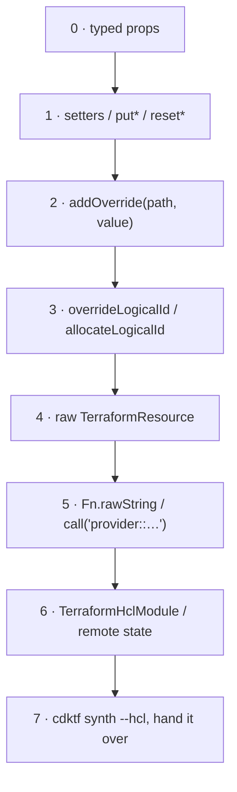

# 10 · Escape hatches, HCL migration & interop

> After this module you can reach any key in the rendered Terraform JSON without waiting for a provider
release, keep Terraform addresses stable through refactors and migrations (`import`, `moved`, pinned logical
ids), consume HCL-managed infrastructure through remote state and Registry modules, convert legacy HCL to
CDKTF with your eyes open, and hand HCL back to teams that will never run `npx`.

## Why this exists (the problem)

Every abstraction leaks and every provider lags. The Google provider gains attributes weekly; the prebuilt
`@cdktf/provider-google` bindings follow on their own cadence; the platform team has a ticket due Friday.
Meanwhile the organisation already has 400 resources in HCL state that nobody is going to recreate, a network
module from the Registry that the security team has reviewed, and an SRE group that reads Terraform and
refuses to read TypeScript.

CDKTF is only viable in that world if the escape hatches are first-class and the migration path is
incremental. They are, and it is — but each hatch has a cost the typed API does not (invisibility to
validators, no round-trip through `*Input`), and each migration step has a specific failure mode (a rename is
a destroy). This module is the ladder, with the rung heights marked.

## Mental model



Climb only as far as the problem requires, and leave a comment at every rung above 1 saying why. The migration
playbook runs the other way: start at rung 6 (read the legacy state), then adopt (`import`), then rename in
place (`moved`), then retire the HCL.

## How it works

### `addOverride`: nested keys and list indexes (`overrides-stack.ts`)

```ts
this.api.addOverride('template.containers.0.image', '…:latest');       // list block: numeric index
this.api.addOverride('template.scaling.min_instance_count', 1);        // single block: object path, no index
this.api.addOverride('lifecycle.ignore_changes', ['client', 'client_version']);
this.db.addOverride('settings.deletion_protection_enabled', true);     // settings is a single block
```

Overrides are deep-merged over the rendered JSON after `toTerraform()` (`deepMerge`, `cdktf/lib/util.js`):
objects merge recursively, **lists concatenate**, `undefined` deletes. A single nested block (`template`,
`settings`, `encryption`) renders as a JSON *object*, so the path has no index; a repeated block
(`containers`, `env`, `lifecycle_rule`) renders as an array and takes one. `settings.0.tier` produces a bogus
`"0"` key that Terraform rejects at validate time. The test asserts both shapes.

### `overrideLogicalId` and the freeze (`overrides-stack.ts`, `converted.ts`, exercise 3)

The Terraform address is `<type>.<logicalId>`. Top-level children of a stack use their construct id verbatim;
nested constructs get `Path_Segments_<8 hex of the path>` with a component dropped when the previous one ends
with it (`HostProject/Project` → `HostProject_…`). `overrideLogicalId('main')` replaces it — and **must be
called before any attribute of the element is read**: `friendlyUniqueId` is computed on first use and cached,
and every `resource.attr` read computes it. After that the override is silently ignored (there is an assertion
only for `.fqn`). Stack-wide pinning therefore cannot be an aspect; it is a `TerraformStack` subclass
overriding the protected `allocateLogicalId` hook (exercise 3), consulted the first time an id is needed
regardless of who asked.

### Raw `TerraformResource` (`overrides-stack.ts`)

```ts
this.newThing = new TerraformResource(this, 'NewThing', {
  terraformResourceType: 'google_some_new_thing',
  terraformGeneratorMetadata: { providerName: 'google', providerVersionConstraint: '~> 6.0' },
  dependsOn: [this.db],
});
this.newThing.addOverride('name', name('thing'));
new TerraformOutput(this, 'ThingId', { value: this.newThing.getStringAttribute('id') });
```

You get the meta-arguments (`provider`, `dependsOn`, `count`/`forEach`, `lifecycle`, `provisioners`) typed;
every attribute is an override; every output is `get*Attribute`. `terraformGeneratorMetadata.providerName`
ties it to the `required_providers` entry the real provider registered. Use it the week the provider ships a
resource the bindings lack; replace it when the bindings catch up (the address does not change, so the swap is
a no-op plan).

### `Fn.rawString` and provider-defined functions

`Fn.rawString('0.0.0.0:${PORT}')` renders `0.0.0.0:$${PORT}` — Terraform's escape for a literal `${`. Use it
whenever a string that Terraform would interpolate must reach the API untouched (Cloud Run's `${PORT}`, a
Cloud Scheduler body template, a regex). It is **not** a way to write expressions; for those use
`Op`/`Fn`/`ref`. Provider-defined functions (Terraform ≥ 1.8) are namespaced `provider::google::name_from_id`,
`project_from_id`, `region_from_id`, `zone_from_id`, `location_from_id`, `region_from_zone`; cdktf has no
typed wrapper, so `call('provider::google::project_from_id', [db.id])` renders the invocation verbatim.

### `import` and `moved` (`refactor-stack.ts`)

```ts
this.adopted.importFrom(`projects/${project}/buckets/${name}`);   // import { to, id }
this.renamed.addMoveTarget('orders-events'); old.moveTo('orders-events');  // moved { from = old, to = renamed }; old is dropped from the JSON
this.reader.moveFromId('google_service_account.legacy_reader');   // moved { from = <address no longer in code>, to = reader }
```

All three are declarative blocks (Terraform ≥ 1.5), applied by `terraform apply`, idempotent, reviewable in
the plan (`1 to import`, `moved`), and replace the imperative `terraform import` / `state mv`. Without the
`moved` block a rename plans as destroy + create — for a bucket or a database that is data loss. Delete the
blocks after the apply that used them. One consequence verified in the tests: a stack with `moved`/`import`
registers a `ValidateTerraformVersion` node validation that runs `terraform version`, so `Testing.fullSynth`
**needs the binary**; offline, synthesize with `skipValidation: true` (the test shows how, and `new App({
skipValidation: true })` is the CLI-side equivalent).

### Interop (`interop-stack.ts`)

`DataTerraformRemoteStateGcs` reads `legacy/main.tf`'s outputs (`assets_bucket`) — two root modules, one
directed dependency, no shared state, no import. `TerraformHclModule` renders a `module` block for
`terraform-google-modules/network/google` with untyped `variables` and `getString('network_self_link')`;
generated bindings (`cdktf.json` → `terraformModules` → `cdktf get`) give you types for modules you call
often. `TerraformAsset` copies `assets/schema/orders.json` into the stack directory under a content-hashed
path, read at plan time by `file()`. `TerraformVariable` without a default must arrive via
`TF_VAR_dataset_owner` or a `*.auto.tfvars` dropped into `cdktf.out/stacks/m10-interop/` after synth (synth
recreates the directory; `terraform.tfvars` there does not survive). Prefer TypeScript config for anything
that varies per environment; keep variables for values that vary per operator run.

### `cdktf convert` and `converted.ts`

```
cdktf convert --language typescript --provider "hashicorp/google@~> 6.0" < legacy/main.tf > converted.generated.ts
```

Not run here (needs the Terraform binary and provider schema download). What it does well: resources,
variables, outputs, `for_each` → `TerraformIterator`, references → tokens, `locals` → `TerraformLocal`. What
to fix by hand, all present in `converted.ts`:
- **Addresses.** Convert uses the HCL name as the construct id, which keeps the address for top-level
  resources — until you wrap anything in a construct. `converted.ts` pins every element with
  `overrideLogicalId('assets')` etc. so `google_storage_bucket.assets` is byte-identical and the first plan
  against the existing state is empty. The test cross-checks every `resource`/`variable`/`output` name in
  `legacy/main.tf` against the rendered JSON.
- **`validation` blocks** are dropped or mangled in some versions; re-add with `ref('var.x')` for the
  self-reference.
- **Backend** comes through; keep it conditional (`keepBackend`) so offline synth stays local.
- **Provider version pins**, `required_version`, `lifecycle` and `provisioner` blocks need a look; `count`
  becomes `TerraformCount`; string templates with functions sometimes come out as `Fn.rawString` and must
  become `Fn.*`.

### `cdktf synth --hcl`

`SYNTH_HCL_OUTPUT=true` / `cdktf synth --hcl` writes `cdk.tf` (HCL) instead of `cdk.tf.json`;
`Testing.synthHcl(stack)` gives the same string in tests. The HCL is machine-formatted, not idiomatic, but it
is *real* Terraform an HCL-only team can `terraform plan` against the same state, review, or take over. That
makes CDKTF reversible, which is the argument that wins the "we are not locking into a TypeScript toolchain"
meeting.

### `cdktf get` for a community provider

Not run here (`cdktf.json` is not to be edited in this repo). The steps:

1. `cdktf.json`: `"terraformProviders": ["integrations/github@~> 6.0"]`.
2. `npx cdktf get` — downloads the provider schema and generates `.gen/providers/github/` with one folder per
   resource (`repository/index.ts`, `branch-protection/index.ts`, `provider/index.ts`), an `index.ts` barrel,
   `lazy-index.ts` (deferred requires so a 1,500-resource provider does not cost seconds at import) and
   `version.json`. `.gen/` is git-ignored and regenerated in CI.
3. `import { Repository } from '../../.gen/providers/github/repository';` — same shape as the prebuilt
   packages, because the prebuilt packages *are* this output published to npm.

Prebuilt packages exist for the major providers only; `cdktf get` works for any provider in the Registry,
including private ones, at the cost of a generate step and a version pinned in `cdktf.json` rather than
`package.json`.

## Walkthrough

1. `overrides-stack.ts` — rungs 2–5 on one Cloud Run service, one Cloud SQL instance, one raw resource.
2. `refactor-stack.ts` — `import`, `moved` (both forms).
3. `interop-stack.ts` — remote state, Registry module, asset, variable.
4. `legacy/main.tf` then `converted.ts` — side by side.
5. `index.ts` — `m10-overrides`, `m10-interop`, `m10-converted`, and — only with `CDKM_ENABLE_REFACTOR_STACK=1` and a Terraform/OpenTofu binary on `PATH` — `m10-refactor` (its `moved`/`import` blocks trigger a `terraform version >= 1.5` check during `app.synth()`).

```
cd cdktf-gcp
npx jest test/10-escape-hatches-hcl-migration-and-interop.test.ts
CDKM_TERRAFORM=1 npx jest test/10-escape-hatches-hcl-migration-and-interop.test.ts   # runs the version validation for real
npx cdktf synth --hcl && sed -n 1,60p cdktf.out/stacks/m10-converted/cdk.tf
```

## Migration playbook (HCL → CDKTF, incrementally)

1. **Inventory** the HCL root modules and their outputs; decide the order (leaves first: things nothing else
   reads from).
2. **Bridge**: new CDKTF stacks read the HCL outputs via `DataTerraformRemoteStateGcs`. Nothing moves; new
   work happens in CDKTF from day one.
3. **Convert** one root module with `cdktf convert`, review against the checklist above, pin every logical id
   to the HCL name, point the stack at the *same* backend and prefix, `cdktf diff` → **must be empty**. If
   not, fix until it is; do not apply a diff you did not intend.
4. **Cut over**: the CDKTF stack now owns that state; archive the HCL. Consumers that used remote state keep
   working (outputs unchanged).
5. **Refactor** with `moved` blocks one construct at a time (exercise 3's `PinnedIdsStack` lets you refactor
   freely and drop pins later), applying between steps so every `moved` is a no-op plan.
6. **Adopt** things created by hand with `importFrom`; the first plan after import must be empty or explain
   every change.
7. **Retire** the bridge: replace remote-state reads with cross-stack references where both sides are CDKTF
   (module 02).

## Production notes

- An override is invisible to validating aspects and to `*Input` getters. Anything policy cares about is set
  through the typed API.
- A raw `TerraformResource` has no schema at synth time; the first `terraform validate` is your type-check.
  Run the gated validate test for stacks that contain one.
- `moved`/`import` blocks in a stack mean `cdktf synth` shells out to `terraform version`; CI runners for
  those stacks need the binary even for synth-only jobs.
- Remote-state readers need `objectViewer` on the *state* bucket, and state contains secrets (passwords in
  `google_sql_user`, keys). Scope the grant to the prefix with an IAM condition, or publish the handful of
  values you share through outputs of a dedicated, secret-free stack.
- Registry modules pin with `version: '~> 10.0'`; a major bump of `terraform-google-modules/network` has
  changed variable names before. Review the module's changelog like you review a provider bump.
- `Fn.file()` reads relative to the synthesized stack directory; do not `path.resolve` it.
- Cost: nothing in this module is expensive except the Cloud SQL instance in `m10-overrides` (`db-f1-micro`,
  ~$8/month) and the Cloud NAT the network module creates if you enable it.

## Gotchas

- Symptom: `settings.0.tier` override yields `settings: {"0": {...}}`. Cause: single block is an object. Fix:
  `settings.tier`.
- Symptom: `overrideLogicalId` has no effect. Cause: an attribute was referenced first. Fix: call it right
  after construction, or use `allocateLogicalId` in a stack subclass.
- Symptom: `Logical ID may not be overridden once .fqn has been requested`. Cause: `.fqn` read (e.g.
  `dependsOn`) before the override. Fix: same.
- Symptom: rename plans destroy + create. Cause: no `moved` block. Fix: `moveFromId('<old address>')` on the
  new construct.
- Symptom: `Could not determine version of terraform` in tests. Cause: `moved`/`import` validation. Fix:
  `skipValidation`, or gate behind the binary.
- Symptom: `${PORT}` becomes empty at runtime. Cause: Terraform interpolated it. Fix: `Fn.rawString`.
- Symptom: `terraform.tfvars` ignored. Cause: synth wiped the directory. Fix: `TF_VAR_*` or copy
  `*.auto.tfvars` after synth.
- Symptom: `cdktf convert` output does not compile. Cause: unsupported functions/expressions rendered as raw
  strings. Fix: rewrite with `Fn`/`Op`/`ref`; treat convert as a first draft.
- Symptom: `module.Network.network_self_link` unknown after `cdktf get` bindings. Cause: mixing
  `TerraformHclModule` (`getString`) with generated bindings (typed getters). Fix: pick one per module.

## Exercises

1. **Easy — `importId`/`adopt`.** A typed table of import-id formats per resource type (bucket, SA, topic, SQL
   instance, network, secret) with a clear error for unknown types, and `adopt(resource, name, ctx)` that
   wires `importFrom`. Solution: `solutions/adopt-existing.ts`.
2. **Medium — convert `for_each`.** Rewrite an HCL snippet with `for_each` over a variable map and over a
   resource: `TerraformIterator.fromMap` / `fromResources`, `each.key` / `getString`, and the map output via
   `forExpressionForMap` (not `pluckProperty`, which yields a list). Solution:
   `solutions/converted-foreach.ts`.
3. **Hard — pinned logical ids.** First the trap: an aspect calling `overrideLogicalId` is ignored for every
   element whose attribute was already referenced (the test proves it and the aspect reports the late pins).
   Then the fix: `PinnedIdsStack` overrides `allocateLogicalId` so a path → legacy-id map applies regardless
   of reference order and `unmatched()` catches typos. Solution: `solutions/pinned-logical-ids.ts`.

## Checklist

- [ ] Every `addOverride` has a comment naming the rung and the reason (missing binding, generic aspect,
  provider bug).
- [ ] No override sets a value a validating aspect or conftest rule checks.
- [ ] Raw `TerraformResource`s are listed in a "replace when bindings catch up" note.
- [ ] Every rename ships with a `moved` block and an empty plan; blocks are removed after apply.
- [ ] Imports are followed by a plan review; unexpected diffs are fixed in code, not applied.
- [ ] Converted stacks pin every logical id and point at the original backend prefix; first `cdktf diff` is
  empty.
- [ ] Remote-state reads are scoped; secret-bearing states are not shared wholesale.
- [ ] Code review: `Fn.rawString` only for literals, never for expressions.

## Interview angle

- *"You need an attribute the provider bindings don't have yet. Options?"* `addOverride` on the existing typed
  resource (best: address unchanged, everything else typed); raw `TerraformResource` if the whole type is
  missing; `cdktf get` against a newer provider version if the bindings lag the provider; a
  `TerraformHclModule` wrapping HCL as a last resort. Name the cost of each (validator visibility, schema
  checking, generate step).
- *"How do you migrate 400 HCL resources to CDKTF without downtime?"* Bridge via remote state; convert one
  root module at a time; pin logical ids to keep addresses; same backend prefix; empty diff before cut-over;
  `moved` for later refactors; `import` for hand-made things; keep `synth --hcl` as the exit strategy.
- *"Why is a rename dangerous in Terraform and how do you make it safe?"* Address = identity; new address =
  new resource = destroy old + create new. `moved` (declarative, ≥ 1.5) tells Terraform they are the same
  object; `prevent_destroy` on stateful resources turns a forgotten `moved` into a failed plan instead of a
  lost bucket.

## References

- Escape hatches: https://developer.hashicorp.com/terraform/cdktf/concepts/resources#escape-hatch
- `cdktf convert`: https://developer.hashicorp.com/terraform/cdktf/cli-reference/commands#convert
- `cdktf get` / providers: https://developer.hashicorp.com/terraform/cdktf/concepts/providers
- Modules in CDKTF: https://developer.hashicorp.com/terraform/cdktf/concepts/modules
- Remote state: https://developer.hashicorp.com/terraform/cdktf/concepts/remote-backends
- Terraform `moved`: https://developer.hashicorp.com/terraform/language/moved ; `import` block:
  https://developer.hashicorp.com/terraform/language/import
- Provider-defined functions (Google):
  https://registry.terraform.io/providers/hashicorp/google/latest/docs/guides/provider_functions
- cdktf source consulted: `cdktf/lib/terraform-element.js` (`friendlyUniqueId` cache),
  `cdktf/lib/terraform-stack.js` (`allocateLogicalId`), `cdktf/lib/private/unique.js`, `cdktf/lib/util.js`
  (`deepMerge`)
