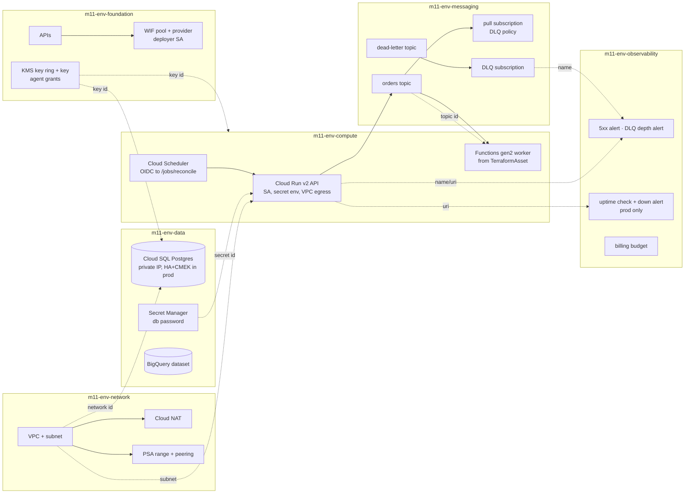

# 11 · Capstone: the Orders platform on GCP

> After this module you have shipped — and can defend line by line — a dev + prod, six-stack, labelled,
governed, tested, WIF-pipelined platform: private Cloud SQL, Cloud Run API with secret-backed config and VPC
egress, a Functions worker built from an asset and fed by Pub/Sub with a dead-letter queue, a scheduler,
alerts, an uptime check and a budget, all produced by one factory parameterised by `EnvironmentTier`.

## Why this exists (the problem)

Modules 00–10 each isolate one idea. Production is the opposite: every idea at once, interacting. The tier
flag that turns on CMEK also has to grant the Cloud SQL service agent access to the key *before* the instance
exists, in another stack. The labels aspect has to be applied to six stacks without anyone remembering to. The
DLQ has to have a subscription or it drops messages. The deployer for prod must be impersonable only from a
protected GitHub environment. None of that is hard; all of it is forgettable, and forgetting any one of them
is an incident. The capstone is where the decisions are made once, in code, and proven by tests that run in
seconds.

## Mental model



Dotted arrows are cross-stack references (an attribute read in TypeScript that CDKTF turns into a remote-state
output/input pair); they *are* the deploy order. Solid arrows are runtime traffic.

## How it works

### The factory (`platform.ts`)

```ts
export class OrdersPlatform {
  constructor(app: App, props: OrdersPlatformProps) {
    const ctx: PlatformContext = { tier, project, region, backend: props.backend ?? backendFromEnv, assetHash };
    this.foundation    = new FoundationStack(app, 'm11-<env>-foundation', { ctx, github });
    this.network       = new NetworkStack(app, 'm11-<env>-network', { ctx, cidr: TIER_SETTINGS[env].cidr });
    this.data          = new DataStack(app, 'm11-<env>-data', { ctx, foundation, network });
    this.messaging     = new MessagingStack(app, 'm11-<env>-messaging', { ctx });
    this.compute       = new ComputeStack(app, 'm11-<env>-compute', { ctx, foundation, network, data, messaging });
    this.observability = new ObservabilityStack(app, 'm11-<env>-observability', { ctx, compute, messaging, ... });
  }
  get deployOrder() { return [foundation, network, data, messaging, compute, observability]; }
}
```

`addToApp` calls it for `ENVIRONMENTS.dev` and `ENVIRONMENTS.prod`: twelve stacks. Everything tier-dependent
reads a flag off the shared `EnvironmentTier` — `retainStatefulResources` (deletion protection,
`prevent_destroy`, `force_destroy`, secret version policy, dataset expiry), `highlyAvailable` (REGIONAL SQL,
min instances, flow logs, retention), `requiresApproval` (WIF binding on a protected GitHub environment),
`logRetentionDays`, `owner`, `costCenter` (labels) — plus `TIER_SETTINGS` for the two numbers that are policy
rather than semantics (CIDR, budget).

### Governance at the stack level (`platform-stack.ts`)

`PlatformStack` is the base class of all six stacks. Its constructor creates the provider, resolves the
backend (`configureBackend` from module 08: GCS when `CDKM_STATE_BUCKET` is set, otherwise local) and calls
`applyGovernance(this, tier)`:

```ts
aspects.add(new LabelsAspect({ labels: mandatoryTags(tier, SERVICE) }));   // mutator
aspects.add(new StatefulProtectionAspect(tier));                           // mutator
aspects.add(new NoPublicBucketsAspect());                                  // validator
if (tier.name === 'prod') aspects.add(new RequireCmekAspect());            // validator, prod only
aspects.add(new ConstructPolicyAspect([PascalCaseIds, maxDepthRule(6)]));  // shared policy via the bridge
```

This is a base class rather than an app-level call because `Aspects.of(app)` is a no-op in cdktf 0.21 (module
06). The bridge skips framework-generated ids (`backend`, `cross-stack-output-*`,
`cross-stack-reference-input-*`), so `PascalCaseIds` judges only ids the author chose. A test adds a rogue
public, unencrypted bucket to the prod compute stack and asserts the synthesizer refuses with both violations
named.

### The stacks

**Foundation.** 21 APIs, `serviceusage` and `cloudresourcemanager` first and everything else `dependsOn` them,
`disableOnDestroy: false`. WIF pool + GitHub provider with `attribute.environment` mapped; the deployer SA is
bound to `attribute.environment/prod` when `tier.requiresApproval` (GitHub's required reviewers become the
gate) and to the repository otherwise. KMS key ring + key with `roles/cloudkms.cryptoKeyEncrypterDecrypter`
for the Cloud SQL, GCS and BigQuery service agents (emails derived from the project number), because a CMEK
grant made in the same apply as the encrypted resource fails if the agent does not exist yet — and API
enablement creates them.

**Network.** Custom VPC, one subnet with Private Google Access (flow logs in prod), router + NAT,
`ComputeGlobalAddress` (`VPC_PEERING`, /16) + `ServiceNetworkingConnection` with `deletionPolicy: 'ABANDON'`.
PSA lives here so the SQL instance, which references `network.id`, can never be applied before the peering.

**Data.** Cloud SQL Postgres 16 with `ipv4Enabled: false`, `privateNetwork` from the network stack, `sslMode:
'ENCRYPTED_ONLY'`; `db-custom-2-7680` REGIONAL with PITR and 30 backups in prod, `db-f1-micro` ZONAL in dev;
`deletionProtection` and `settings.deletionProtectionEnabled` from the tier; `encryptionKeyName` from the
foundation in prod (the `RequireCmekAspect` would refuse otherwise). Database, user with a `random_password`
stored as a Secret Manager version (`DISABLE` on destroy in prod, `DELETE` in dev), BigQuery dataset with CMEK
in prod and 30-day table expiry in dev. `user_labels` set explicitly: the labels aspect cannot see Cloud SQL's
differently named field.

**Messaging.** `orders` topic, `orders-dlq` topic, `orders-pull` with `deadLetterPolicy` (5 attempts) and
exponential retry, **and a subscription on the DLQ** so dead-lettered messages are retained, plus the two
grants without which dead-lettering silently does nothing: the Pub/Sub service agent needs `publisher` on the
DLQ and `subscriber` on the source subscription.

**Compute.** Three service accounts (API, worker, scheduler). Cloud Run v2: internal ingress,
`PRIVATE_RANGES_ONLY` egress through direct VPC (`networkInterfaces` with the subnet from the network stack),
`DB_PASSWORD` from Secret Manager via `valueSource.secretKeyRef`, probes, min instances by tier,
`deletionProtection` by tier. Functions gen2 from `TerraformAsset` (`functions/worker`, ARCHIVE) uploaded to a
CMEK-in-prod, PAP-enforced bucket under a content-hashed object name (so a code change is a redeploy),
Eventarc trigger on the orders topic with retry, internal-only ingress. Cloud Scheduler POSTs to
`/jobs/reconcile` with an OIDC token from the scheduler SA, which holds `roles/run.invoker` — nothing is
public.

**Observability.** Email notification channel; `ApiErrors` (5xx request *rate* over 5 min, CRITICAL in prod),
`DeadLetterDepth` (`num_undelivered_messages` on the DLQ subscription > 0 for 10 min); prod-only
`MonitoringUptimeCheckConfig` on `/healthz` (host derived with `Fn.replace(api.uri, 'https://', '')`) with an
`ApiDown` policy; `BillingBudget` from `TIER_SETTINGS` with 50/90% actual and 100% forecast thresholds routed
to the channel.

## Walkthrough

1. `platform-stack.ts` — base class, governance set.
2. `platform.ts` — the factory, `TIER_SETTINGS`, `deployOrder`.
3. `stacks/foundation-stack.ts` → `network-stack.ts` → `data-stack.ts` → `messaging-stack.ts` →
   `compute-stack.ts` → `observability-stack.ts`, in deploy order.
4. `functions/worker/index.js` — the worker; throwing triggers Eventarc retry and eventually the DLQ.
5. `index.ts` — dev + prod.
6. `test/11-capstone-platform.test.ts` — synth for both tiers, per-tier assertions, labels on every labelled
   resource, governance live, wiring details, one stabilised snapshot, exercise tests.

```
cd cdktf-gcp
npx jest test/11-capstone-platform.test.ts
```

### Deploy runbook

Bootstrap (once per environment, a human with `roles/owner` on the project, `roles/billing.costsManager` on
the billing account):

```
export CDKM_GCP_PROJECT=orders-prod CDKM_GCP_REGION=us-central1
export CDKM_GITHUB_OWNER=<org> CDKM_GITHUB_REPO=<repo> CDKM_BILLING_ACCOUNT=XXXXXX-XXXXXX-XXXXXX CDKM_ALERT_EMAIL=oncall@…
# 1. state bucket (module 08's WifStack can create it; or by hand):
gcloud storage buckets create gs://orders-prod-tfstate --location=us-central1 --uniform-bucket-level-access --public-access-prevention
gcloud storage buckets update gs://orders-prod-tfstate --versioning
export CDKM_STATE_BUCKET=orders-prod-tfstate
# 2. foundation first, as the human: it creates the identity the pipeline will use
npx cdktf deploy m11-prod-foundation
# 3. copy outputs WorkloadIdentityProvider / DeployerServiceAccount into repository variables; grant the deployer objectAdmin on the state bucket
# 4. from here the pipeline (module 08 workflow, STACKS in this order) or the human:
npx cdktf deploy m11-prod-network m11-prod-data m11-prod-messaging m11-prod-compute m11-prod-observability
```

`cdktf deploy` with several stacks orders them by cross-stack dependencies; listing them explicitly makes a
failure attributable to one stack and a rerun cheap. The data stack takes 10–20 minutes (REGIONAL Cloud SQL);
keep it in its own job step.

### Rough monthly cost per tier

From `solutions/cost-estimate.ts` (list prices, us-central1, ±30%):

| Item | dev | prod | Assumption |
|---|---|---|---|
| Cloud SQL Postgres | $10 | $260 | dev: db-f1-micro zonal; prod: db-custom-2-7680 REGIONAL (2×) + 100 GB SSD + PITR |
| Cloud NAT | $34 | $52 | gateway ~$32 + $0.045/GB |
| Cloud Run API | $3 | $85 | prod: 1 min instance always on |
| Cloud Functions worker | $1 | $15 | 256 MB; ~2M invocations/month prod |
| Pub/Sub | $0 | $40 | 10 GB/day prod |
| Secret Manager + KMS | $1 | $1 | |
| BigQuery | $0 | $25 | |
| Monitoring + Logging | $0 | $35 | 365-day retention in prod |
| **Total** | **~$49** | **~$513** | budgets: $150 / $1200 (`TIER_SETTINGS`) |

The two numbers that dominate are Cloud SQL HA and the always-on Cloud Run instance; both are tier flags,
which is the point of having tiers. Cloud NAT is the surprise in dev: a fixed $32 for a gateway that moves
almost no bytes.

### Teardown order (and the `deletionProtection` gotcha)

Reverse of deploy: `observability → compute → messaging → data → network → foundation`. In dev this is `npx
cdktf destroy` per stack and it works. In prod it does **not**, by design, and you should know exactly where
it stops:

1. `m11-prod-compute`: `google_cloud_run_v2_service.Api` has `deletion_protection = true` → the plan fails.
   Flip it in code (a reviewed PR that says "we are decommissioning prod"), deploy, then destroy. The
   function-source bucket has `prevent_destroy` → same.
2. `m11-prod-data`: `deletion_protection` (Terraform-side) *and* `settings.deletion_protection_enabled`
   (API-side) on Cloud SQL, `prevent_destroy` on the secret. Both flags come from
   `tier.retainStatefulResources`; a destroy needs a code change, an apply that removes the protection (the
   API-side flag must be *applied* first — Terraform cannot delete an instance whose API flag is on), then the
   destroy. The `random_password` and `google_sql_user` (`ABANDON`) go quietly.
3. `m11-prod-network`: the PSA connection is `ABANDON`ed (it cannot be deleted while a SQL instance exists,
   and after the instance is gone it is harmless); the VPC deletes.
4. `m11-prod-foundation`: the KMS key has `prevent_destroy`; key rings cannot be deleted at all — remove them
   from state (`terraform state rm` in `cdktf.out/stacks/m11-prod-foundation`) and accept an empty key ring.
   The WIF pool is soft-deleted for 30 days. APIs stay enabled (`disable_on_destroy = false`).

That is three code changes to destroy prod. It is meant to be annoying; the annoyance is proportional to the
data at stake.

## Production notes

- **Cross-stack references are stack-level ordering, not resource-level.** `depends_on` across stacks does not
  exist; the SQL instance waits for the *network stack* to be applied, which includes PSA. Put prerequisites
  in the producer stack, not in the consumer's `dependsOn`.
- **Secrets in state.** `random_password.result`, `google_sql_user.password` and
  `google_secret_manager_secret_version.secret_data` are in the data stack's state. The GCS backend bucket
  needs uniform access, PAP, versioning, CMEK (`kmsEncryptionKey` on `GcsBackend`) and object-admin limited to
  the deployer. Treat that bucket as production data.
- **Asset hash = redeploy.** The worker's object name embeds `assetHash`; a comment change in `index.js`
  redeploys the function. Intended; a `.gcloudignore`-style filter is not available for `TerraformAsset`, so
  keep the function directory free of build artefacts.
- **Cloud Run direct VPC egress** needs a subnet with free IPs (`/20` gives room) and ≥ 4 IPs per instance at
  peak; NAT handles egress to the internet from the subnet.
- **Eventarc + Functions gen2** creates its own push subscription with its own retry; the DLQ policy in the
  messaging stack is on `orders-pull`. For a DLQ on the Eventarc path, create the trigger's subscription
  yourself and attach the policy (exercise for the reader of module 04).
- **Budgets need the Billing Budget API on the project and `roles/billing.costsManager`** for the deployer on
  the billing account; without it the observability stack fails at the last resource. Apply budgets from a
  seed project if that grant is politically hard.
- **Uptime checks reach the API from Google's checkers**, so the prod API needs an external HTTPS load
  balancer in front of the internal ingress for the check to pass; the check is defined against `api.uri` here
  for the demo and should point at the LB hostname in a real deployment.
- Monitor: the three alerts here, plus Cloud SQL CPU/storage, Cloud Run instance count vs
  `max_instance_count`, and function execution errors.

## Gotchas

- Symptom: prod synth fails with `must use a customer-managed key` on the function-source bucket. Cause:
  `RequireCmekAspect` is prod-only and buckets need `encryption`. Fix: reference `foundation.key.id` (done);
  any new bucket must too.
- Symptom: `The principal service-…@gcp-sa-cloud-sql… does not exist` on the KMS grant. Cause: agent not yet
  created. Fix: enable `sqladmin` first (foundation does), or `google_project_service_identity` (module 09).
- Symptom: Cloud SQL create fails with `Failed to create subnetwork… peering`. Cause: PSA not applied. Fix:
  deploy network before data (the reference enforces it).
- Symptom: dead-lettered messages vanish. Cause: no subscription on the DLQ topic or missing agent grants.
  Fix: both are in the messaging stack; do not remove them.
- Symptom: scheduler gets 403. Cause: scheduler SA lacks `run.invoker` or the OIDC `audience` differs from the
  service URI. Fix: `audience: api.uri`.
- Symptom: `cdktf destroy m11-prod-data` fails on the instance. Cause: API-side deletion protection. Fix: set
  `deletionProtectionEnabled: false`, apply, then destroy.
- Symptom: labels missing on Cloud SQL. Cause: `user_labels`, not `labels`. Fix: set explicitly (done); the
  exercise-1 validator from module 06 would catch a new such resource.
- Symptom: PascalCase violation on `cross-stack-reference-input-…`. Cause: framework id. Fix:
  `isFrameworkManagedId` skip in the bridge (default).

## Exercises

1. **Easy — cost model.** `estimateMonthlyCost(tier)` derives line items from the same tier flags the stacks
   use, and `costTable` renders the README table; tests pin prod > dev and budgets above estimates. Solution:
   `solutions/cost-estimate.ts`.
2. **Medium — dead-letter archive.** A BigQuery subscription on the DLQ topic writing every dead-lettered
   message with metadata into a day-partitioned table, with the Pub/Sub agent granted `bigquery.dataEditor` on
   the table and the subscription `dependsOn` the grant. Solution: `solutions/dead-letter-archive.ts`.
3. **Hard — cross-region read replica, prod only.** `addReadReplica` returns `undefined` for non-HA tiers,
   refuses the primary's region, and builds a private, CMEK'd (key in the replica's region),
   deletion-protected replica with `masterInstanceName` and `replicaConfiguration.failoverTarget: false`; the
   doc comment lists the apply-time constraints (backups + PITR on the primary, key region, promotion outside
   Terraform). Solution: `solutions/read-replica.ts`.

## What I'd change at 10× scale

- **Projects, not stacks, as the blast radius.** One project per environment is fine at 1×; at 10× the data
  stack gets its own project (Cloud SQL quotas, IAM separation for DBAs), compute another, and the module 09
  factory + Shared VPC replace `NetworkStack`. Cross-project references are the same CDKTF mechanism; the IAM
  (service agents across projects, module 09 exercise 3) is the work.
- **Regional isolation.** Two regions with an external HTTPS LB and Cloud Run in each, Cloud SQL primary +
  cross-region replica (exercise 3), Pub/Sub is global already. `regionalProviders` from module 09 and a
  `region` dimension in the factory; tests already iterate tiers and would iterate regions.
- **Schema-typed events.** A `google_pubsub_schema` on the orders topic with `schemaSettings` enforced; today
  the worker validates by hand.
- **One deployer per stack group**, not per environment: data deployer, compute deployer, each with the roles
  for its stacks (module 08 exercise 3 pattern extended), so a compromised compute pipeline cannot touch Cloud
  SQL.
- **Policy in two more places**: the conftest rules from module 06 in CI on `cdktf.out/stacks/m11-*`, and org
  policies at the folder (module 09) so the same guarantees hold for the team that does not use this repo.
- **Observability as code beyond alerts**: SLOs (`google_monitoring_slo`) on the API with burn-rate alerts
  replacing the fixed 5xx threshold, a dashboard resource, log-based metrics for business events, and log
  sinks to a central project.
- **Testing**: `toPlanSuccessfully` in a nightly job against an ephemeral project created by the module 09
  factory and destroyed after; today the gated tests exist but nobody runs them.
- **Cost**: committed-use discounts for Cloud SQL, Cloud Run request-based billing review, VPC flow-log
  sampling down to 10%, BigQuery slot reservations if analytics grows. The budget becomes per project and per
  label, which the labels aspect already makes possible.

## Checklist

- [ ] Every tier-dependent value reads a tier flag; no `if (env === 'prod')` outside `tier.name === 'prod'`
  for CMEK/uptime.
- [ ] All six stacks extend `PlatformStack`; no stack constructs its own provider or backend.
- [ ] Cross-stack references only flow forward in deploy order.
- [ ] Every bucket: uniform access, PAP enforced, CMEK in prod, versioning where content matters.
- [ ] DLQ has a subscription and the agent grants; the DLQ alert targets that subscription.
- [ ] No `allUsers`, no SA keys, no primitive roles; each workload has its own SA.
- [ ] Prod teardown requires code changes (documented above); dev teardown is one command per stack.
- [ ] Budgets exist and route to a channel a human reads.
- [ ] Code review: a new resource type gets checked for label field name, CMEK support, deletion protection
  support.

## Interview angle

- *"Walk me through what happens when `cdktf deploy m11-prod-compute` runs."* synth (aspects
  label/protect/validate, cross-stack refs become remote-state reads of network/data/messaging/foundation),
  `terraform init` against the GCS prefix, plan reads four remote states, apply creates SAs, IAM, the Cloud
  Run service (which needs the subnet and secret to exist — they do, by order), uploads the asset, builds the
  function via Cloud Build, creates the Eventarc trigger and the scheduler. Name what would fail if data were
  not applied first.
- *"Why is prod not destroyable with one command, and is that good?"* Three independent protections (Terraform
  `prevent_destroy`/`deletion_protection`, API-side `deletion_protection_enabled`, KMS immutability) each stop
  a different actor: a pipeline run, a laptop with credentials, a bug. The cost is a documented three-step
  runbook; the alternative is a documented data-loss postmortem.
- *"How do you know every resource is labelled?"* An aspect does it and a test walks every node of every
  stack, filters those that accept labels, and asserts the mandatory keys; the two resources with differently
  named label fields (Cloud SQL, alert policies) are set explicitly and asserted separately.

## References

- Cloud Run direct VPC egress: https://cloud.google.com/run/docs/configuring/vpc-direct-vpc
- Cloud SQL private IP + PSA: https://cloud.google.com/sql/docs/postgres/configure-private-ip
- Cloud SQL CMEK: https://cloud.google.com/sql/docs/postgres/configure-cmek
- Pub/Sub dead-letter topics: https://cloud.google.com/pubsub/docs/handling-failures#dead_letter_topic
- Functions gen2 Pub/Sub triggers: https://cloud.google.com/functions/docs/calling/pubsub
- Cloud Scheduler OIDC to Cloud Run: https://cloud.google.com/run/docs/triggering/using-scheduler
- Monitoring alert filters: https://cloud.google.com/monitoring/alerts/using-alerting-ui#filter ; uptime
  checks: https://cloud.google.com/monitoring/uptime-checks
- Billing budgets API: https://cloud.google.com/billing/docs/how-to/budget-api-overview
- Modules reused: 06 (aspects, bridge), 08 (WIF constants, backends, roles), 07 (`stabilise`)
